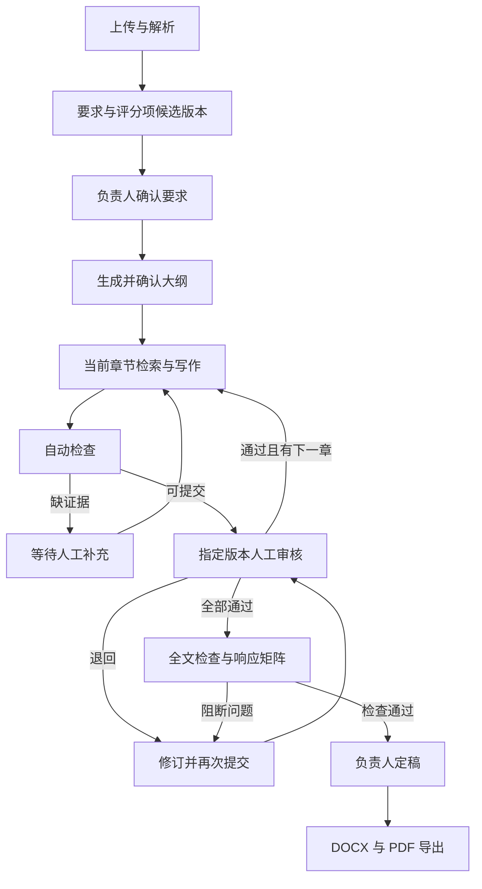
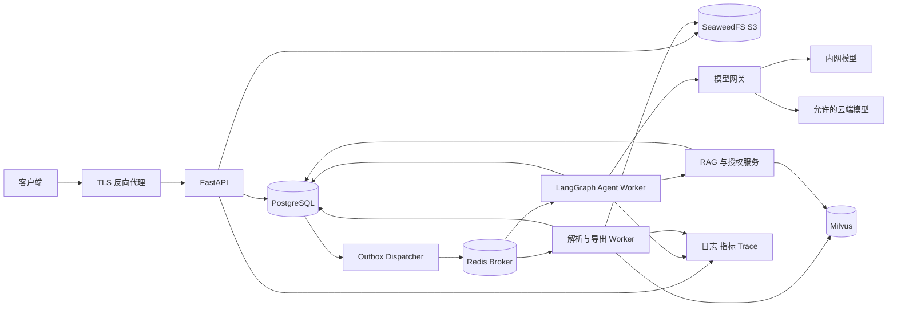

# 企业技术标写作 Harness Agent 开发文档

版本：1.0.0  
设计日期：2026-10-16（Asia/Shanghai）  
性质：待实现设计基线，未构建业务系统，性能指标尚未实测。  
配套文档：[数据库模型](./数据库模型.md)、[API文档](./API文档.md)。

## 1. 需求分析阶段

### 1.1 业务目标与边界

为一家企业的部门及项目组提供技术标写作服务，将招标要求、评分点、企业知识、技术方案、引用证据、人工审核和导出连接成可恢复、可追溯的流程。

已确认：Python + FastAPI；LangGraph 构建 Harness；Milvus 存储向量与关键词索引；企业私有化 Docker 多机部署；200 名用户、20 个并发生成任务、合计100万知识片段。并发指跨项目正在计算的任务，人工等待不占生成槽位。每项目至多一个活动写作 run，同一技术标逐章审核后推进。

首期覆盖：招标文件及补遗解析、强制条款与评分项提取、要求确认、大纲、技术方案写作、响应矩阵、证据定位、逐章审核、全文检查、DOCX/PDF 导出、企业知识库、模型策略、权限审计。支持通用模板及工程建设/IT 服务模板扩展。输入 PDF、扫描 PDF、DOCX、XLSX，输出受控模板 DOCX/PDF。

首期不构建商务标、报价、签章、自动递交、自由互联网搜索、任意代码执行、多人实时协同编辑或任意原始模板的像素级还原。涉及资格/商务但不属技术标的条款仍提取并标注 out_of_scope/needs_human，不能静默丢弃。历史标书作为参考，不自动成为当前企业事实或承诺。

### 1.2 角色与权限

| 角色 | 职责 | 边界 |
|---|---|---|
| system_admin | 账号、部门、模型、基础模板、运维 | 不自动获得项目正文和知识资料读取权 |
| knowledge_admin | 创建知识库，管理获授权的资料范围 | 不得给自己授予其他知识库权限 |
| owner | 项目成员、要求/大纲确认、模型策略、预算、定稿 | 不能越过来源资料的密级和出网限制 |
| writer | 上传、解析、生成、修改、提交审核 | 不能批准自己提交的版本 |
| reviewer | 核查证据、审核、处理检查问题 | 审核绑定版本，需拥有全部来源读取权限 |
| reader | 查看获准资料与产物 | 不触发生成或内容变更 |

组织角色与项目角色分离。项目 owner 可写作但不自动成为 reviewer。账号默认本地认证，密码 Argon2id，访问令牌15分钟，刷新令牌随机生成、仅存 hash、轮转、7天绝对有效期。预留 OIDC 身份适配接口，首期不提供未配置的 OIDC 登录入口。

有效访问由 active 用户、企业、项目成员、知识库授权、文档附加授权、有效期与删除状态共同决定。选择知识库仅确定检索范围，不等于授予权限；权限由服务端推导，客户端不能自报 org_id 或角色。

### 1.3 主流程和变更规则



要求和大纲先由 owner 确认，当前章通过才生成下一章。允许后台解析及建立知识索引，不提前写下一章。Agent 版本的 author_kind=agent，但 submitted_by 仍为业务发起人，不得利用机器作者绕过自审限制。

正文使用不可变版本。修改已批准章节使旧 review=stale，当前章及所有后续既有章节标 needs_review，保留人工修改；活动 run 转 waiting_input。补遗创建新 requirement_set，人工确认后更新项目指针，依据差异标记章节，同时撤销旧定稿/产物；不能仅凭模型认为变更不大而自动沿用审核。

企业资质、人员、业绩和已具备的技术参数需有效证据。无证据时产生待补充项。拟采用的方法属于 proposal，需审核人确认后成为当前方案，不表述为已发生事实。草稿可包含待补充标记；正式定稿要求所有章节批准、当前全文检查通过、无开放 blocker、warning 已处理。

### 1.4 可量化验收目标

以下是规划目标，必须在指定硬件、模型、输入长度和网络条件下实测，不能作为已达成 SLA。

| 项目 | 目标与条件 |
|---|---|
| 普通 API | 内网100 RPS持续30分钟，P95≤500ms、5xx<0.5%，排除文件与模型计算 |
| 长任务受理 | 从请求到事务提交并返回202，P95≤1秒 |
| 检索 | 100万片段，10QPS，dense50+BM2550、重排40、上下文12，P95≤3秒 |
| 生成 | 总共20个槽位；模型限额不足时排队，不承诺仍达到20并发吞吐 |
| OCR | 100页300DPI中文样本、独占OCR GPU槽位，P95≤10分钟 |
| 章节生成 | 3000中文字符、模型持续≥30tokens/s，排除排队/人工等待，P95≤5分钟 |
| 导出 | 200页、≤50张压缩图片的标准模板，独占渲染进程，P95≤120秒 |
| Worker恢复 | 租约90秒、扫描30秒，依赖可用时180秒内重新调度 |
| 灾备 | 核心记录RPO≤15分钟、RTO≤4小时；完整向量重建恢复目标24小时 |
| 文件容量 | 单文件200MiB，PDF最多2000页，项目最多200个章节 |

服务可用性目标99.5%，须通过演练证明。首期 Milvus Standalone 有单点风险，多机部署本身不意味着自动高可用。人工等待不计活动计算超时，24小时应用内提醒、7天进入运维关注清单，不自动批准。

### 1.5 需求追踪

REQ-01文件版本与定位；REQ-02条款/评分点/强制项可纠正；REQ-03大纲与条款映射；REQ-04证据化写作；REQ-05逐章审核；REQ-06可恢复且不重复推进；REQ-07补遗与资料失效传播；REQ-08全链路权限；REQ-09标准文档导出；REQ-10可监控、可备份和可回滚。开发任务及测试报告需关联这些编号。

## 2. 系统设计阶段

### 2.1 架构与职责

采用模块化单体组织代码，API、Agent Worker、文档 Worker、Dispatcher/恢复调度器分别运行，按需要独立扩容。



PostgreSQL 是业务真相源，保存正文、原文片段、版本、权限、审核、用量和事件。Milvus 是可重建的派生索引。Redis 用于任务传递、缓存和限流，不能作为唯一任务状态源。S3 保存不可变原件、模板、渲染文件与导出物。LangGraph 检查点记录图恢复状态，不替代业务表。

模块：identity、projects、documents、knowledge、tenders、authoring、reviews、runs、exports、audit。Controller 只做协议转换/鉴权；Service 编排事务和领域规则；Repository 执行数据访问，不自行 commit；Adapter 隔离模型、Milvus、S3、解析/渲染。

### 2.2 技术选择

| 层 | 设计基线 |
|---|---|
| 语言/API | Python3.12、FastAPI、Pydantic v2、Uvicorn |
| 数据 | PostgreSQL17、SQLAlchemy2 async、psycopg3、Alembic |
| 编排 | LangGraph1.x及匹配的 PostgreSQL checkpointer |
| 调度 | Celery5.6、Redis7.2；Broker与缓存独立实例 |
| 检索 | Milvus2.6及匹配PyMilvus；dense+BM25混合检索 |
| 内网推理 | BAAI/bge-m3 1024维；bge-reranker-v2-m3；生成模型按企业批准的profile配置 |
| 文档 | pypdf/pdfplumber、PaddleOCR、python-docx、openpyxl、LibreOffice |
| 对象存储 | SeaweedFS S3，附件桶和Milvus内部桶隔离 |
| 工具 | uv、Ruff、mypy、pytest、httpx、Hypothesis、Locust |
| 运维 | OpenTelemetry、Prometheus、Grafana、集中JSON日志 |

这是兼容线选择，不是已测试的组合。环境搭建阶段锁定具体包版本、镜像digest、模型revision、字体hash和SBOM。升级重复兼容性测试。[BGE-M3模型卡](https://huggingface.co/BAAI/bge-m3)、[重排模型卡](https://huggingface.co/BAAI/bge-reranker-v2-m3)、[SeaweedFS官方仓库](https://github.com/seaweedfs/seaweedfs)。

### 2.3 Harness与工具契约

主图节点：load_snapshot→validate_policy→retrieve_evidence→plan_section→draft_section→validate_section→persist_version→request_review→advance_section→check_document→complete。固定业务节点负责权限与推进，章节子图允许受限的“检索—写作—检查—修订”循环。

| 对象 | 必须字段 |
|---|---|
| RunContext | run_id、project_id、actor_user_id、trace_id、workflow_version、policy_id、lease_epoch |
| InputSnapshot | requirement_set_id、outline_id、template_version_id、policy_id、generation_ids、profile_ids、approved_chapters、acl_epoch、content_snapshot_hash |
| ToolSpec | name、version、input_schema、output_schema、permission、side_effect_class、timeout_s、max_result_tokens |
| ToolCall | step_key、call_id、name、version、arguments、input_hash、attempt |
| ToolResult | call_id、status、data、evidence_ids、error_code、retryable、usage |
| Evidence | document_version_id、chunk_id、locator、quote_hash、usage_kind、valid_until |
| ModelResult | structured_output、usage、provider_request_id、finish_reason；显式处理拒绝/截断 |

允许工具 search_knowledge、read_evidence、draft_section、check_claims、revise_section。所有参数经严格 Pydantic 校验，extra=forbid；无任意URL、SQL、文件路径、shell或发送工具。资料和工具返回文本均为不可信数据，不能变成系统指令。

每章最多12次工具调用、2次自动修订；单次模型瞬态失败重试2次；run默认30万输入+输出tokens；每章活动计算上限1800秒；到限转 waiting_input。调用前原子预留最大token，成功后实际结算；结果未知保留额度并标 unknown，不当作零费用。只有owner可提高额度，组织默认单run上限200万tokens。

上下文保留系统约束、强制要求、当前大纲、当前章目标、证据包、审核意见、已批准前章摘要和受限工具轨迹。按context_window预留输出及10%安全余量，先减少低相关参考，不能静默截掉强制条款；仍超限则拆节或等待人工。摘要继承所有来源权限，不用摘要绕过保密限制。

### 2.4 状态与可靠执行

状态字典以《数据库模型》为唯一命名基线。run queued→running；需要审核→waiting_review；缺资料/退回/预算/输入变更→waiting_input；全部写作和检查完成→succeeded。failed只在有限重试耗尽后使用。取消在运行中先cancel_requested，节点间检查后cancelled；在等待态立即cancelled并使本run的pending审核失效。

业务结果、Outbox、SSE事件同一个PostgreSQL事务提交。Dispatcher使用SKIP LOCKED，发送成功后标记；崩溃窗口可能重复消息。稳定step_key包含run/job ID、输入hash、章节逻辑ID、节点和持久化循环编号，不含重试attempt。committed步骤复用结果，不能重复创建章节。

每run/job有90秒租约和20秒心跳，取得新所有权时lease_epoch递增。每次业务提交验证epoch、租约和run状态。标准checkpointer外增加带租约校验的Saver：保存checkpoint时在同一数据库事务锁run并验证epoch，防过期Worker写坏恢复状态。业务先提交，checkpoint随后保存；恢复依据步骤账本补齐图状态。

LangGraph恢复interrupt会重跑所在节点，审核请求必须先按唯一业务键持久化，恢复时读取已有决定，不能在interrupt前无条件重复创建。审核决定提交后通过Outbox恢复图，客户端不能直接改graph state。[LangGraph中断机制](https://docs.langchain.com/oss/python/langgraph/interrupts)、[持久化说明](https://docs.langchain.com/oss/python/langgraph/persistence)。

Celery采用acks_late、task_reject_on_worker_lost、prefetch=1，Redis visibility_timeout=7200秒。长文档按≤50页OCR批次、256片段入库批次切分；人工等待立即结束当前消息并释放槽位。业务attempt上限5次，节点重试与队列重试共享账本，指数退避加抖动。Redis丢失后从PG的Outbox和可执行状态重建队列。[Celery任务语义](https://docs.celeryq.dev/en/stable/userguide/tasks.html)、[Redis投递说明](https://docs.celeryq.dev/en/stable/getting-started/backends-and-brokers/redis.html)。

模型请求不在数据库事务里。外部已执行而本地结果未提交时可能再次计费；记录provider_request_id、请求指纹和unknown状态，不承诺模型调用exactly-once。恢复调度每30秒处理未投递、租约过期、已审核未恢复、checkpoint/步骤不一致和未登记临时对象。

审核绑定chapter_version_id、requirement_set_id、outline_id和dependency_hash。审批事务重查全部当前版本、权限和非自审，旧版本返回409 REVIEW_STALE。手工编辑必须If-Match，新版本永不覆盖旧正文。取消后的模型回调可以记实际费用，但不能继续提交正文或推进业务。

输入变化时服务端重建InputSnapshot，使用新checkpoint namespace从load_snapshot开始，仅带入仍获授权的批准章节；不得加载已撤权旧checkpoint正文。发起人停用后owner不能借旧身份继续运行，应取消并以自己的身份创建新run。受撤权资料污染的章节可从清洁上下文重新生成，保留历史父版本引用但不将其正文当输入；来源谱系按实际新输入重新计算。
### 2.5 解析与RAG入库

文件上传通过API流式转存临时S3对象，不把200MiB文件装入内存。会话初始化、二进制PUT、完成校验三步分离；服务器核实字节数、MIME、SHA-256后才创建文档版本。首期不做分片断点续传，失败重新上传。对象键由服务器生成，不使用文件名拼路径。

解析器运行在无外网、非root、只读根文件系统、受限CPU/内存/临时盘的容器。Office限制解压总量1GiB、文件数10000和压缩比100；拒绝宏、加密、损坏、嵌入可执行内容。LibreOffice禁用宏、外链和脚本，使用独立用户配置目录。

PDF优先文字层，缺字/乱码页面走OCR；DOCX保留标题、段落、编号和表格，渲染副本页码只作辅助；XLSX保留sheet/单元格/显示值和公式文字，不执行公式，缺缓存值标待核实。跨页表格保留列头、延续关系、单位和合并单元格来源。

定位Locator绑定不可变document_version和parser_version：PDF为1起始页码、归一化bbox及block_id；DOCX为段落ID/标题路径/表格行；XLSX为sheet/cell_range。禁止用最新文件页码解释旧引用。

分块按标题结构，默认600 embedding tokens、80重叠；表格按行组拆分并重复列头。单片段≤32768 UTF-8字节，超限再拆。保留父子块、ordinal和hash；不跨权限域去重暴露资料。OCR置信度<0.85、关键否定词/数字/日期不确定进入needs_input。人工纠正形成新提取版本，不覆盖原结果。

发布：PG登记processing版本和chunks→建立index_entries→幂等upsert Milvus→按Strong一致性校验片段数和hash→事务标ready并切current_version。失败时新版本不开放，旧版本继续可用。更换embedding、维度、分词或chunker创建新generation，影子构建、增量追平、验证后切PG指针。

### 2.6 检索、证据与资料失效

查询流程：项目授权→PG计算可见当前文档版本白名单→内网查询改写→dense50与BM2550→RRF(k=60)融合→最多40条重排→上下文最多12条→补相邻块→再次检查授权/有效期→生成。

白名单每批最多500个document_version_id注入两路Milvus过滤，最多4批并行，合并后重排。不能变成全库召回再靠后过滤。白名单过大导致超时预算时返回RETRIEVAL_SCOPE_TOO_LARGE，要求缩小知识范围，不能扩大权限。Milvus只给ID与分数，原文从PG取并校验，Milvus端仅内网服务账号可达。

采用BGE-M3归一化dense、1024维COSINE/HNSW与Milvus内建BM25；Chinese analyzer固定版本。重排分数不是事实正确概率。[Milvus混合检索](https://milvus.io/docs/multi-vector-search.md)、[中文分词](https://milvus.io/docs/chinese-analyzer.md)。

引用usage_kind区分fact（已存在事实）、reference（历史方案写法）、requirement（招标要求）、proposal（拟采用方案）。fact须有效证明材料。生成版本记录完整chapter_sources，覆盖所有进入上下文的来源及上游摘要传递来源，范围大于最终可见引用。

正文、摘要、检查、checkpoint和导出继承来源最高密级和限制。无任一来源权限时首期保守拒绝展示整版派生正文，返回ACCESS_DEPENDENCY_REVOKED，不只隐藏引用。人工修改继承既有谱系，不允许客户端直接删来源；从清洁上下文重新生成可重建新谱系。

缓存键包含user、project、ACL epoch、query hash、index generation、policy/profile版本，TTL5分钟。授权变化先在PG递增ACL epoch，读取/模型发送前重新比较，再异步清缓存与向量。资料删除先tombstone禁止服务，再清派生索引。过期资料可供获授权者历史审计，不用于当前履约事实。

### 2.7 模型网关与数据边界

Profile固定provider、model/revision、purpose、capabilities、context_window、是否云端、endpoint_ref、secret_ref和计价快照。配置改动新增版本，只允许原地启停。API不返回密钥/secret_ref。生成路由必须同时满足项目allowed profiles和所有输入资料的出网限制；internal可显式许可云服务，confidential/restricted强制内网。OCR、embedding、reranker默认内网。

无可用的合规模型时waiting_input，不自动跨边界降级。网关最终授权提交是请求出网的授权时点；此前已合法发出的数据不能撤回，记录该时点、ACL epoch和输入指纹。日志不写资料原文、凭证、完整提示词或模型隐藏推理。

调用按token原子预留、实际结算，金额Decimal及币种，未知费用null。应用按用户/项目/模型限流和熔断；不并行竞速多个provider以免重复外发。

### 2.8 检查、定稿与标准输出

确定性检查先于模型辅助检查：章节完整、强制响应、占位符、引用存在/有效、数字/单位/时间一致、项目名称、权限、版本审核。模型只输出发现，不直接判定法律合规或中标。

blocker包括缺强制响应、缺关键事实证据、来源失效、未批准版本、待填内容；不能人工忽略，只能修正后复检。warning由reviewer说明理由接受或修复。检查绑定snapshot_hash，内容、要求、映射、证据、模板、权限变化使结果失效。全文检查有blocker时run转waiting_input，受影响章节重新审核；此时不能标记run.succeeded。

owner finalize时锁项目并重查全部active章节批准、当前全文检查、问题处置、来源可用，形成finalized_snapshot和有序snapshot_chapters。正式导出只读该快照，渲染前与下载前重验；草稿水印明确“待审核”。

模板默认A4、宋体12pt正文、黑体标题、1.5倍行距、上下2.5cm/左右2.8cm页边距、三级目录、自动页码、表格重复表头。招标指定版式优先，冲突形成blocker。工程模板扩展施工/进度/质量/安全/资源；IT模板扩展架构/实施/测试/安全/运维。

python-docx生成DOCX→隔离LibreOffice更新目录/域/分页并保存最终DOCX→从同一文件转换PDF。模板、字体包和渲染版本固定hash；缺字体失败，不静默替换。引用清单保留为审查附件，是否内嵌正式正文由模板决定；企业事实追踪始终保留。

## 3. 开发环境搭建阶段

### 3.1 工程规划

```text
backend/
  app/api/v1/           HTTP、DTO、鉴权、统一异常、SSE
  app/domain/           状态、业务约束和值对象
  app/services/         用例与事务
  app/repositories/     PostgreSQL数据访问
  app/harness/          图、工具、预算、租约Saver
  app/rag/              解析、入库、检索、证据
  app/adapters/         模型、Milvus、S3、身份、转换
  app/workers/          Celery、Outbox、恢复调度
  app/observability/    日志、指标、Trace
  migrations/
  tests/{unit,integration,contract,e2e}/
  evals/
  deploy/
```

该目录仅为后续规划，本阶段不创建。IDE使用VS Code/PyCharm，Git、uv及Docker Compose；Windows可用WSL2，生产Linux。开发依赖由隔离Compose运行，普通测试用确定性模型mock，真实模型仅用于集成/质量评估。同步解析库不进入ASGI事件循环。

### 3.2 关键配置

| 配置 | 初值与规则 |
|---|---|
| DATABASE_DSN/CHECKPOINT_DSN | 同PG集群app/harness schema，分账号权限 |
| BROKER_URL/CACHE_URL | 不同Redis实例；broker AOF、noeviction、认证 |
| MILVUS_URI/TOKEN_REF | 内网TLS与秘密引用 |
| S3_ENDPOINT/BUCKETS | originals/templates/exports/milvus-internal分桶分凭证 |
| GENERATION_CONCURRENCY | 全局20，每项目1 |
| LEASE/HEARTBEAT | 90秒/20秒 |
| MAX_UPLOAD_BYTES/MAX_PAGES | 209715200/2000 |
| MAX_TOOL_CALLS/MAX_REVISIONS | 每章12/2 |
| RUN_TOKEN_BUDGET | 300000，组织初始最大2000000 |
| SSE_RETENTION/IDEMPOTENCY_TTL | 30天/168小时 |
| OCR_CONFIDENCE_THRESHOLD | 0.85，基于样本校准 |
| EGRESS_MODE | 默认local_only |

Secrets通过受保护挂载或企业秘密服务提供，不入仓库/普通配置。时间保存UTC，用户展示Asia/Shanghai。公共函数有类型，金额Decimal，状态共用枚举。每请求独立Session，Service显式事务；DTO区分Create/Update/Read，ORM不得直接暴露。提交前Ruff、mypy及必要测试；依赖版本锁定、镜像digest和模型revision入发布清单。

## 4. 编码实现阶段规划

| 阶段 | 实施内容 | 门槛 |
|---|---|---|
| M1平台 | 身份/权限、项目、文件、迁移、Outbox、响应与日志 | 越权、重复任务测试通过 |
| M2知识 | 解析/OCR、版本、chunk、混合检索、证据定位 | 入库、撤权、删除、检索质量通过 |
| M3招标 | 要求/补遗/评分、大纲、响应矩阵 | 原文可追溯、范围外和歧义不遗漏 |
| M4Harness | 图、工具、网关、预算、租约、Saver、事件 | 杀Worker与重投不重复推进 |
| M5审核 | 章节版本、编辑冲突、逐章审核、失效传播 | 自审和旧审核被拒绝，人工内容保留 |
| M6交付 | 全文检查、定稿、模板、DOCX/PDF | 正式门禁与视觉验收通过 |
| M7生产 | 压测、监控、恢复演练、灰度、升级兼容 | 运维与质量门禁通过 |

按M1→M7实施，保留模块边界；不提前拆微服务。领域约束先测，再实现Repository/Service/Controller和Worker入口。上线脚本及CI/CD仅在后续代码阶段落地。

## 5. 测试阶段

### 5.1 分层与指标

| 测试 | 范围 | 验收 |
|---|---|---|
| 单元 | 权限、状态、hash、预算、映射、引用 | 核心领域覆盖率≥85%，关键拒绝分支全覆盖 |
| 集成 | 真实PG/Milvus/Redis/S3、checkpoint、OCR/转换 | 不用mock替代事务和消息恢复验证 |
| 契约 | API/schema/错误码/ETag/SSE/幂等/工具 | 文档示例可通过DTO校验 |
| 端到端 | 上传至审核、定稿导出 | 工程/IT各≥5个脱敏项目 |
| 故障 | 崩溃、断网、重复消息、失效租约 | 不重复正文/审核/推进，无越权 |
| 性能 | 1.4节条件及热点资料 | 报P50/P95/P99、吞吐、费用和队列时间 |
| 安全 | IDOR、提示注入、Office、SSRF、令牌、撤权下载 | 高危问题0、越权泄漏0 |
| 视觉 | 实际DOCX/PDF渲染，逐页检查 | 无字体替换、重叠、截断、目录错误 |

必测：提交成功但未投递；发布后未标记导致重投；模型返回后未提交；业务提交后checkpoint失败；旧Worker迟到；审批成功恢复消息丢失；审核并发冲突；已批章节改写；补遗变更；缓存/checkpoint/导出撤权；用户停用；无答案/仅历史标书；注入指令；并发预算；取消与提交竞态；SSE断线/过期；OCR乱码和公式无值；导出中版本变更；索引重建失败；新旧workflow不兼容。

### 5.2 RAG与写作评估

Golden set：工程/IT各100个查询，另50个无答案、越权、过期及冲突样本，按项目分训练/开发/测试，专家标注真实证据。固定模型/索引/分词/提示词版本。

| 指标 | 发布目标 |
|---|---|
| Recall@20 | ≥90%，至少一个金标准证据进入前20 |
| 引用定位准确 | ≥99%，对应正确版本及原文位置 |
| 事实支持率 | ≥98%，关键企业资质事实100% |
| 范围内强制条款映射 | 100%，不等于保证响应合规 |
| 无证据识别 | ≥95% |
| 权限泄漏 | 0 |
| 专家可用章节 | ≥70%，报告样本和无需重写标准 |

规则、专家抽样及辅助模型交叉判断，不只用同一生成模型自评。关键指标相对基线下降>2个百分点阻断升级。所有指标是验收门槛，当前未运行这些测试。

## 6. 部署上线阶段

### 6.1 环境和资源起点

开发/测试/预发/生产使用独立数据库、桶、凭证和模型额度，生产资料不直接复制到低环境。Compose只管理各主机自身容器，跨机地址和发布由配置清单管理。

| 角色 | 资源起点 | 说明 |
|---|---|---|
| app-1/app-2 | 各8vCPU/16GiB | API/TLS代理，接企业LB；无LB时双代理+验证过的VIP切换 |
| worker-1/worker-2 | 各16vCPU/32GiB | 共20 Agent槽，文档CPU队列独立 |
| db-1/db-2 | 各16vCPU/64GiB/1TiB NVMe | PG主/异步备，手工故障切换防双主 |
| vector-1 | 16vCPU/64GiB/1TiB NVMe | Milvus Standalone及受支持etcd/存储依赖，存在单点 |
| infra-1/infra-2 | 各8vCPU/16GiB | broker主备、独立缓存、监控；第三Sentinel在app |
| storage-1..3 | 各8vCPU/16GiB，磁盘按原件测算 | SeaweedFS 3master、2filer、跨主机双副本volume；filer元数据入PG |
| inference | GPU24GiB起评估 | OCR/embedding/reranker；生成大模型单独评估GPU与并发 |

100万×1024维float32原始向量约4.1GB，不含HNSW、稀疏索引、标量、文本、日志和双代重建空间。保留至少两代索引容量，磁盘70%预警、85%告警。硬件是压测起点，不是保证。

数据端口只向内网服务开放；外部仅TLS API。容器非root、固定digest、资源限制、只读根FS、健康检查。SeaweedFS作为Milvus后端需验证S3兼容操作，不因都叫S3就跳过联调。

### 6.2 CI/CD、灰度和回滚

GitLab CI示例阶段：lint/type→unit→integration/contract→migration_check→image/SBOM→security_scan→staging→golden_eval/render_QA→人工生产门禁→canary→rollout。本次不创建流水线。

发布清单固定app/workflow/tool/prompt/schema/index/template/font版本。先expand迁移，再应用；破坏性contract在旧Worker和旧run全部退出后进行。灰度按项目稳定hash，5%→25%→100%，每档至少观察30分钟并跑一个合成审核流程。

新run路由新workflow队列，旧run由旧Worker完成；长期等待审核也不强制改图。超过7天由owner选择保留旧执行器或取消后重建。API摘流后SSE重连，Worker停止取新消息并完成有界节点。回滚保留新版本已创建run所需Worker，不能把新checkpoint塞给旧图或删除新列。

排队P95>60秒持续15分钟且模型额度充足才扩Worker；检索P95>3秒或内存>70%时扩大向量节点或迁移Distributed；需要自动跨机恢复时迁移Kubernetes，保持协议和数据模型。

### 6.3 可观测性与告警

指标：API延迟/错误、DB连接、队列年龄、Outbox年龄、租约接管、模型耗时/429/用量、token预留、OCR置信度、索引积压、检索质量、审核等待、导出失败、授权拒绝和磁盘。Trace贯通API/Outbox/Worker/模型，不放原文或隐藏推理。

告警：5xx>1%持续5分钟；queued>120秒；Outbox>60秒；模型失败>10%；索引积压>10分钟；备份24小时未成功；磁盘>85%；权限泄漏立即处理。默认应用内审核提醒，不擅自发邮件/外部消息。

审计记录操作者、版本、动作、结果、request/run、前后hash。应用仅INSERT审计，周期生成签名摘要备份；数据库管理员仍有高权限，不能宣称日志绝对不可篡改。

### 6.4 备份、恢复和保留

PG每日基础备份+持续WAL归档，覆盖app/harness及SeaweedFS filer元数据；加密异机保存。对象采用不可变业务键、跨机副本和15分钟增量备份清单；副本不是备份。etcd做快照；Milvus可备份加速，也可从PG/原件重建。

恢复顺序：冻结写入→选时间点→恢复PG/对象清单→校验hash→恢复或重建Milvus→废除旧租约→对账步骤/checkpoint/Outbox→重建broker→小流量检索/审核/导出验证→开放。恢复历史备份后应用最新删除/撤权清单，不能让资料复活。

SSE事件30天，运维日志30天；终态run checkpoint90天；审核/审计至少365天；原件、章节和正式产物随项目保留，归档365天后才允许申请清理。有法律保留标记时禁止清理，这些是业务默认而非法律期限。checkpoint清理后原点恢复返回CHECKPOINT_EXPIRED，可基于当前业务版本新开run。

每季度演练DB故障、Redis丢失与Milvus重建，报告真实RPO/RTO。检索完整重建目标单独计时，不把24小时重建算作核心记录4小时恢复。

## 7. 评审与交付

产品确认流程和范围；投标专家确认要求、模板和审核；后端审查事务/恢复；安全负责人确认权限和出网；运维验证容量/备份/版本共存；测试确认可复现样本。

交付只含三份Markdown，附图、字段、接口示例和后续验收要求。没有创建业务代码、实际迁移或部署资源；文档中的配置/SQL均为设计示例。

