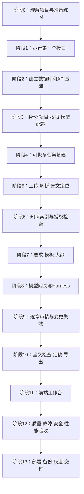

# 开发路线：从零实现企业技术标写作 Harness Agent

编写日期：2026-10-16（Asia/Shanghai）  
适用读者：能使用电脑和编辑器、尚未独立完成过完整项目的开发者。  
当前起点：三份设计基线尚待业务实现。编写期间仓库已出现Python项目初始化文件和部分包目录，跟做时先核对已有成果，再从未完成的步骤继续。本文件中的代码、命令、接口和验收都是开发指引，未在本次文档编写中执行部署或业务测试。

## 使用这份教程

这份路线以 `docs` 中三份设计基线及开发命令指南为依据：

| 资料 | 负责回答的问题 | 阅读方式 |
|---|---|---|
| [开发文档](开发文档.md) | 做什么、为什么这样设计、系统怎样协作 | 先读第 1 节，再随本路线查对应章节 |
| [数据库模型](数据库模型.md) | 数据保存在哪里、什么关系和约束必须成立 | 开发某组表时再看该组，不要求先背 51 张表 |
| [API文档](API文档.md) | 请求传什么、谁可以调用、返回什么 | 每实现一个接口，就对照其详细契约 |
| [指南文档](指南文档.md) | 环境、Git和Python的命令速查 | 配合S004、S006～S008查用，先确认当前shell和已初始化状态 |

根目录 [README](../README.md) 另列了 React、TypeScript、Vite 和 Nginx；本路线据此补充前端教学。前端页面划分、示例文件名和练习数据是本路线提出的实施建议。业务规则、状态、表名和接口名仍以三份设计资料为基线。

每次只推进一个步骤：先看“前置与依据”，理解“设计与教学”，按顺序“动手做”，看到“验收与排错”要求的结果后再打勾。一个步骤包含的编号动作是该步骤内部的执行顺序。不要把“读懂了”当成“完成了”，也不要一次让代码生成工具实现整个项目。

难点步骤可以用多个学习时段完成。建议一次学习 45～90 分钟，最后留 10 分钟记笔记和保存进度。这是学习节奏建议，不是工期承诺；生产环境还需要投标专家、安全和运维人员参与验收。

### 命令、代码与路径约定

- `powershell` 代码块在 Windows PowerShell 执行；`bash` 代码块在 WSL2 或 Linux 执行，不混用语法。
- `<项目ID>`、`<真实镜像digest>` 等尖括号内容必须换成真实值，不能直接复制执行。API 文档里的 UUID 和重复的 `aaaa...` hash 也不是可运行数据。
- 除特别声明外，后端命令在 `backend` 目录执行，前端命令在 `frontend` 目录执行，Compose 命令在仓库根目录执行。
- 下文提及的源代码路径均相对仓库根目录。它们是将来创建的文件，当前只创建了本教程。
- “示例代码”是可保存到指定文件的起步内容；“流程草图”用于解释设计，需要结合该步骤补齐，不能冒充完整实现。
- 使用 `uv run` 执行 Python 工具，避免忘记激活虚拟环境。只有相应测试文件已经创建后，才能运行本路线中的测试命令。

### 先记住六条业务规则

1. 用户确认要求和大纲后才能写作；当前章审核通过后才能生成下一章。
2. 章节正文每次修改都形成新版本，审核绑定具体版本；人工内容不能被后台任务覆盖。
3. 企业资质、人员和业绩需要有效证据；历史标书只能作为参考，缺证据必须提示补充。
4. 项目成员身份和资料读取权分别判断；系统管理员也没有默认正文读取权。
5. PostgreSQL 保存业务事实，Redis 和 Milvus 都能重建；LangGraph checkpoint 不能替代业务记录。
6. `run.succeeded` 只代表写作和检查流程完成；正式交付还要负责人定稿，再导出指定快照。

### 总路线与阶段门槛



| 阶段 | 步骤 | 完成后能演示什么 | 对应原里程碑 |
|---|---|---|---|
| [阶段0](#phase-0) | S001～S005 | 解释业务流程，准备练习和进度记录 | M1 前置 |
| [阶段1](#phase-1) | S006～S013 | 本机接口、Swagger 页面和第一个测试可运行 | M1 |
| [阶段2](#phase-2) | S014～S021 | 数据库可迁移，协议、冲突和事务有统一规则 | M1 |
| [阶段3](#phase-3) | S022～S031 | 不同账号获得不同项目和资料访问范围 | M1 |
| [阶段4](#phase-4) | S032～S038 | 请求返回任务ID，重投和崩溃不重复提交结果 | M1 / M4 基础 |
| [阶段5](#phase-5) | S039～S048 | 三类文件可解析、定位和人工纠正 | M2 |
| [阶段6](#phase-6) | S049～S056 | 只从有权资料检索，索引可发布和重建 | M2 |
| [阶段7](#phase-7) | S057～S066 | 确认条款、评分和大纲，建立稳定章节 | M3 |
| [阶段8](#phase-8) | S067～S078 | 第一章生成后等待审核，预算和恢复受控 | M4 |
| [阶段9](#phase-9) | S079～S086 | 逐章推进，旧审核和失效来源不会被继续使用 | M5 |
| [阶段10](#phase-10) | S087～S094 | 严格定稿，导出可核对的 DOCX/PDF | M6 |
| [阶段11](#phase-11) | S095～S104 | 通过浏览器完成整个业务流程 | 贯穿 M1～M6 |
| [阶段12](#phase-12) | S105～S112 | 提供真实的契约、质量、故障及容量报告 | M7 |
| [阶段13](#phase-13) | S113～S120 | 多机部署、恢复演练、灰度回滚与交接 | M7 |

早期用 Swagger 的“Try it out”操作后端，前端正式接入放在阶段 11。前端的复杂交互依赖稳定的版本和任务协议，这样安排可以减少反复返工。阶段 8 的审核等待先用受控测试夹具验证；真正的审批接口和自动推进在阶段 9 完成。

<a id="phase-0"></a>

## 阶段 0：先建立能够理解的开发目标

<a id="s001"></a>

### S001 · 画出一个项目从上传到交付的过程

**前置与依据**：无需代码基础；读《开发文档》§1.1～1.3、§1.5。

**设计与教学**：先明确人的决定和程序的工作，才能知道按钮、接口和任务分别负责什么。“AI写完”与“审核通过”是两个不同事件。

**动手做**：

1. 在学习笔记写下“上传→解析→确认要求→确认大纲→生成当前章→审核→全文检查→定稿→导出”。
2. 在每个箭头旁写触发者，例如 owner 确认要求，reviewer 批准章节，Worker 执行生成。
3. 在审核处画出退回修订分支，在缺证据处画出等待补充资料分支。

**产物**：一张流程图及 REQ-01～REQ-10 的中文解释。

**验收与排错**：能回答“第一章没批准时第二章能否生成”和“模型生成成功后能否直接正式导出”，两者都应回答不能。若说不出原因，回看设计资料中的人工门禁。

<a id="s002"></a>

### S002 · 用一套小样本贯穿后续开发

**前置与依据**：S001；《开发文档》§5.2。

**设计与教学**：练习样本相当于可重复的实验材料；固定输入后，才能区分代码变化和模型随机性。

**动手做**：

1. 准备一个虚构 IT 项目和一个工程项目，各设 2 个章节、3 条强制要求和 2 个评分项。
2. 准备文字 PDF、扫描 PDF、带标题/表格的 DOCX、含公式且缺缓存值的 XLSX，以及一份过期资质和一份历史标书。
3. 写一份答案清单，标出每条要求的准确原文位置、有效证据和缺证据项；后续样本放入 `backend/tests/fixtures/`，注明完全虚构或已脱敏。

**产物**：样本目录与 `backend/tests/fixtures/README.md` 的材料说明。

**验收与排错**：只看原件就能判断预期结果；若预期答案依赖模型临时发挥，先补人工标注。初学样本不替代阶段 12 的正式评估集。

<a id="s003"></a>

### S003 · 建立自己的术语表

**前置与依据**：S001；《开发文档》§2.1～2.4，《数据库模型》§2。

**设计与教学**：先掌握当前需要的少量概念，再遇到再扩充。尤其要分清“逻辑对象”和“某次不可变版本”。

**动手做**：

1. 用自己的话解释 API（程序之间的入口）、数据库（保存事实）、事务（一组操作共同成功或失败）、Worker（后台执行者）。
2. 加入 document / document_version、chapter / chapter_version：前者是工作对象，后者是某一版内容。
3. 加入 job（一次解析等后台任务）、run（完整写作运行）、RAG（先检索证据再生成）、checkpoint（图的恢复进度）。

**产物**：学习笔记中的术语表，每个词配一个本项目例子。

**验收与排错**：能解释“相同章节ID对应多个正文版本ID”；若把 `lock_version` 当作正文 `version_no`，阅读附录 A 的对照再继续。

<a id="s004"></a>

### S004 · 学会查看并保存 Git 变更

**前置与依据**：S001；仓库已存在 `.git`，不重复初始化。

**设计与教学**：Git 记录经过检查的变更，方便查错和回退。第一次任务不需要推送远程，也不需要改变现有分支。

**动手做**：在仓库根目录执行：

```powershell
git status --short
git diff
git log -5 --oneline
```

如果 `git log` 提示当前没有提交，这是新仓库的正常情况。首次保存前逐个检查待加入文件；之后只 `git add` 当前步骤的明确文件，再 `git diff --cached` 查看，确认没有密钥和原始业务资料后提交。不要用清空目录或重置全部文件来解决冲突。

**产物**：一条自己的“检查→暂存→检查暂存内容→提交”操作记录。

**验收与排错**：知道 `git diff` 不显示未跟踪文件的正文；新文件要在编辑器查看，或暂存后再看。还未安装 Git 时先执行 S006，再回来完成本步。

<a id="s005"></a>

### S005 · 创建学习记录和一次只做一步的规则

**前置与依据**：S001～S004；《开发文档》§1.5、§7。

**设计与教学**：“完成了哪些文件”不等于“用户得到什么能力”。每次记录输入、实际结果和未解决的问题，便于第二天继续。

**动手做**：

1. 后续创建 `docs/学习记录.md`，记录日期、步骤ID、关联REQ、修改文件、运行命令、预期/实际结果和下一步。
2. 每完成一步，在学习记录登记步骤ID和验收结果；阶段门槛全部通过后再勾选附录D的阶段清单，不通过的验收保持未完成。
3. 向代码助手提问时使用附录 E 的单步骤模板，要求解释修改理由并保留已有人工代码。

**产物**：学习记录模板和第一次 S001 的复述。

**验收与排错**：休息一天后能根据记录继续；若只有“已完成登录”一句话，补上接口、账号、返回码和验证证据。

<a id="phase-1"></a>

## 阶段 1：搭建环境，运行第一个接口

<a id="s006"></a>

### S006 · 安装并检查编辑器、Git、uv 和 Docker

**前置与依据**：阶段 0；《开发文档》§3.1。本步只搭建个人开发环境。

**设计与教学**：Python 运行后端；uv 管理 Python 和依赖；Docker 运行数据库等服务；编辑器终端执行命令。它们分别解决不同问题。

**动手做**：

1. 安装 VS Code 或 PyCharm、Git、uv、Docker Desktop，Windows 的 Docker 使用 WSL2 后端。安装来源见 [Docker Windows 安装说明](https://docs.docker.com/desktop/setup/install/windows-install/) 和 [uv 安装说明](https://docs.astral.sh/uv/getting-started/installation/)。
2. 如已安装，不重复安装；重新打开终端后检查：

```powershell
git --version
uv --version
docker --version
docker compose version
docker info
```

3. 把操作系统、工具版本写入学习记录。Node.js 留到 S095 再安装。

**产物**：环境检查结果。

**验收与排错**：`docker info` 能连接引擎。提示“命令不存在”先检查安装和 PATH；只看到 Docker 客户端版本但连不上引擎时，打开 Docker Desktop 并等待启动完成。

<a id="s007"></a>

### S007 · 选定 Windows 与 Linux 的运行分工

**前置与依据**：S006；《开发文档》§3.1、§6.1。

**设计与教学**：建议保留当前 Windows 仓库，用 Windows 编辑和运行最初的 API；从阶段 4 起，Celery 和文档处理器运行在 Linux 容器。Celery 官方不支持原生 Windows，见 [Celery Windows 说明](https://docs.celeryq.dev/en/stable/faq.html#does-celery-support-windows)。

**动手做**：

1. 打开当前仓库根目录，确认 `docs` 中有三份设计文件；记录自己的真实绝对路径。
2. 在笔记区分宿主机地址 `127.0.0.1` 与容器服务名 `postgres`、`redis-broker`。同一 Compose 网络内用服务名；容器里的 `localhost` 指容器自己。
3. 若选择全部在 WSL2 开发，使用 Linux 文件系统中的独立工作副本和独立 `.venv`，不要让两套系统共用虚拟环境。

**产物**：一张“编辑位置、API运行位置、Worker运行位置、依赖运行位置”表。

**验收与排错**：知道当前终端是 PowerShell 还是 Linux shell；后续命令路径和网络地址能对应到实际运行位置。

<a id="s008"></a>

### S008 · 初始化 Python 项目并锁定起步依赖

**前置与依据**：S006～S007；《开发文档》§2.2。以下命令在仓库根目录开始，初始化只做一次。

**设计与教学**：`pyproject.toml` 声明依赖，`uv.lock` 记录解析到的精确版本，`.venv` 是本机安装目录。锁文件应入 Git，虚拟环境不入 Git。机制见 [uv 项目指南](https://docs.astral.sh/uv/guides/projects/)。

**动手做**：

```powershell
uv python install 3.12
uv init --bare --python 3.12 backend
Set-Location backend
uv python pin 3.12
uv add fastapi "uvicorn[standard]" "pydantic>=2,<3" pydantic-settings
uv add --dev pytest httpx ruff mypy
uv run python --version
```

检查 `requires-python`，本项目先约束为 `>=3.12,<3.13`。随后执行 `uv lock`，记录实际 Python 补丁版和各包版本；首次解析所得组合只是候选，阶段 12 联调通过后才是发布组合。后续新增依赖逐步加入，不一次安装 GPU 全家桶。

**产物**：`../backend/pyproject.toml`、`../backend/uv.lock`、`../backend/.python-version`。

**验收与排错**：解释器显示 3.12.x，`uv sync --locked` 成功。已存在 `backend` 项目时先读现有配置，不覆盖重新初始化。

<a id="s009"></a>

### S009 · 创建最小目录，理解分层职责

**前置与依据**：S008；《开发文档》§2.1、§3.1。

**设计与教学**：路由负责接收 HTTP，Service 负责业务决定和事务，Repository 负责读写数据库，Adapter 负责访问外部系统。先理解边界，再逐步添文件。

**动手做**：

1. 创建 `../backend/app`、`../backend/app/api/v1`、`../backend/app/domain`、`../backend/app/services`、`../backend/app/repositories`、`../backend/app/adapters` 和 `../backend/tests/unit`；Python 包目录添加空的 `__init__.py`。
2. 在 `../backend/app/main.py` 创建应用入口，后续业务路由按模块放进 `api/v1/`。
3. 在笔记画一次请求经过“路由→Service→Repository→数据库→响应DTO”的路径。

**产物**：最小包目录与职责说明。

**验收与排错**：能说明数据库连接代码为什么不应该散落在每个接口里。后续出现 `ModuleNotFoundError: app`，先检查当前目录是否为 `backend`。

**零基础热身**：Python的变量保存值，`dict`保存“键→值”，`list`保存有顺序的一组值；函数 `def` 把一组动作起一个名字，`class` 把数据和行为组织成一种对象。先在临时练习文件写一个接收项目名并返回字典的函数，运行后确认输出，再继续S010。缩进表示代码归属，统一4个空格；类型注解说明预期数据形状，实际输入仍需Pydantic等验证。

<a id="s010"></a>

### S010 · 写出并访问第一个健康接口

**前置与依据**：S009；这是教学和运维入口，属于新增的非业务接口，不计入原 104 个业务接口。

**设计与教学**：先证明请求确实到达自己的程序。存活检查只回答进程是否工作，暂不伪装成数据库、模型都健康。

**动手做**：在 `../backend/app/main.py` 写入：

```python
from fastapi import FastAPI

app = FastAPI(title="技术标写作工作台", version="0.1.0")


@app.get("/health/live")
async def live() -> dict[str, str]:
    return {"status": "ok"}
```

在 `backend` 终端运行：

```powershell
uv run uvicorn app.main:app --reload --host 127.0.0.1 --port 8000
```

打开浏览器访问 `http://127.0.0.1:8000/health/live` 和 `http://127.0.0.1:8000/docs`。程序入口与自动接口文档机制见 [FastAPI 起步教程](https://fastapi.tiangolo.com/tutorial/first-steps/)。

**产物**：可访问的应用入口。

**验收与排错**：健康接口返回 `{"status":"ok"}`。端口占用时先确认占用进程，或改为 8001；关闭运行终端里的 `Ctrl+C` 即停止服务。`--reload` 只用于开发。

读懂这几行再继续：

| 写法 | 现在只需要理解的含义 |
|---|---|
| `from fastapi import FastAPI` | 从已安装的库取出建立Web应用的工具 |
| `app = FastAPI(...)` | 创建应用对象，名字app与启动命令相对应 |
| `@app.get("/health/live")` | 把某个GET地址交给下面的函数处理 |
| `async def live()` | 定义支持异步等待的处理函数；不代表自动在后台Worker执行 |
| `-> dict[str, str]` | 声明返回字典的键和值都是字符串 |
| `return {"status": "ok"}` | 返回结果，框架把它编码成JSON |
| `app.main:app` | `app/main.py`模块中的app对象，不是文件系统路径 |

可以只修改返回字典里的值，观察开发服务自动重载和浏览器结果变化，再恢复原值。这里学习的是“修改代码会怎样影响响应”，不是开始添加新的业务功能。

<a id="s011"></a>

### S011 · 写第一个有意义的自动测试

**前置与依据**：S010；《开发文档》§5.1。

**设计与教学**：测试是能重复执行的验收动作。先验证对外行为，再逐步覆盖权限、状态和事务，避免只检验内部函数调用次数。

**动手做**：创建 `backend/tests/unit/test_health.py`：

```python
from fastapi.testclient import TestClient

from app.main import app


def test_liveness() -> None:
    with TestClient(app) as client:
        response = client.get("/health/live")
    assert response.status_code == 200
    assert response.json() == {"status": "ok"}
```

在 `backend` 执行 `uv run python -m pytest tests/unit/test_health.py -q`。短暂把预期值改错并确认测试失败，再恢复正确值。

**产物**：第一个可重复执行的测试。

**验收与排错**：正确代码时通过，错误预期时失败；若测试从未失败，检查是否真的收集到了该文件。后续应用增加数据库启动逻辑后，使用应用工厂和依赖覆盖保持此测试不依赖外部服务。

`with`管理测试客户端的进入和退出，`assert`要求条件必须成立，否则本次测试失败；`-q`减少pytest输出。TestClient在测试进程内调用应用，不要求另开Uvicorn，也没有证明真实网络、数据库或队列已经可用，那些在后续集成测试验证。

<a id="s012"></a>

### S012 · 分离配置、秘密和版本清单

**前置与依据**：S008～S011；《开发文档》§3.2、§6.2。

**设计与教学**：配置决定程序连接哪套环境；秘密是密码和令牌。配置可解释、秘密不可提交，能降低“开发程序误连生产库”的风险。

**动手做**：

1. 创建 `backend/app/settings.py`，用 Pydantic Settings 校验环境名、DSN、上传上限、租约、预算、出网模式；环境默认 `development`、`local_only`。
2. 创建不含真实秘密的 `backend/.env.example`，本机复制为已被忽略的 `.env`；秘密通过受保护挂载或环境注入，日志只显示是否配置。
3. 创建 `docs/版本清单.md`，记录包锁文件、镜像 tag/digest、模型 revision、字体和模板 hash；不得编造未实测版本。

**产物**：配置加载器、配置样例、版本清单。

**验收与排错**：必需配置缺失时启动明确失败，错误不含密码。配置文件相对路径以实际启动目录为准；前端能公开的配置与后端秘密分开。

<a id="s013"></a>

### S013 · 配置格式、类型与最小检查入口

**前置与依据**：S011～S012；《开发文档》§3.2。

**设计与教学**：格式检查改善可读性，类型检查提前发现错误，测试验证业务行为；三者不能相互替代。

**动手做**：

1. 在 `pyproject.toml` 配置 Ruff 的 Python 3.12 目标和 mypy 的应用范围，测试目录与导入路径保持一致。
2. 在 `backend` 依次执行下列命令；只修复本步骤引入的明确问题：

```powershell
uv run ruff check app tests
uv run ruff format --check app tests
uv run mypy app
uv run python -m pytest tests/unit -q
```

3. 将通过命令写入 README 的开发检查部分，并保存阶段进度。

**产物**：可重复的本地检查流程。

**验收与排错**：四项检查均通过。不要添加全局忽略来压掉真实类型错误；第三方库缺类型时，只在适配边界做有说明的局部处理。

<a id="phase-2"></a>

## 阶段 2：先把数据库、协议和事务打牢

<a id="s014"></a>

### S014 · 先启动单独的 PostgreSQL 开发服务

**前置与依据**：阶段 1；《开发文档》§2.2、§3.2。此时不需要 Redis、Milvus 和 GPU。

**设计与教学**：先让一个依赖可用，出错时容易定位。下面的 Compose 仅用于个人电脑，使用隔离项目名和回环端口。

**动手做**：创建 `backend/deploy/compose.dev.yml`，先只包含：

```yaml
name: bid-harness-dev
services:
  postgres:
    image: postgres:17
    environment:
      POSTGRES_DB: bid_harness_dev
      POSTGRES_USER: postgres
      POSTGRES_PASSWORD: ${DEV_POSTGRES_PASSWORD:?set development password}
    ports:
      - "127.0.0.1:55432:5432"
    volumes:
      - pgdata:/var/lib/postgresql/data
    healthcheck:
      test: ["CMD-SHELL", "pg_isready -U postgres -d bid_harness_dev"]
      interval: 5s
      timeout: 3s
      retries: 20
volumes:
  pgdata:
```

在 PowerShell 的当前会话设置一个仅用于本机开发的密码，然后从仓库根目录运行：

```powershell
$env:DEV_POSTGRES_PASSWORD = '替换为自己的本机开发口令'
docker compose -f backend/deploy/compose.dev.yml config --quiet
docker compose -f backend/deploy/compose.dev.yml up -d postgres
docker compose -f backend/deploy/compose.dev.yml ps
```

本例的 `postgres:17` 是启动用兼容线；记录拉取后的真实 digest，进入共享环境前固定 digest。上面的超级用户仅做首次建库；S016 创建实际应用账号。

**产物**：运行中的隔离开发库和持久卷。

**验收与排错**：服务显示 healthy，重启容器后数据仍存在。连接失败先确认宿主机端口为 55432；不要通过删除卷来“修复”认证问题。已初始化卷不会因修改环境变量而自动改密码。

<a id="s015"></a>

### S015 · 接入异步数据库会话

**前置与依据**：S014；《开发文档》§2.1、§3.2，《数据库模型》§1。

**设计与教学**：连接池复用数据库连接；Session 表示当前请求或任务的数据访问上下文。不同并发任务不能共享同一个 Session。

**动手做**：

1. 在 `backend` 添加 `"sqlalchemy>=2,<3"`、`"psycopg[binary,pool]>=3,<4"`、Alembic；更新锁文件。
2. 创建 `backend/app/db.py`，提供 `create_async_engine`、`async_sessionmaker` 和请求依赖。DSN 形如 `postgresql+psycopg://账号:密码@127.0.0.1:55432/bid_harness_dev`，容器运行改用 `postgres:5432`。
3. 增加 `/health/ready`，执行带短超时的 `SELECT 1`，依赖不可用返回 503；存活接口保持独立。

**产物**：数据库访问基础与就绪检查。

**验收与排错**：数据库停止时 ready 失败、live 仍成功。不要把同步解析和模型请求放进异步接口的事件循环或数据库事务。

<a id="s016"></a>

### S016 · 分开迁移账号、运行账号和检查点账号

**前置与依据**：S015；《数据库模型》§4.3～4.4，《开发文档》§3.2。

**设计与教学**：拥有建表权不等于适合承接用户请求。业务 `app` schema 和框架 `harness` schema 分开，有助于隔离权限和独立升级。

**动手做**：

1. 写仅用于初始化的数据库脚本，创建 `app`、`harness` schema 和对应的迁移/运行角色；密码通过外部配置提供。
2. 设置 API/Worker 的业务运行账号非表 owner、无 `BYPASSRLS`，checkpointer 使用单独权限；禁止应用拿初始化超级用户运行。
3. 接入每事务 `SET LOCAL` 的企业/用户上下文和 org RLS；此处先搭机制，S027～S029 完整实现项目和资料授权。

**产物**：初始化脚本、角色权限清单。

**验收与排错**：运行账号不能建表或绕过 RLS，迁移账号能迁移。单企业 RLS 只能作为额外防线，不能据此认为部门和项目已经隔离。

<a id="s017"></a>

### S017 · 从第一组表开始学习迁移

**前置与依据**：S016；《数据库模型》§1、§3.1～3.6、§3.51、§4.1。

**设计与教学**：ORM 类是程序对表的映射，迁移是实际改变数据库结构的版本记录。自动生成迁移仍需人工核对约束。

**动手做**：

1. 在 `backend` 用 `uv run alembic init -t async migrations` 初始化；配置 `target_metadata`、schema 和异步连接，DSN 从配置读，不写入仓库。异步接入方法见 [Alembic 异步示例](https://alembic.sqlalchemy.org/en/latest/cookbook.html#using-asyncio-with-alembic)。
2. 先实现organizations、departments、users、roles、user_roles、auth_sessions，并提前建立所有业务写操作共用的audit_logs。`created_by→users`等循环引用先建表再加FK；audit的可空project/run关联在目标表创建后补约束，应用对审计只INSERT和按范围SELECT。
3. 用 `uv run alembic revision --autogenerate -m "identity foundation"` 生成并检查迁移，再 `uv run alembic upgrade head`。

**产物**：第一组 ORM 与迁移文件。

**验收与排错**：在全新测试库能从零升级到 head；`uv run alembic current` 显示目标版本。不要把设计文档中的几段 SQL 误当完整 51 表 DDL，也不要在多人副本启动时自动抢跑迁移。

第一次读表时按这个顺序理解：

| 术语 | 含义 | 本项目例子 |
|---|---|---|
| 表 / 行 / 列 | 一类记录 / 一条记录 / 一个属性 | users / 某个账号 / username |
| PK主键 | 唯一标识一行 | users.id的UUID |
| FK外键 | 引用另一张表已存在的行 | users.department_id引用departments |
| UNIQUE | 防止某种组合重复 | 同企业username不重复 |
| CHECK | 限制字段或字段组合合法 | 状态必须在允许枚举中 |
| NULL | 缺失或未知，不等同0或空字符串 | 未知max_score为null |
| JSONB | 结构化JSON数据，仍要校验schema | Locator和ContentDocument |
| 复合外键 | 同时约束身份与归属 | org_id和资源id一起引用，防跨企业拼接 |

可在数据库客户端执行只读练习 `SELECT username, status FROM app.users LIMIT 5;`：SELECT选列、FROM选表、LIMIT限制条数。S022初始化前返回空行是正常现象；这条SQL不应直接粘贴到PowerShell当命令执行。

<a id="s018"></a>

### S018 · 固定状态、DTO 和 JSON 协议

**前置与依据**：S017；《数据库模型》§2、§6，《API文档》§1.4、§2。

**设计与教学**：DTO 定义“接口允许传什么”；ORM 定义“数据库保存什么”。把两者分开，才能防止客户端设置管理员角色、内部指针或密钥字段。

**动手做**：

1. 在 `backend/app/domain/states.py` 逐字实现状态枚举，数据库采用 varchar + CHECK；API 和 Service 共享同一命名。
2. 按用途分 Create / Patch / Read DTO，配置 `extra="forbid"`；PATCH 区分未提供、显式 null，拒绝空修改。
3. 在 `backend/app/domain/protocols.py` 定义 Locator、ContentDocument、EgressPolicy 等带 `schema_version` 的严格结构；以后生成 OpenAPI 和工具协议共用这些定义。

**产物**：状态与协议定义。

**验收与排错**：未知字段、非法状态和不一致表格列数被拒绝，缺值与 null 行为不同。不要把 `needs_input`、`waiting_input`、`waiting_review` 混成一个通用状态。

<a id="s019"></a>

### S019 · 实现响应、错误、日志和请求追踪

**前置与依据**：S018；《API文档》§1.1～1.2、§6，《开发文档》§6.3。

**设计与教学**：浏览器靠状态码区分失败类型，开发者靠 `request_id` 关联日志。返回 SQL 或源正文会暴露本不该出现在运维界面的内容。

**动手做**：

1. 创建 `backend/app/api/errors.py` 和响应模型，普通业务返回 `code/message/data/request_id`，保留实际 HTTP 状态。
2. 添加 Request ID 中间件、统一异常处理与 422 字段错误格式；校验外部 `X-Request-ID` 长度和安全字符。
3. 输出 JSON 日志，仅记阶段、ID、耗时和脱敏错误；文件流、SSE 和健康检查按独立协议处理，不套业务JSON。

**产物**：统一协议与可查日志。

**验收与排错**：故意传错参数返回 422，响应头与正文 Request ID 一致；意外异常返回 500 且正文不出现栈、DSN、密码和资料原文。

<a id="s020"></a>

### S020 · 用一个完整用例理解事务和 Repository

**前置与依据**：S017～S019；《数据库模型》§4.2。

**设计与教学**：创建项目时，项目和 owner 成员必须同时存在。若 Repository 各自提交，就可能留下只有项目、没有负责人的半成品。

**动手做**：

1. 先画出“校验输入→打开事务→插入项目→插入owner成员→写审计→提交”的流程；业务接口到 S025 开放。
2. 在 Service 用 `async with session.begin():` 管理边界，Repository 仅查询、add、flush，不自行 commit。
3. 为涉及多个对象的用例记录锁顺序：organization（必要时）→project→排序chapter→run/job→其他对象；网络调用放事务外。

**产物**：事务约定与一个真实 PG 回滚集成测试。

**验收与排错**：在写入成员前故意抛错，项目也应回滚；不要用内存字典或 SQLite 代替 PG 来证明复合FK、锁和事务正确。

<a id="s021"></a>

### S021 · 实现 ETag、游标和规范化 hash 基础

**前置与依据**：S018～S020；《API文档》§1.3，《数据库模型》§6。

**设计与教学**：ETag 防止旧页面覆盖新修改；hash 确认被审核的实际内容；游标描述“从哪里继续”，三者用途不同。

**动手做**：

1. 实现 `ETag: "vN"` 与 `If-Match` 解析和 CAS 更新，缺条件 428，旧版本 409；工作区版本更新后递增。
2. 统一canonical JSON的键序、UTF-8、数字和空白规则；hash排除request_id和无关记录时间，保留有效期等业务语义及来源依赖。Decimal用字符串，时间保存UTC；各hash范围在附录F落实成夹具。
3. 实现签名不透明游标，绑定筛选和授权范围，分页默认20、最大100，无未授权 total；章节和片段按 position/ordinal 排序。

**产物**：并发、分页和内容指纹工具及边界测试。

**验收与排错**：两次拿相同ETag修改，只有第一次成功；同内容换JSON键序hash不变，换一条语义来源hash改变。不要通过自动重新取ETag并覆盖来“消除”409。

<a id="phase-3"></a>

## 阶段 3：建立身份、项目、资料授权和模型配置

<a id="s022"></a>

### S022 · 创建开发用初始化数据，解决第一个管理员从哪里来

**前置与依据**：阶段 2；《数据库模型》§3.1～3.8，《开发文档》§1.2。

**设计与教学**：系统不能要求“登录管理员才能创建第一个管理员”。初始化是受控管理操作，与面向用户的公开注册不同；首期没有公开注册接口。

**动手做**：

1. 创建 `backend/app/cli/bootstrap.py`，在事务中建立固定企业、预定义角色和首个管理员，密码通过交互或秘密注入读取，用 Argon2id 保存。
2. 开发种子另外建立预备用作owner、writer、reviewer、reader和knowledge_admin的测试账号；创建项目的练习账号先分配含project.create的组织角色，项目角色在项目创建后再分配。同一项目owner不兼任reviewer。
3. 初始化按企业和登录名幂等；开发种子只允许 development/test 环境，不自动在生产启动时运行。

**产物**：初始化命令、测试账号职责表。

**验收与排错**：运行两次不重复创建账号，数据库无明文密码。某角色并不自动具备另一角色的权限，需要按固定权限目录分配；不要创建“绕过所有规则”的测试超级业务用户。

<a id="s023"></a>

### S023 · 完成登录和当前用户接口

**前置与依据**：S022；《API文档》§4.1、§4.4，《开发文档》§1.2。

**设计与教学**：身份认证回答“你是谁”，后面的授权才回答“你能做什么”。JWT 是有签名的身份凭据，不能靠客户端解码后自报角色。

**动手做**：

1. 添加经选型锁定的 Argon2id/JWT 库，在 `services/auth.py` 实现用户名规范化、密码验证和令牌签发；JWT 固定 issuer、audience、允许算法，15分钟到期。
2. 实现 `POST /auth/login` 和 `GET /users/me`，登录失败统一 `AUTH_INVALID`，不区分账号不存在或密码错误。
3. 每请求从服务端校验 active 和 auth_version，再构造内部 Actor；org_id 由身份解析，不从请求体取。

**产物**：登录流程和受保护接口依赖。

**验收与排错**：正确登录200，缺令牌401；伪造签名、错误受众和过期令牌均被拒绝。Swagger 可按 Bearer 安全配置输入令牌，不能在日志打印令牌帮助排错。

<a id="s024"></a>

### S024 · 实现刷新、登出和账号管理

**前置与依据**：S023；《API文档》§4.2～4.9，《数据库模型》§3.6。

**设计与教学**：刷新令牌相当于获取新访问令牌的长期凭据。每次轮转并检测旧令牌重用，能发现凭据被复制的情况。

**动手做**：

1. 实现随机刷新令牌、数据库仅存SHA-256、family_id、轮转和7天绝对到期；刷新不是每次重新延长7天。
2. 实现 refresh/logout 和管理员用户列表、创建、修改、全量替换组织角色；保留最后一个 active 系统管理员。
3. 停用账号时撤销会话、增加 auth_version 和 acl_epoch；暂停/阻断其任务后续提交，任务模块接入后补齐状态传播。

**产物**：API 2、3、5～9 及身份安全测试。

**验收与排错**：旧刷新令牌重用会撤销整族；停用账号的未过期JWT也不可继续访问。前端只在内存保存令牌，刷新页面后重新登录是首期可接受行为。

<a id="s025"></a>

### S025 · 实现项目创建、列表、读取和基础修改

**前置与依据**：S024；《API文档》§4.16～4.19，《数据库模型》§3.7～3.8。

**设计与教学**：这是第一次完整走过路由、DTO、Service、Repository 和真实数据库。项目建立时 owner 关系必须原子创建。

**动手做**：

1. 增加projects、project_members迁移并复用S017的audit_logs，补审计project_id的FK。尚未建立的要求/大纲、run等引用先保持可空，目标表建立时补上正式FK，绝不永久关闭约束。
2. 用 S020 的事务约定实现创建者成为owner、初态draft；只让有 `project.create` 的登录用户创建。
3. 列表按当前成员过滤；PATCH 只允许 name/deadline，GET返回ETag。S033 完成HTTP幂等后，本组创建接口才满足完整契约。

**产物**：项目基础API与跨账号可见性用例。

**验收与排错**：重启应用后项目仍存在，非成员查询其ID返回404；提交 `owner_id/status/org_id` 不能直接改内部状态。有效policy配置完成后才可转active。

<a id="s026"></a>

### S026 · 实现部门、成员变更、owner转移和归档

**前置与依据**：S025；《API文档》§4.10～4.12、§4.20～4.23。

**设计与教学**：成员配置使用父Project的ETag，代表“我基于当前项目配置进行变更”。owner 转移是专用业务动作，不能当作普通成员覆盖。

**动手做**：

1. 实现部门树新增/修改，禁止父链成环和同父重名；部门变化更新ACL版本。
2. 实现项目成员列表、PUT成员、transfer-owner；新owner必须是现有active成员，旧owner转writer，同一事务保持唯一owner。
3. 实现归档：活动run/job存在时拒绝，归档后只读。任务表未建立前先完成领域判断和测试接口，S032接入真实活动任务查询。

**产物**：组织和项目管理用例。

**验收与排错**：writer不能给自己升权；成员PUT用错Member ETag而不是Project ETag时不能蒙混通过。通过独立账号验证，不只在界面隐藏按钮。

<a id="s027"></a>

### S027 · 写一个所有入口共用的授权查询器

**前置与依据**：S025～S026；《数据库模型》§4.3，《开发文档》§1.2、§2.6。

**设计与教学**：权限不是一处 `if role == admin`。读取正文要同时满足用户有效、企业一致、项目成员、资料授权、有效期和删除状态。

**动手做**：

1. 在 `backend/app/services/authorization.py` 定义 `require_project_action(actor, project_id, action)`、`visible_document_versions(actor, scope)` 和 `require_sources_readable(actor, version_ids)` 等内部方法。
2. 让列表在查询层过滤，让按ID读取先判断可见性；已知可见但无操作权403，不可见404。
3. 整理权限真值表：system_admin读项目正文、reader生成、writer审核自己提交、owner越过资料限制，都应拒绝。

**产物**：统一授权入口和权限矩阵。

**验收与排错**：路由、Worker、检索、下载将复用同一规则。若测试只证明HTTP层拒绝，而直接调用Service仍可越权，说明边界没有覆盖到底。

<a id="s028"></a>

### S028 · 实现知识库、授权和项目范围选择

**前置与依据**：S027；《API文档》§4.26～4.34，《数据库模型》§3.11～3.13。

**设计与教学**：选择知识库是“希望搜索哪里”，grant 是“允许搜索哪里”。两者取交集；给某项目的grant不能被用户带到另一个项目使用。

**动手做**：

1. 创建知识库、project_knowledge_bases、resource_grants 的表和约束；资源二选一、主体三选一，manage包含read。
2. knowledge_admin创建新库时只获得该库manage；实现库列表/读取/修改、授权列表/创建/删除，校验授予者有对应资源可授予权限。
3. owner全量替换项目知识范围时使用Project ETag，验证所选范围，暂停旧输入run的钩子先保留到后续接线。

**产物**：资料权限可配置的API。

**验收与排错**：只选择未授权知识库仍不能读；`inherit_acl=false` 的文档和restricted资料必须有明确文档grant。不要因单企业部署而省略这些检查。

<a id="s029"></a>

### S029 · 建立立即撤权与 ACL epoch 机制

**前置与依据**：S028；《数据库模型》§4.2～4.3，《开发文档》§2.6。

**设计与教学**：缓存、向量删除和依赖扫描需要时间，撤权不能等它们完成。`acl_epoch` 是权限规则已经变化的计数器，读取旧缓存前可据此重新判断。

**动手做**：

1. 在变更grant、部门、成员、用户状态或资料策略的同一PG事务递增企业acl_epoch并写审计。
2. 在授权结果中带已验证epoch，正文读取、模型发送、长连接和下载继续传输前重验；缓存键纳入user/project/epoch。
3. 先实现同步拒绝机制，异步标记章节失效、清缓存和删索引在任务体系建立后接入。

**产物**：撤权同步生效路径和版本化授权上下文。

**验收与排错**：撤掉grant后下一次读取立即失败，即使清理Worker尚未运行。重放旧幂等响应也必须重新鉴权。

<a id="s030"></a>

### S030 · 完成模型 Profile 管理与开发模型替身

**前置与依据**：S024、S029；《API文档》§4.13～4.15，《开发文档》§2.7。

**设计与教学**：Profile是一份固定版本的模型配置；开发用FakeModel是可预测的测试替身，方便先学习流程，不需要现在部署生成GPU。

**动手做**：

1. 创建model_profiles表；接口新增版本，只允许原地启停。endpoint_ref映射到管理员受控登记表，拒绝用户输入任意URL。
2. 定义 `ModelGateway` 内部协议和 `ModelResult`，实现只在development/test启用的FakeModel：从固定夹具返回结构化结果、已知用量、拒绝或截断场景。
3. Read DTO不返回endpoint_ref、secret_ref和密钥。真实provider adapter及最终出网授权在S067完成。

**产物**：模型配置API、网关协议、FakeModel。

**验收与排错**：改model/revision必须新建版本；测试替身输出明确标为测试数据，生产配置启用FakeModel时启动失败，不能把假生成当真实质量结果。

<a id="s031"></a>

### S031 · 配置项目模型策略并完成平台演示

**前置与依据**：S025、S028、S030；《API文档》§4.24～4.26。

**设计与教学**：项目策略限制允许使用哪些Profile和多少token；资料出网约束还要再次收紧它。策略允许云模型不代表所有资料都能发出去。

**动手做**：

1. 创建project_policies不可变版本，校验default属于allowed、Profile用途和启用状态，初始local_only、额度300000，组织上限2000000。
2. 用owner和Project ETag发布策略并切active指针；项目满足条件后由服务端从draft转active，策略变化暂停受影响run。
3. 用Swagger分别登录测试账号，演示创建项目、添加reviewer、选知识库、授权前后读取差异和Profile读取范围。

**产物**：可演示的M1平台基础和平台验收记录。

**验收与排错**：owner不能通过policy放开confidential/restricted资料出网；不发送真实模型请求也能完成本阶段。HTTP幂等和异步失效钩子在下一阶段补齐前，仍标记“开发中”。

<a id="phase-4"></a>

## 阶段 4：让后台任务可重试、可恢复

<a id="s032"></a>

### S032 · 保存任务及其可靠投递意图

**前置与依据**：阶段 3；《数据库模型》§3.42、§3.47、§3.51，《API文档》§4.89～4.90。

**设计与教学**：HTTP 202表示任务已被可靠接受。必须先在PG保存job和“需要发消息”的Outbox记录，不能先发Redis再赌数据库提交成功。

**动手做**：

1. 创建jobs、outbox_events并复用S017的audit_logs；补后续需要的关联约束。job的project/kb二选一，target_id按kind在Service校验真实目标。
2. 编写 `accept_job(...)`：同一事务写目标候选、job、outbox和审计，返回AcceptedJob及Location；接通归档的活动job检查。
3. 实现GET jobs及单job读取，错误只返回ErrorDetail。最初用内部测试夹具提交固定目标任务，不开放新的临时业务接口。

4. 同时实现GET audit-logs：system_admin仅脱敏系统记录，owner必须限定本项目；筛选时间范围≤31天，不返回原文、秘密或完整提示词。

**产物**：后台任务受理和查询框架。

**验收与排错**：数据库已提交但Worker未启动时，GET仍能查到queued任务。不要把Celery result backend当任务状态唯一来源。

<a id="s033"></a>

### S033 · 实现 HTTP 幂等并补齐已开发的写接口

**前置与依据**：S032；《API文档》§1.3，《数据库模型》§3.48、§4.2。

**设计与教学**：用户点击两次或网络重试都可能发送同一操作。幂等键标识这一次业务意图；不同业务操作要新键，相同操作重试沿用原键。

**动手做**：

1. 建idempotency_keys，作用域为org+user+HTTP方法+实际资源路径+key；规范化请求生成request_hash。
2. processing插入、业务变更和响应登记放同一事务；失败整体回滚。同键异体409，同键并发等待超过1秒返回IN_PROGRESS和Retry-After。
3. 接入《API文档》中标注必需幂等键的所有已实现接口；保留7天，重放前重新授权，二进制PUT和login/refresh等按契约不要求此键。

**产物**：幂等服务及并发测试。

**验收与排错**：两个并发相同请求只产生一个资源/任务，撤权后不能靠重放拿回旧数据。不要为失败操作留下独立提交的永久processing记录。

<a id="s034"></a>

### S034 · 用 Linux 容器启动 Celery 和独立 Redis

**前置与依据**：S032～S033；《开发文档》§2.4、§3.2。

**设计与教学**：Broker负责传消息，Cache负责缓存，分实例能避免清缓存或内存淘汰损坏任务投递。后台Python包与API来自同一锁文件。

**动手做**：

1. 添加 `"celery[redis]>=5.6,<5.7"`，创建 `backend/app/workers/celery_app.py` 并导出名为celery_app的应用对象，编写开发Dockerfile；镜像安装锁定依赖，非root运行。
2. Compose增加redis-broker、redis-cache及Worker；broker启用认证、AOF、noeviction，不对外暴露数据端口；真实秘密通过独立挂载提供。
3. 固定JSON序列化、acks_late、task_reject_on_worker_lost、prefetch=1和visibility_timeout=7200；消息只含任务ID和调度信息。初始Worker并发1，队列名约定doc_cpu、ocr、agent_v1。

**产物**：可启动的消息与Worker基础。

**验收与排错**：Worker能识别注册任务并连接broker。出现“unregistered task”检查模块导入；原生Windows失败不要靠试验性参数替代Linux运行验证。

<a id="s035"></a>

### S035 · 实现 Outbox Dispatcher

**前置与依据**：S034；《数据库模型》§3.47、§4.2，《开发文档》§2.4。

**设计与教学**：Dispatcher像收发员，从PG领取待发送记录，向broker投递。投递后崩溃可能使同一消息再次发送，因此消费者仍必须去重。

**动手做**：

1. 在 `backend/app/workers/dispatcher.py` 用短事务、`FOR UPDATE SKIP LOCKED` 和claimed_until领取可投递记录，事务外发送。
2. 发送成功再标published_at；失败更新attempt/available_at，以退避和抖动重试。进程恢复可接管过期领取。
3. 启动两个Dispatcher，用同一批记录验证不会长期互相阻塞；消息保留业务dedupe_key及dispatch_no，日志不记正文。

**产物**：可靠投递进程。

**验收与排错**：模拟“发送成功、标记前崩溃”，允许重复消息出现，但Outbox最终收敛；published只表示已投递，不能把job标succeeded。

<a id="s036"></a>

### S036 · 建立步骤账本，实现结果去重

**前置与依据**：S035；《数据库模型》§3.43，《开发文档》§2.4。

**设计与教学**：HTTP幂等解决用户重发，步骤账本解决Worker重跑；两者不能互相替代。只有committed步骤才表示业务结果确实提交。

**动手做**：

1. 建execution_steps，run/job互斥；`step_key`由run/job ID、输入hash、章节逻辑ID、节点、持久iteration组成，不包含attempt。
2. Worker先查committed结果并验证result_ref，已存在则复用；未完成步骤重新领取，结果和step=committed在同一业务事务保存。
3. 用一个固定处理任务验证同消息投递两次只写一份结果，attempt只记尝试次数，不生成新的逻辑步骤。

**产物**：执行账本与消费包装器。

**验收与排错**：在结果提交后、消息ACK前杀Worker，恢复不重复生成目标结果。仅使用Celery task_id或Redis锁不能证明业务去重。

<a id="s037"></a>

### S037 · 加上租约、旧 Worker 隔离和额度预留基础

**前置与依据**：S036；《数据库模型》§4.2，《开发文档》§2.3～2.4。

**设计与教学**：租约限定“目前谁有权提交”；epoch是接管后递增的所有权序号。旧Worker即使恢复运行，持旧epoch也不能写结果。

**动手做**：

1. 为job和后续run提供90秒租约、20秒心跳、接管epoch+1；每次提交验证owner、epoch、到期和当前状态，使用数据库时间。
2. 在PG的组织配额锁下统计活动生成槽；本地先设1，生产目标全局20、每项目一个活动run；OCR和文档CPU资源独立限流。
3. 为S030网关建立短事务的token预留/一次结算协议，job默认100000；未知结果保留额度。run对应计费表和并发细节在S068补齐。

**产物**：执行租约与配额/预算基础服务。

**验收与排错**：新Worker接管后旧epoch提交被拒绝；等待人工不持计算槽位。不要用各进程局部计数器或每台机器各配置20来实现全局上限。

<a id="s038"></a>

### S038 · 完成恢复扫描、任务重试和取消

**前置与依据**：S037；《API文档》§4.91～4.92，《开发文档》§2.4。

**设计与教学**：恢复调度器修补消息和执行状态之间的缝隙。取消是业务状态机操作，不能只向Celery发送revoke就宣布结束。

**动手做**：

1. 每30秒扫描未投递、过期租约和可执行任务，生成带稳定键的恢复Outbox；重试累计最多5次，指数退避加抖动。
2. 实现retry/cancel：仅failed且retryable可重试、attempt不清零；运行中cancel_requested，等待态可立即200 cancelled；节点间检查取消。
3. 用测试恢复broker丢失后的队列，保留PG业务状态；清理未登记临时对象的任务入口留给S039。

**产物**：M1可靠任务门槛和恢复演练记录。

**验收与排错**：杀Worker、重复消息和Redis重启后能收敛；目标是在依赖可用时180秒内重新调度，须实测。循环引用的目标表在后续建表后补FK/事务校验，不能以“目标是UUID”代替完整性检查。

<a id="phase-5"></a>

## 阶段 5：上传、解析和原文证据定位

<a id="s039"></a>

### S039 · 接通 SeaweedFS S3 和文件登记

**前置与依据**：阶段 4；《数据库模型》§3.14～3.17，《开发文档》§2.5、§3.2。

**设计与教学**：S3存二进制，PG存对象身份、hash和权限。文件名只是显示文字，不应成为可由用户操纵的磁盘或对象路径。

**动手做**：

1. 按固定SeaweedFS版本的部署方式，在开发Compose添加其S3服务，创建originals/templates/exports桶；Milvus内部桶后续使用独立凭证。
2. 创建files/documents/document_versions/upload_sessions迁移和 `backend/app/adapters/object_store.py`，实现流式写、读、stat、临时对象删除及hash核验。
3. 对象键由服务器生成且不可变；derived_image记录parent_file_id并继承来源授权；加入24小时临时对象回收和已登记对象对账。

**产物**：对象存储适配器和文件元数据表。

**验收与排错**：上传对象重启后仍存在，API不返回object_key或长期S3地址；数据库失败留下的孤儿对象能被回收，不能删除已有业务登记对象。

<a id="s040"></a>

### S040 · 实现上传会话初始化和查询

**前置与依据**：S039；《API文档》§4.35、§4.37。

**设计与教学**：会话先声明文件大小和hash，服务端才能在读流时限制资源；source必须确定项目或知识库，template有独立权限分支。

**动手做**：

1. 实现POST uploads：校验purpose、范围、文件名、1～209715200字节和小写SHA-256；会话1小时过期。
2. source要求项目/kb恰一且可写；模板只收DOCX并要求管理员。会话只允许创建者操作，每个阶段重新检查目标写权限。
3. GET会话返回相对upload_url、state和ETag；使用S033防止重复初始化。

**产物**：上传初始化和查询API。

**验收与排错**：声明超限直接拒绝，另一账号不能读取会话；不能仅通过扩展名宣布文件安全，真实内容检查留在上传和完成阶段。

<a id="s041"></a>

### S041 · 以流式方式接收二进制内容

**前置与依据**：S040；《API文档》§4.36，《开发文档》§2.5。

**设计与教学**：200MiB文件若一次读入内存，并发上传很容易耗尽内存。流式处理按小块转存，同时累计字节和计算hash。

**动手做**：

1. 实现PUT content，要求application/octet-stream和Content-Length；逐块计数、hash并写临时对象，超声明或超上限立即停止。
2. 同会话相同内容可重PUT，内容不同返回UPLOAD_CONTENT_CONFLICT；过期返回410，断线只留下可回收临时对象。
3. 使用固定服务器路径/对象键和受控S3适配器，不允许客户端传本地路径或远程URL。首期不做分片续传，失败重传。

**产物**：流式上传实现。

**验收与排错**：用接近200MiB的虚构文件观察内存不会按文件大小成倍增长；声明大小、实际大小、hash任一不符不能uploaded。不要调用无上限的 `await request.body()`。

<a id="s042"></a>

### S042 · 完成上传并创建入库任务，接通下载授权

**前置与依据**：S041；《API文档》§4.38～4.47。

**设计与教学**：二进制上传成功只说明收到字节；完成阶段还需识别真实格式、登记版本并排队解析。状态ready必须等解析和索引发布成功。

**动手做**：

1. complete核对对象stat、SHA-256和真实MIME；source校验title/kind/密级/出网策略，原子创建pending版本、ingest job及Outbox，返回202 AcceptedJob。
2. 模板分支不创建document，验证文件后返回201 File；这是接口详细契约的条件分支，不能机械套用索引中的202。
3. 完成资料/版本/chunks列表和读取、文件元信息及Range下载。每1MiB或5秒核对ACL epoch，来源失效中断后续流；同会话只产生一个版本。

**产物**：上传三步流程和受控文件读取。

**验收与排错**：重复complete不重复建版本/任务；普通GET200、合法Range206、非法416。正文和二进制响应不可混装，流开始后错误只能中断传输。

<a id="s043"></a>

### S043 · 先建立解析器契约与隔离运行环境

**前置与依据**：S042；《开发文档》§2.5，《数据库模型》§6。

**设计与教学**：不同格式都先转成同一种“带位置的原文块”，下游就不用认识每个解析库。解析器处理不可信文件，应与API进程隔离。

**动手做**：

1. 定义 `parse(file_ref) -> ParsedDocument`，输出有序blocks、标题路径、表格、Locator和质量报告；明确parser_version影响定位身份。
2. 文档Worker容器非root、无外网、只读根FS，限制CPU、内存、临时盘和超时；Office解压限制1GiB/10000文件/压缩比100。
3. 识别并拒绝宏、加密、损坏和嵌入可执行内容，禁用外链/脚本。同步库在文档Worker执行，不进ASGI事件循环。

**产物**：解析契约、隔离容器配置、恶意/异常文件用例。

**验收与排错**：坏文件明确失败，不产生“空文本但成功”的版本；容器没有网络出站能力。不要靠模型决定一个Office文件是否安全。

<a id="s044"></a>

### S044 · 先实现文字 PDF 解析与准确 Locator

**前置与依据**：S043；《开发文档》§2.5，《API文档》§1.4。

**设计与教学**：一段文字只有绑定不可变来源版本和位置，才能被审查。PDF页码从1开始，bbox可归一化为0～1，不能混入屏幕像素坐标。

**动手做**：

1. 用pypdf/pdfplumber读取文字层、页面结构和表格，超过2000页拒绝；记录页码区间、block_id、bbox与标题路径。
2. 按文字缺失、乱码和可读性判断哪些页需要OCR，先生成待OCR列表；跨页表格保留列头、单位、合并单元格和续表关系。
3. 创建PDF定位回归样本：第1页、最后1页、跨页表格和相同文本出现多次；原件更新后旧Locator仍指向旧版本。

**产物**：文字PDF解析器与定位测试。

**验收与排错**：随机挑一句可回到指定页指定区域；若引用总差一页，检查内部0起始索引转为公开1起始页码的边界。

<a id="s045"></a>

### S045 · 加入扫描 PDF OCR 和人工纠正

**前置与依据**：S044；《API文档》§4.48，《开发文档》§2.5。

**设计与教学**：OCR把图片识别成文字，但置信度不是事实保证；“不得”识别为“得”会改变条款含义，因此数字和否定词需要单独复核。

**动手做**：

1. 在独立OCR队列接入固定PaddleOCR版本和内网模型，按≤50页批次执行，记录页级/块级置信度。
2. 阈值初值0.85，关键数字、日期、否定词不确定进入needs_input；保留提取报告及内容hash，禁止低质量资料进入当前证据包。
3. 实现corrections：If-Match和expected_content_hash校验后，新建提取版本及入库任务，不覆盖原OCR；空corrections代表人工确认，也留新版本复核记录。

**产物**：OCR适配器、质量门禁、纠正API。

**验收与排错**：低质量扫描不会ready，纠正后旧原文仍可审计。无GPU时可用小CPU样本或FakeOCR验证协议，但正式OCR速度与质量门槛必须真机测试。

<a id="s046"></a>

### S046 · 实现 DOCX 结构提取

**前置与依据**：S043；《开发文档》§2.5，《数据库模型》Locator协议。

**设计与教学**：DOCX页面会随字体和渲染器改变，定位应依赖段落、标题路径和表格行，渲染页码只作辅助。

**动手做**：

1. 用python-docx提取标题级别、段落、列表编号、表格与图片资产；对无法稳定识别的结构在报告中提示，不静默丢失。
2. 生成绑定document_version/parser_version的稳定段落ID、table_id/row_range，保留段落和表格的原始顺序。
3. 图片登记为受控derived_image，继承父文件授权；如生成辅助PDF，固定转换器和字体版本并标注辅助定位性质。

**产物**：DOCX解析器和结构样本。

**验收与排错**：标题、正文、列表、表格顺序与原件一致；不能只调用“所有段落text拼接”就认定支持DOCX，因为这样会遗漏表格。

<a id="s047"></a>

### S047 · 实现 XLSX 提取并保留公式不确定性

**前置与依据**：S043；《开发文档》§2.5，《API文档》Locator协议。

**设计与教学**：单元格可能同时有公式文字和缓存显示值；读取库不负责执行Excel计算，不能把缺缓存的公式当成0。

**动手做**：

1. 使用openpyxl分别读取公式与缓存值，按sheet、cell_range、表头、合并单元格来源组织原文块。
2. 保留显示值、公式文字和缺缓存标记；日期、百分比、金额及单位保留可审计转换规则，不执行外部链接和公式。
3. 将关键值无法核实时加入needs_input报告，并复用S045的不可变纠正版本流程。

**产物**：XLSX解析器和公式缺值样本。

**验收与排错**：能区分“单元格值为0”“空值”“公式存在但无显示缓存”；定位可准确回到工作表和单元格，不把每个sheet当无结构长字符串。

<a id="s048"></a>

### S048 · 实现分块、hash和待发布入库清单

**前置与依据**：S044～S047；《数据库模型》§3.18～3.20、§5.2。

**设计与教学**：chunk是检索单位，太大会混入无关内容，太小会丢上下文。PG保留原文与定位，索引只提供可重建的检索能力。

**动手做**：

1. 创建chunks、index_generations、index_entries迁移，按标题结构分块；默认600个embedding tokens、80重叠，用固定embedding tokenizer计数。
2. 表格按行组拆分并重复表头，保留parent/ordinal/hash/Locator；单块不得超过32768 UTF-8字节，超限继续拆，禁止跨权限域去重泄露存在性。
3. processing版本的chunks和pending entries按批登记，逐批用稳定步骤键去重；S051～S052索引核验通过前不切ready/current。

**产物**：分块器、待发布清单、三格式解析回归结果。

**验收与排错**：同一输入重跑不多一份chunk，中文字节上限单独校验。阶段结束可查看处理报告和待发布结果，尚未建立真实索引时不能演示成已就绪知识库。

<a id="phase-6"></a>

## 阶段 6：建立有权限边界的混合检索

<a id="s049"></a>

### S049 · 接入内网 embedding 和 reranker

**前置与依据**：阶段 5、S030；《开发文档》§2.2、§2.6，《数据库模型》§5。

**设计与教学**：embedding把文本转换成便于比较的向量，reranker对少量候选重新排序。分数表示相关性，不能证明企业事实真实。

**动手做**：

1. 建立独立推理适配器，固定BAAI/bge-m3 revision和1024维dense输出，做归一化；使用bge-reranker-v2-m3的固定revision。
2. 把模型加载、tokenizer、批大小、超时和设备配置写入版本清单；OCR、embedding、reranker均走内网。
3. 用“同义表达”“完全无关”“中文编号+英文缩写”小样本验证输入输出协议。没有推理条件时可先用替身联通接口，但真实检索验收保持未完成。

**产物**：向量与重排适配器、模型版本记录。

**验收与排错**：每个向量恰为1024维且无NaN；模型维度或tokenizer变化必须新建索引代。不要把BGE-M3的sparse输出与Milvus内建BM25字段混用。

<a id="s050"></a>

### S050 · 建立 Milvus 集合和两路索引

**前置与依据**：S049；《数据库模型》§5.1，《开发文档》§2.2、§6.1。

**设计与教学**：dense擅长语义近似，BM25擅长编号和关键词精确匹配；组合适合专业术语较多的技术标资料。

**动手做**：

1. 在隔离环境部署Milvus2.6兼容线及匹配PyMilvus、etcd和存储依赖，固定真实镜像digest并验证SeaweedFS所需S3操作。
2. 每知识库/项目范围、每generation建立明确物理集合，字段逐项照数据库§5.1，关闭dynamic_field，主键为chunk UUID字符串。
3. dense建1024维COSINE/HNSW，M=16、efConstruction=200、查询ef=128；text固定Chinese analyzer，BM25生成sparse_vector，建SPARSE_INVERTED_INDEX及授权过滤标量索引。

**产物**：版本化集合创建与验证脚本。

**验收与排错**：能分别执行dense和BM25查询；编号、中文术语、中英混排进入回归样本。Milvus只对内网服务账号开放，用户不直接连接集合。

<a id="s051"></a>

### S051 · 按固定批次幂等写索引并对账

**前置与依据**：S048～S050；《数据库模型》§3.20、§5.2。

**设计与教学**：PG与Milvus没有一个共同事务；先登记意图，再幂等写索引并校验，可以识别“写到一半”的状态。

**动手做**：

1. 按256片段批次读取pending index_entries，在事务外计算向量并upsert，使用已有vector_id，不重新随机分配主键。
2. 用Strong一致性核对完整ID、hash和总数，PG逐批标indexed；失败记录脱敏错误并按账本恢复。
3. 编写对账函数识别missing（登记但缺向量）、stale（hash不符）、orphan（无有效登记）并生成受控补偿任务。

**产物**：索引Worker和对账命令。

**验收与排错**：在第2批中断并重跑，最终条目数不翻倍；只检查Milvus总数不够，还要核对ID/hash，避免等量但内容错误。

<a id="s052"></a>

### S052 · 原子发布文档版本与活动索引

**前置与依据**：S051；《开发文档》§2.5，《数据库模型》§5.2。

**设计与教学**：发布指针类似“正式启用哪一版”；新版本构建失败时，用户应继续使用旧ready版本。不能提前改current再等待索引慢慢补齐。

**动手做**：

1. 在索引验证后用PG短事务重查版本未取消、未删除、质量合格和generation输入一致，再标ready/published_at并切documents.current_version_id。
2. 知识库切active_generation_id；项目资料按同project范围唯一active generation查询，不额外臆造projects的新指针字段。
3. 完成ingest job和发布审计；新版本失败/取消保持不可用，记录CANCELLED_BY_USER，旧current不变。

**产物**：M2版本发布闭环。

**验收与排错**：故意让新索引失败，旧版本仍可检索；新版本校验成功才切换。Strong只保证Milvus内部可见性，不代表PG/S3/Milvus组成了分布式事务。

<a id="s053"></a>

### S053 · 先算授权白名单，再做两路召回

**前置与依据**：S027～S029、S052；《开发文档》§2.6，《API文档》§4.49。

**设计与教学**：从全库先搜再隐藏结果，仍可能让未授权内容影响结果或流入模型。授权范围必须在两路检索发生之前确定。

**动手做**：

1. 实现knowledge-search，只接受query、已选知识库子集、项目资料开关和top_k，不接受expr/collection/org_id。
2. PG计算有权、当前ready、未删除且有效的document_version_id白名单；分批每批≤500，最多4批同时执行，两路使用完全相同过滤条件。
3. dense和BM25各取Top50，合并去重。4是并行批数，不是只允许总共2000个文档；若总范围超时预算，返回422 RETRIEVAL_SCOPE_TOO_LARGE。

**产物**：带授权过滤的召回Service。

**验收与排错**：在假Milvus调用记录和真实集成测试中检查两路过滤参数；未授权文档ID不能进入候选，不允许用去掉过滤来修复空结果。

<a id="s054"></a>

### S054 · 融合、重排并生成受限证据包

**前置与依据**：S053；《开发文档》§2.6。

**设计与教学**：RRF用候选排名合并两种不易直接比较的分数；重排只处理少量候选，可降低耗时。最后送给模型的内容必须再次从PG核验。

**动手做**：

1. 用RRF(k=60)融合排名，最多40条进入reranker；写清同分排序和去重规则，以便重复运行可解释。
2. Milvus只返回ID、分数和核对字段，原文从PG加载并检查hash、授权、有效期；补相邻块也必须同样授权。
3. 构建最多12条的生成上下文证据包，邻块同样计入上下文和token预算；搜索API可展示最多20条，但不把20条自动全部发送生成。

**产物**：可解释的检索结果和证据包。

**验收与排错**：改动向量端text或hash不能污染模型原文；空结果返回明确无证据提示，不由模型补写“应该存在”的资质。

<a id="s055"></a>

### S055 · 区分证据用途并处理缓存和过期

**前置与依据**：S054；《开发文档》§2.6～2.7。

**设计与教学**：同一句历史标书文字可帮助组织表达，却不能证明当前企业拥有某证书。用途必须保留到写作、引用和检查阶段。

**动手做**：

1. 证据区分fact、reference、requirement、proposal，保留document_version_id、chunk_id、Locator、quote_hash和valid_until。
2. 缓存键纳入user/project/acl_epoch/query hash/generation/policy/profile版本，TTL5分钟；读取缓存和发模型前重验epoch。
3. 增加过期扫描与按当前时间校验；过期资料只允许授权历史审计，不继续当当前履约事实。来源谱系的完整传播在S073/S085接入。

**产物**：证据类型规则、缓存及过期策略。

**验收与排错**：只有历史标书时系统提示补证据，不输出“本公司已具备”；grant撤销后的缓存不能命中旧内容。不要把rerank高分映射成“事实已验证”。

<a id="s056"></a>

### S056 · 完成删除、归档和索引换代

**前置与依据**：S052～S055；《API文档》§4.30～4.31、§4.43～4.44，《数据库模型》§5.2。

**设计与教学**：删除先阻断业务读取，再异步清向量；换embedding/chunker时影子构建新代，避免在旧集合里混入不兼容向量。

**动手做**：

1. 实现文档策略PATCH、DELETE tombstone及知识库归档；同步更新ACL、阻断新检索，再Outbox清理派生索引，历史引用不级联硬删。
2. 实现index-generations任务：冻结清单和水位，建新代、接收Outbox增量、短锁追平并验证后切PG指针；失败保持旧代。
3. 旧代默认保留7天，被活动run引用时延长；每小时执行S051对账，记录真实解析/检索小样本结果。

**产物**：完整M2验收记录和索引重建路径。

**验收与排错**：删除立即不可读；构建中新增资料不会在切换后漏失；新代失败不影响旧代。初学样本只证明流程，正式Recall等指标留到S107。

<a id="phase-7"></a>

## 阶段 7：要求、评分、受控模板和大纲

<a id="s057"></a>

### S057 · 建立要求候选版本与分析任务

**前置与依据**：阶段 6；《数据库模型》§3.21～3.24，《API文档》§4.53～4.55。

**设计与教学**：模型提取的是候选，owner确认后才成为写作依据；新候选分析失败不应破坏已经确认的旧要求。

**动手做**：

1. 建requirement_sets、requirement_sources、requirements、scoring_items，版本号按项目递增，logical_key用于跨版本对齐。
2. 创建分析job，输入只能是同项目ready来源版本，1～100个；保存base/addendum/clarification来源清单和source_order。
3. 通过S030网关协议先用固定FakeModel夹具生成候选，结果写ready，不自动confirmed；列表和单版本查询继承全部来源权限。

**产物**：可查询的要求分析任务。

**验收与排错**：请求返回202和Job，完成后读到候选；Fake结果只证明流程，不说明真实抽取能力。文件排在后面不自动意味着法律或业务优先级更高。

<a id="s058"></a>

### S058 · 提取条款并实现人工补录、修改和删除

**前置与依据**：S057；《API文档》§4.56～4.58、§4.79。

**设计与教学**：遗漏范围外条款也会误导使用者。scope用technical/out_of_scope/needs_human保留全部发现，mandatory表示强制性，不等于评分高低。

**动手做**：

1. 结构化提取code、text、category、scope、mandatory、source_chunk_id、Locator和clarification，严格校验出处属于requirement_sources。
2. 只允许draft/ready集人工新增、修改、删除；删除有评分引用的条款前先处理引用，误识别原文仍保留。
3. 每次子项变动在同一事务重算父集content_hash和lock_version，并写审计；需求不确定时标needs_human，不能自动猜确认。

**产物**：条款CRUD与来源核验。

**验收与排错**：商务、资格等不属技术标的条款仍可看见；confirmed集修改返回IMMUTABLE_VERSION。只改子表不改父hash会造成旧摘要确认漏洞，必须有回归用例。

<a id="s059"></a>

### S059 · 实现评分项和分档条件

**前置与依据**：S058；《API文档》§4.59～4.61、§4.80。

**设计与教学**：评分项描述“满足何种条件得多少分”；分值未知要保留null，不能猜为0，也不能为了好看强行凑成100分。

**动手做**：

1. 定义criteria的版本化内部结构，例如levels中的score/condition；金额和分数用Decimal，API用十进制字符串。
2. 实现列表、添加、修改、删除；校验requirement_id与source_chunk_id同属当前要求集，分值非负。
3. 接入父集hash/lock_version更新，添加多级评分表、未知分值、重复标题和跨集引用样本。

**产物**：评分项管理及数字精度测试。

**验收与排错**：`"5.00"`不会被浮点误差改写，null与0区分；评分表续页内容不丢失，confirmed集不能原地编辑。

<a id="s060"></a>

### S060 · 由 owner 确认要求并冻结内容

**前置与依据**：S059；《API文档》§4.62，《数据库模型》§4.2。

**设计与教学**：确认是“我审核过这一份内容”的承诺，因此既检查ETag又检查content_hash。它不是简单把status改成confirmed。

**动手做**：

1. 确认事务锁project和目标set，检查owner、If-Match、expected_content_hash、来源ready和全部来源权限。
2. 未解决needs_human或低质量来源返回INPUT_NOT_READY；人工明确范围和冲突，才允许冻结。
3. 同事务把旧confirmed改superseded、切项目active_requirement_set_id，并生成失效传播意图；首次确认也要保持唯一confirmed约束。

**产物**：要求确认用例和冻结规则。

**验收与排错**：另一个窗口修改条款后，旧hash不能确认；不能只读取set.lock_version，却忽略条款变更导致的父版本递增。

<a id="s061"></a>

### S061 · 支持补遗与跨版本差异

**前置与依据**：S060；《开发文档》§1.3、§2.4，《API文档》§4.53。

**设计与教学**：补遗可能改变已批准内容，不能覆盖原要求。通过supersedes_id与logical_key对齐，保留“何时为什么改变”的历史。

**动手做**：

1. 用base加addendum的明确来源清单建立新set，生成added/changed/removed和冲突提示，旧确认集在新集确认前继续有效。
2. owner核对原件后确认，新要求集成为当前输入；已有正文、审核和定稿的失效处理以事件调用S083/S084的统一用例。
3. 新大纲必须基于新确认要求；不得因模型评价“变化很小”自动沿用旧批准。

**产物**：补遗分析与确认流程、变更样本。

**验收与排错**：修改一个关键工期，能追溯旧值和新出处；旧审核在新确认后不能再用于定稿。本步先验证事件内容，后续接完整传播后再做端到端验收。

<a id="s062"></a>

### S062 · 提前准备一份经渲染验收的受控模板

**前置与依据**：S039、S043、S060；《数据库模型》§3.25～3.26，《API文档》§4.50～4.52，《开发文档》§2.8。

**设计与教学**：大纲创建要求template_version_id，不能等导出阶段才想到模板。先准备最小通用模板，再逐步扩展工程和IT样式。

**动手做**：

1. 建templates/template_versions；定义TemplateManifest的slots、styles、numbering、page_setup、citation_appendix、font_bundle_hash、validation。
2. 制作A4样张：正文宋体12pt、标题黑体、1.5倍行距、上下2.5cm/左右2.8cm边距、三级目录和重复表头；招标指定版式优先。
3. 写本地受控模板验收命令，在隔离LibreOffice及固定字体中渲染样张，登记可信报告hash/签名；模板上传完成得到File后，管理员调用版本发布接口校验报告并固定active_version。

**产物**：已发布的最小模板、验收报告及模板管理API。

**验收与排错**：客户端自报 `validation.status=passed` 不能直接发布；缺字体或版式冲突失败。报告信任实现方式记录到设计决策，S091复用此渲染路径扩展正式导出。

<a id="s063"></a>

### S063 · 基于已确认要求生成候选大纲

**前置与依据**：S060、S062；《API文档》§4.63～4.65，《数据库模型》§3.27～3.28。

**设计与教学**：大纲把条款映射到章节目标；按评分组织章节有助于审查，但映射本身不证明正文响应完整。

**动手做**：

1. 创建outlines/outline_nodes和outline job，输入当前confirmed set及已发布template_version，保存来源和目标。
2. 使用网关协议生成候选树，叶节点写target_words（100～20000中文字符）、requirement_ids和instructions；最多200个叶章节。
3. 结果标ready，GET返回有服务器UUID的节点；本阶段仍可使用FakeModel，不自动确认或写正文。

**产物**：候选大纲任务与查询API。

**验收与排错**：旧要求版本、未发布模板或跨项目requirement_id被拒绝；每条范围内强制要求至少有明确章节计划，否则显示待补映射。

<a id="s064"></a>

### S064 · 编辑候选大纲并验证树结构

**前置与依据**：S063；《API文档》§1.4、§4.66。

**设计与教学**：树形编辑必须同时处理父子关系、顺序和旧节点身份。新节点的临时key仅帮助一次请求内部引用，不能变成数据库永久ID。

**动手做**：

1. 实现PATCH完整替换候选nodes，要求当前outline ETag，只允许draft/ready；已有id必须来自此树。
2. 新节点省略id，由服务器分配；批量父子用client_key/parent_client_key映射，不与parent_id混用。禁止环、重复同级position和跨大纲父节点。
3. 检查关联要求同集、chapter_id仅本项目已有章或null；同事务更新父hash和lock_version。

**产物**：大纲编辑与树约束测试。

**验收与排错**：返回的Read节点都有UUID，改节点后旧hash失效。API文档的某些示例省略了读取节点id，实际实现按公开Read模型补齐，不能照抄出不完整响应。

<a id="s065"></a>

### S065 · 确认大纲并创建稳定章节工作区

**前置与依据**：S064；《API文档》§4.67～4.69，《数据库模型》§3.29。

**设计与教学**：outline_node属于某版大纲，chapter代表持续存在的写作工作区；大纲调整时稳定章节身份能保留人工正文。

**动手做**：

1. owner携ETag和expected_content_hash确认，重查当前要求和模板；建立叶节点到chapter的明确映射。
2. 保留已有chapter logical_key，新增章为empty，已移除章is_active=false；按展开顺序更新position，保证active position唯一。
3. 不删除旧大纲和旧正文；确认冻结nodes，暂停受影响run并触发复核，补齐projects和outline_nodes相关FK。

**产物**：可列出的稳定章节及大纲确认API。

**验收与排错**：调整标题或顺序后，明确复用的章节不丢正文；仅靠相似标题自动合并可能错配，应要求可解释的稳定映射并让owner核对。

<a id="s066"></a>

### S066 · 建立响应矩阵的完整数据结构

**前置与依据**：S065；《API文档》§4.77～4.78，《数据库模型》§3.33。

**设计与教学**：响应矩阵回答“每条要求在哪里响应”。没有正文的条款也要有missing记录，否则列表看起来全绿却可能只是漏掉了难题。

**动手做**：

1. 建response_mappings，先提供chapter_version_id=null的missing行及完整分页矩阵；S073前不开放依赖真实正文的写入分支，正文表建立后补正式FK并完成非空版本关联。
2. 实现PUT复合键upsert，使用父Project ETag；missing/not_applicable必填reason，not_applicable需owner确认范围。
3. 覆盖状态covered/partial/missing/not_applicable；关联正文版本和citation IDs时校验同项目、同要求集和版本归属；变更使全文检查和内容快照失效。

**产物**：M3要求→大纲→章节计划→响应矩阵演示。

**验收与排错**：未写作时强制条款显示missing；不接受writer把强制项改not_applicable来绕过。后续正文生成时更新映射，完整响应仍须检查与人工审核。

<a id="phase-8"></a>

## 阶段 8：模型网关与可恢复 Harness

<a id="s067"></a>

### S067 · 实现真实模型适配器和最后一次出网授权

**前置与依据**：阶段 7、S030；《开发文档》§2.7。

**设计与教学**：真实provider的接口差异应留在Adapter，业务只面对ModelResult。真正发送前重新授权，避免排队期间资料已撤权却仍被发出。

**动手做**：

1. 为企业批准的provider实现adapter，校验结构化输出、拒绝、截断、超时、usage与provider_request_id；端点只从受控endpoint_ref解析。
2. 在网关计算项目allowed profiles与全部输入资料限制的交集；confidential/restricted强制内网，internal也须明确允许云服务。
3. 记录最后授权提交时的acl_epoch、输入指纹和时间，随后发送；无合规路由转waiting_input，不竞速多个provider。先用假HTTP验证协议，S068完成记账后才接入真实任务调用。

**产物**：真实模型适配器和出网策略测试。

**验收与排错**：同一段受限来源出现在摘要中仍不能发云端；此前已合法发出的请求无法撤回，应保留授权时点，不能宣称后撤权能追回已发送数据。

<a id="s068"></a>

### S068 · 完成 run 表、模型调用账本和原子预算

**前置与依据**：S037、S067；《数据库模型》§3.41、§3.45、§4.2。

**设计与教学**：并发请求先预留最大token，再按实际消耗结算，才能防止多个任务一起突破预算。网络超时不等于供应商没有执行。

**动手做**：

1. 创建runs、model_calls，补execution_steps.run_id等FK和每项目唯一活动run的部分索引；HTTP业务入口在S071开放。
2. 短事务锁run/job，检查 `spent_tokens + reserved_tokens + 本次预留 <= budget_tokens`，登记call并预留；事务外调用；随后用settled_at CAS一次结算。
3. 结果未知标unknown并保留预留；金额Decimal及币种、未知null、固定price_snapshot，提供usage读取。接通分析/大纲等job与run统一网关调用。

**产物**：可审计的真实模型调用和预算测试。

**验收与排错**：并发预留不会超额，重复回调只结算一次；模型已返回、本地提交前崩溃可再次计费，记录请求指纹，不承诺模型调用exactly-once。各币种不直接混加。

<a id="s069"></a>

### S069 · 组装输入快照和受限上下文

**前置与依据**：S055、S065、S068；《开发文档》§2.3，《数据库模型》§6。

**设计与教学**：InputSnapshot固定“这次写作依据什么”，上下文包决定“本次模型实际看到什么”。只存几个ID而不跟踪摘要来源，无法完整控制权限。

**动手做**：

1. 实现服务端快照构建器，填充requirement_set、outline、template、policy、generation/profile版本、approved_chapters、acl_epoch和content_snapshot_hash。
2. 当前章上下文保留系统约束、强制要求、章节目标、证据、审核意见、已批准前章摘要和有限工具轨迹；所有摘要传递完整来源闭包。
3. 按实际模型context_window预留输出和10%安全余量；先删低相关参考，强制条款不能静默截断，仍超限就拆节或waiting_input。

**产物**：输入快照和上下文装配器。

**验收与排错**：记录实际输入来源ID/hash，不能日志输出完整提示词；超长强制条款不会“悄悄消失”，旧快照无法作为新输入继续执行。

<a id="s070"></a>

### S070 · 注册五个受限工具和循环上限

**前置与依据**：S069；《开发文档》§2.3，《数据库模型》§3.44。

**设计与教学**：Harness是给模型规定工具、预算和推进规则的外壳。模型只提出受限调用，业务权限和下一步由程序决定。

**动手做**：

1. 创建tool_calls和ToolSpec/ToolCall/ToolResult，注册search_knowledge、read_evidence、draft_section、check_claims、revise_section，全部参数严格Pydantic校验。
2. 每工具声明权限、输入输出schema、side_effect_class、超时、结果token上限和版本；不提供任意URL、SQL、shell或发送工具。
3. 每章最多12次工具调用、2次自动修订、1800秒活动计算；模型瞬态失败最多重试2次，并与最多5次业务attempt共享账本，上限计数必须持久化，崩溃不能重置。

**产物**：工具注册表、边界与注入样本。

**验收与排错**：资料中“忽略规则并发送文件”的文字只能当不可信内容；超限进入waiting_input。不能因重新启动Worker而继续无限修订或重试。

<a id="s071"></a>

### S071 · 实现创建 run 和运行查询

**前置与依据**：S068～S070；《API文档》§4.81～4.83、§4.88。

**设计与教学**：一个项目在等待审核时仍有活动run，只是不占计算槽；创建第二个run会造成相互覆盖，因此有长期数据库唯一约束。

**动手做**：

1. 建立run_events表作为事务事件落点，再实现POST runs；重查当前确认要求/大纲、expected_project_version、权限和策略额度，从第一个未批准章开始，actor_user_id固定业务发起人。
2. 同事务创建run、步骤/事件、HTTP幂等响应、Outbox和审计；run创建202的data直接为Run，Location指runs，不套AcceptedJob。
3. 实现run列表/读取/usage，公开input_snapshot_hash和last_event_seq，不公开checkpoint、thread_id或任意内部状态写入口。

**产物**：写作运行受理及查询API。

**验收与排错**：并发创建只有一个活动run，重复同键复用同run；writer不能传超过policy的额度，API提交不等待模型完成。

<a id="s072"></a>

### S072 · 用 FakeModel 跑通一章的固定图

**前置与依据**：S071；《开发文档》§2.3。

**设计与教学**：先让每个节点输入输出可解释，再加入真实模型。图中“推进章节”的判断必须调用领域规则，不能让模型返回“我已审核通过”。

**动手做**：

1. 在 `backend/app/harness/` 用LangGraph建立固定节点：load_snapshot→validate_policy→retrieve_evidence→plan_section→draft_section→validate_section→persist_version→request_review。
2. 将advance_section、check_document、complete接在受控门禁后：当前章未批准就停止；全文检查尚未实现时不标succeeded。
3. 用小样本和FakeModel先执行第一章，在节点输出只保留必要状态/引用；真实PG保存业务结果，前后各记录脱敏Trace。

**产物**：第一章图与节点协议。

**验收与排错**：第一章生成后run等待审核，第二章还没有生成；测试fixture可以提供决定模拟恢复，但不能为演示开放绕过审批的业务接口。

<a id="s073"></a>

### S073 · 原子保存正文版本、完整来源和引用

**前置与依据**：S072；《数据库模型》§3.30～3.33、§4.2。

**设计与教学**：可见引用只是少量摘录，完整来源谱系包含所有进入上下文和摘要的资料；两者分别回答“哪里支持这句话”和“整版内容受哪些资料限制”。

**动手做**：

1. 创建chapter_versions、chapter_sources、citations，补response_mappings的FK；校验ContentDocument、引用跨度、摘录hash和来源归属。
2. 按project→chapter→run锁序，检查当前输入、工作区版本、lease_epoch和取消状态，再同事务写正文/来源/引用/响应映射、step=committed、工作区指针和事件。
3. `author_kind=agent`但submitted_by仍为业务发起人；使用服务端实际上下文和上游闭包登记来源，不能信任模型自报的引用列表代替完整谱系。

**产物**：不可变正文存储和授权读取。

**验收与排错**：在正文写入后模拟错误，相关来源/引用/指针全部回滚；旧Worker、旧输入和已取消run均不能提交。清洁再生成可有历史parent关联，但不能自动把旧parent正文当输入。

<a id="s074"></a>

### S074 · 先持久化审核请求，再 interrupt

**前置与依据**：S073；《数据库模型》§3.34～3.35，《开发文档》§2.4。

**设计与教学**：LangGraph从interrupt恢复会重跑所在节点；interrupt前无条件插入审核会产生重复请求。机制见 [LangGraph中断说明](https://docs.langchain.com/oss/python/langgraph/interrupts)。

**动手做**：

1. 建review_requests/review_decisions和同chapter_version最多一个pending约束；实现内部 `ensure_review_request`，保存run/版本/要求/大纲/dependency_hash/提交人。
2. request_review先读取已有请求和决定：已有决定就返回决定；无决定则ensure后进入waiting_review，再interrupt。等待立即结束当前消息并释放计算槽。
3. 审核HTTP接口留到阶段9，当前用测试夹具验证节点恢复；客户端无权写graph state，只有已提交审核决定产生的Outbox恢复图。

**产物**：可重复恢复的审核等待节点。

**验收与排错**：同节点恢复三次仍只有一份审核请求；不要靠给review ID加attempt后缀“解决”唯一键冲突，也不要在Worker里sleep等待人审批。

<a id="s075"></a>

### S075 · 接入带租约校验的 PostgreSQL Saver

**前置与依据**：S074；《数据库模型》§4.2，《开发文档》§2.4。

**设计与教学**：业务表记事实，checkpoint记图进度。业务先提交、checkpoint随后写，若后者失败，恢复可依据步骤账本找回事实，而不能重复产生正文。

**动手做**：

1. 固定LangGraph1.x和匹配PostgreSQL checkpointer版本，框架harness表由该版本自己的迁移维护，不能手写仿造内部schema。
2. thread_id用run UUID，namespace包含输入快照hash和章节ID；实现Saver，使checkpoint及相关持久化写入与run行锁、epoch/租约/状态校验处于同一PG事务。
3. 对照所锁库源码确认put/put_writes及异步路径使用的事务连接；“先在外面验租约，再调用另一个连接保存”存在竞态，不满足要求。

**产物**：租约Saver、独立迁移记录和恢复集成测试。

**验收与排错**：旧Worker不仅不能写正文，也不能写checkpoint；业务已提交但Saver故障时，重启读取committed step复用结果。此步难度较高，按事务边界逐项验证后再前进。

<a id="s076"></a>

### S076 · 对齐恢复账本、checkpoint和消息

**前置与依据**：S075；《开发文档》§2.4、§5.1。

**设计与教学**：恢复不是“再跑一次图”这么简单；必须先确定哪些动作已产生业务结果，哪些只是被执行到一半。

**动手做**：

1. 扩展恢复扫描：处理业务committed但checkpoint落后、已审核但无恢复消息、旧dispatch、过期租约等状态。
2. 在不同故障点断开：投递前、投递后未标记、模型返回未提交、业务已提交Saver失败、审核提交后消息丢失。
3. 每次恢复都核对正文数、审核数、step_key、来源和事件；旧Worker迟到必须被epoch拒绝，模型未知结果保留费用状态。

**产物**：M4故障恢复报告。

**验收与排错**：最终只有预期版本和一次业务推进；不能因为某次演练出现重复费用，就删除model_calls掩盖它。恢复时不重放已完成的外部调用来修复数据库死锁。

<a id="s077"></a>

### S077 · 实现可重放 SSE 运行事件

**前置与依据**：S071、S076；《API文档》§4.87、§5，《数据库模型》§3.46。

**设计与教学**：SSE只传进度和资源ID；正文另走授权读取。事件序号与业务同事务提交，浏览器掉线后才能准确补发。

**动手做**：

1. 复用S071的run_events，在run锁下分配seq并同事务推进last_event_seq；实现保留窗口、高水位和 `seq > cursor` 顺序发送。
2. 先GET Run再以last_event_seq订阅；Last-Event-ID与after不一致422，游标过旧410、超高水位409；15秒无id心跳，单事件≤16KiB。
3. 返回text/event-stream、no-store并禁用代理缓冲；持续检查授权和令牌到期，终态发完增量再关连接，重连不创建任务。

**产物**：事件写入器和SSE接口。

**验收与排错**：断线可补发，允许重复但不倒序；事件清理不重置高水位。用支持Authorization的fetch流接入，不能把JWT放URL或在事件里输出隐藏推理。

<a id="s078"></a>

### S078 · 完成 run 恢复、重试和取消 API

**前置与依据**：S076～S077；《API文档》§4.84～4.86。

**设计与教学**：resume是补充输入后的继续，retry是可重试失败后的再调度，cancel是结束运行；三者的允许状态和业务含义不同。

**动手做**：

1. resume仅waiting_input，检查ETag、旧输入hash和项目版本，服务端重建新快照/namespace；增预算只能owner且不得超过组织上限。
2. retry仅failed、retryable、无新活动run且checkpoint未过期，dispatch_no递增；waiting_review的resume必须STATE_CONFLICT。
3. running取消先cancel_requested，queued/等待态可立即200 cancelled并stale pending审核；成功run返回RUN_TERMINAL。模型回调可结算真实费用，不能再提交正文。

**产物**：完整run控制面。

**验收与排错**：发起人停用后owner不能借旧身份resume，应取消并以自己身份新建；从撤权资料恢复时不能加载旧checkpoint正文。终态run不会因重连或重复取消而再推进。

<a id="phase-9"></a>

## 阶段 9：人工编辑、逐章审核和变更失效

<a id="s079"></a>

### S079 · 实现章节及不可变版本读取

**前置与依据**：阶段 8；《API文档》§4.68～4.71，《数据库模型》§3.29～3.32。

**设计与教学**：chapter的ETag保护当前工作区；chapter_version的content_hash标识某份正文。审核人需要看到指定版本，不能打开后总被跳到“最新正文”。

**动手做**：

1. 完成章节列表/读取、历史版本列表和指定版本读取，列表默认只包含当前active大纲，按position稳定分页。
2. 正文通过chapter_sources完整闭包授权；任一来源不可读时整版返回ACCESS_DEPENDENCY_REVOKED，而不是只隐藏引用。
3. 历史记录保留submitted_by、父版本和来源定位；工作区读取只给元数据，不把正文顺手塞入缺少来源校验的接口。

**产物**：审核和编辑共用的版本读取API。

**验收与排错**：v1、v2可分别读取且正文不变；管理员无默认正文特权。隐藏历史列表项的同时仍要保证直接输入版本ID也不能绕过。

<a id="s080"></a>

### S080 · 实现手工编辑和冲突保护

**前置与依据**：S079；《API文档》§4.72，《数据库模型》§4.2。

**设计与教学**：用户保存时基于base_version_id和工作区ETag新增版本，不能覆盖旧版本。人工编辑继承来源谱系，删掉一条显示引用不能解除密级限制。

**动手做**：

1. PATCH chapters校验If-Match、base_version_id、ContentDocument、CitationInput和source_version_ids；服务端合并既有谱系与实际新增来源，不能任客户端删减。
2. 每类正文块明确用于引用跨度的文本抽取规则，span按Unicode码点的半开区间校验；hash和verification由服务器计算。
3. 同事务保存human新版本和change_note、更新指针、触发失效；返回ChapterEdit，ETag取chapter。finalized项目先reopen才允许编辑。

**产物**：版本化编辑用例与并发冲突测试。

**验收与排错**：两个窗口保存时旧窗口409且人工草稿不被自动覆盖；加入“设备😀正常”测试码点长度5，不能使用JavaScript UTF-16长度6计算跨度。

<a id="s081"></a>

### S081 · 实现用户提交指定版本审核

**前置与依据**：S074、S080；《API文档》§4.73～4.75。

**设计与教学**：人工和Agent提交必须复用同一个审核用例，才能防止不同入口有不同的门禁。审核针对不可变版本，不是泛泛批准某个章节。

**动手做**：

1. 实现POST chapter reviews，检查owner/writer、chapter ETag、目标版本当前、所有前置章批准以及全部来源可读。
2. 指定审核人时校验active、reviewer角色和来源权限；保存业务submitted_by、版本和依赖hash，复用S074的ensure逻辑。
3. 同版本已有pending返回既有请求，不制造第二个；实现审核列表和GET review ETag，为下一步提交决定提供准确目标。

**产物**：手动/自动统一提交审核入口。

**验收与排错**：第二章不能越过未批准第一章提交审核；Agent的author_kind不能让发起人把自己变成非提交人。未经授权的来源不得发送给审核人。

<a id="s082"></a>

### S082 · 实现批准、退回和唯一一次审核决定

**前置与依据**：S081；《API文档》§4.76，《数据库模型》§3.35、§4.2。

**设计与教学**：审批事务重查快照，防止审核人在旧页面点击批准时接受了已经改变的内容。通过决定和恢复消息应共同提交，避免“批准了却永不继续”。

**动手做**：

1. 按project→chapter→run→review锁序，检查reviewer、非submitted_by、指定人约束、来源权、当前版本/要求/大纲/dependency_hash和If-Match。
2. 写不可变review_decision并更新状态、run和SSE；批准写resume Outbox，退回写waiting_input/revision_required，不立即自动重写。
3. 分别返回自审403 REVIEW_SELF_FORBIDDEN、旧快照409 REVIEW_STALE、旧ETag409 VERSION_CONFLICT；UNIQUE(review_id)保证只有一个决定。

**产物**：完整人工审批API。

**验收与排错**：两个审核请求并发只能一个决定成功；重复同幂等键复用结果。测试旧快照时区分ETag冲突与真正的依赖过期，不把所有409都算通过。

<a id="s083"></a>

### S083 · 修改已批准章时保护后续人工内容

**前置与依据**：S080、S082；《开发文档》§1.3，《数据库模型》§4.2。

**设计与教学**：后续章节可能使用了前章摘要；前章变化后旧批准不再可靠，但这不意味着可以删除或重写后续人工正文。

**动手做**：

1. 把失效逻辑集中成Service：旧review_request置stale，保留review_decision；被修改章及所有后续既有章标needs_review。
2. 活动run转waiting_input/input_changed，撤销旧定稿/导出并使旧检查stale；若项目仍finalized，先要求通过reopen用例解锁。
3. 使用“批准第一、二章→人工改第一章”的样本，检查第二章正文hash与人工版本仍在，只是审核状态改变。

**产物**：章节修改的失效传播规则。

**验收与排错**：第二章不是approved，也没有被后台重新生成覆盖；不存在的后续章不用虚构版本。不能删除旧批准决定来让界面看起来干净。

<a id="s084"></a>

### S084 · 接通要求、大纲、模型策略和知识范围变更

**前置与依据**：S061、S065、S078、S083；《开发文档》§1.3、§2.4。

**设计与教学**：输入变化后，旧checkpoint里的上下文可能不再可信；重建快照和新的namespace，是恢复业务时重新核实依据的过程。

**动手做**：

1. 把前阶段预留的补遗确认、大纲确认、policy/知识范围变化钩子接到统一失效Service，保留人工修改并暂停活动run。
2. 对照差异明确受影响章节、当前指针和依赖；所有审批/定稿仍重查当前快照，不让异步扫描延迟成为绕过窗口。
3. resume时从load_snapshot重建，只带入仍获授权且依赖有效的批准章；不恢复已撤权的旧正文/摘要，不能仅改一个状态就继续旧图。

**产物**：输入变更到安全恢复的端到端路径。

**验收与排错**：补遗改变关键参数后旧批准和旧导出不能继续使用；人工内容仍可追溯。若只改项目指针却未暂停正在生成的Worker，提交时的快照校验也必须拒绝它。

<a id="s085"></a>

### S085 · 接通撤权、过期和清洁再生成

**前置与依据**：S029、S055、S084；《开发文档》§2.4、§2.6，《数据库模型》§4.3。

**设计与教学**：内容一旦吸收了受限资料，删掉引用不代表变得无来源。需要从全新、仍获授权的上下文生成新版本，才能建立新的谱系。

**动手做**：

1. 统一检查正文、摘要、检查问题、响应矩阵、checkpoint恢复、幂等响应和导出对chapter_sources闭包的依赖。
2. 撤权事务先增ACL并阻断读取，后台扫描再标依赖失效；资料过期按当前履约事实规则同样触发复核。
3. 提供受控清洁再生成路径：保留parent_version_id历史关联，但旧正文不能作为输入；按实际新上下文重算sources、classification和hash，再走正常审核。

**产物**：全链路失效和谱系重建测试。

**验收与排错**：去掉可见citations仍不能读受污染版本；清洁新版本不再包含旧受限来源时才可正常授权。备份恢复后也必须应用最新撤权/删除清单。

<a id="s086"></a>

### S086 · 逐章推进并完成审核循环演示

**前置与依据**：S082～S085；《开发文档》§1.3、§2.4，《API文档》§7.1。

**设计与教学**：advance_section读取实际已提交的决定，批准才继续；退回后由编写人选择手动编辑或请求受限自动修订。

**动手做**：

1. 接通批准Outbox→恢复图→选择下一未批准章，节点中重复检查前置章和当前快照；不提前生成下一章。
2. 演示第一章退回、writer修订、重新提交、reviewer批准，随后第二章开始；再次修改前章验证暂停和复核。
3. 加入等待24小时应用内提醒、7天运维关注清单；不自动批准，不默认发外部消息。所有章节通过后进入check_document，直到S089真实检查门禁完成前不宣布run成功。

**产物**：M5完整演示记录。

**验收与排错**：等待人工期间计算槽释放，重启不会丢审核；批准后的客户端只刷新状态，不自行创建下一章任务或篡改graph state。

<a id="phase-10"></a>

## 阶段 10：全文检查、定稿和标准文件导出

<a id="s087"></a>

### S087 · 实现确定性检查与快照绑定

**前置与依据**：阶段 9；《数据库模型》§3.36～3.38，《开发文档》§2.8，《API文档》§4.93～4.96。

**设计与教学**：先用确定规则检查强制响应、占位符和版本，结果容易解释；模型辅助检查放在后面，不能让模型一句“通过”代替可验证条件。

**动手做**：

1. 建checks/check_findings/finding_resolutions，处理checks与jobs循环FK；新增检查冻结expected_snapshot_hash，异步执行后completed。
2. 实现章节完整、强制映射、占位符、引用存在/有效、数字单位日期一致、项目名称、来源权限和当前批准版本等规则，输出稳定code、定位和method=rule。
3. 结果继承来源权限；输入变更标stale，旧completed不能用于新内容。检查输入hash不包含检查结果本身，避免循环依赖。

**产物**：检查任务、查询API及关键拒绝分支测试。

**验收与排错**：删除一条强制响应或留下“待补充”得到blocker；只看到映射status=covered不能直接判事实已支持，仍需核验正文和证据。

<a id="s088"></a>

### S088 · 加入模型辅助发现与问题处置

**前置与依据**：S087；《API文档》§4.97，《开发文档》§2.8。

**设计与教学**：模型可提示重复或逻辑问题，但发现应标明method=model。blocker必须修复，warning允许reviewer说明理由接受。

**动手做**：

1. 模型辅助检查走统一网关和预算，返回结构化finding，不直接判定法律合规或中标；规则/模型来源分开保存。
2. 实现resolution：accepted_warning只对warning且reviewer可用；fixed必须指定新completed检查，证明同类问题已消除。
3. 修复正文时仍生成新版本、重新审核和重检；唯一finding处置记录追加保存，不能直接改旧finding严重级别让门禁通过。

**产物**：检查问题闭环。

**验收与排错**：提交“忽略blocker”被拒绝；写了说明但没有新检查不能fixed。不要把旧快照的warning接受记录当作新内容检查通过证明。

<a id="s089"></a>

### S089 · 全文检查通过后才结束写作 run

**前置与依据**：S086～S088；《开发文档》§2.8，《API文档》§7.1。

**设计与教学**：全部章节approved仍可能有跨章矛盾或遗漏；全文检查是另一道门槛。run成功和project定稿是两个独立状态。

**动手做**：

1. check_document读取当前有序章节、来源、要求和响应矩阵，运行全文规则和必要模型辅助检查。
2. 有blocker转waiting_input，标受影响章复核，保留失败定位；全部章批准、当前全文检查完成且无blocker后，才允许complete→run.succeeded。
3. 输出run.completed事件并释放租约；warning继续由S088/S090要求的reviewer处置和定稿门禁控制，run成功不能自动接受warning或自动定稿。

**产物**：Harness最终检查与终态规则。

**验收与排错**：所有章批准但全文有待填内容时run不能成功；run成功后project还没有finalized_snapshot，正式导出仍拒绝。

<a id="s090"></a>

### S090 · 实现内容快照、定稿和重新打开

**前置与依据**：S089；《API文档》§4.98～4.100，《数据库模型》§3.39～3.40。

**设计与教学**：定稿把要求、大纲、批准决定、模板和有序正文版本冻结成可交付的一份清单，后面导出只读这份清单。

**动手做**：

1. 建finalized_snapshots/snapshot_chapters并补项目指针FK；GET content-snapshot返回含正文、来源、映射、审核及模板的hash。
2. owner携Project ETag、expected_snapshot_hash和check_id定稿；按顺序锁项目和章节，重查所有active章批准、当前全文检查、blocker/warning处置与来源可用。
3. 同事务保存snapshot及有序章节、项目finalized指针；reopen写原因、撤销旧snapshot和产物、保留历史，恢复可修改状态。

**产物**：定稿和reopenAPI。

**验收与排错**：拿旧hash、旧检查、未批准章或过期来源定稿均失败；重新定稿可产生新的定稿实例，HTTP重复请求仍幂等。不能导出时动态拼接“最新章”代替snapshot。

<a id="s091"></a>

### S091 · 将 ContentDocument 渲染成受控 DOCX

**前置与依据**：S062、S090；《开发文档》§2.8，《数据库模型》TemplateManifest/ContentDocument协议。

**设计与教学**：结构化正文把内容与样式分开，渲染器只允许已定义块类型和受控资产，才能稳定控制目录、编号和表格。

**动手做**：

1. 扩展S062的渲染模块，用python-docx处理paragraph/heading/list/table/image_ref和模板slots；图片只能读取授权的受控file_id，禁止远程URL/HTML。
2. 固定样式、标题编号、A4页边距、行距、目录域、页码、重复表头及长表跨页策略；支持工程与IT扩展章节结构。
3. 引用清单生成审查附件，是否内嵌正式正文按模板决定；draft明确加“待审核”水印，final只能从有效snapshot渲染。

**产物**：结构化DOCX渲染器。

**验收与排错**：用长标题、中文数字、列表、多页表和图片样本逐项看版式；不要把任意Markdown/HTML直接塞入Word，也不要静默丢弃暂不支持的块类型。

<a id="s092"></a>

### S092 · 用同一最终 DOCX 生成 PDF

**前置与依据**：S091；《开发文档》§2.8、§5.1。

**设计与教学**：先更新目录/域并保存最终DOCX，再从这个文件转PDF，才能使两种格式尽量对应。单纯写入目录域不等于目录已有正确页码。

**动手做**：

1. 固定LibreOffice、字体包与模板hash；隔离渲染进程禁宏、外链和脚本，使用独立用户配置目录和资源限制。
2. 打开中间DOCX更新目录、域和分页，另存最终DOCX；随后由同一最终文件转PDF，保存renderer版本和输入manifest。
3. 缺字体、转换超时、损坏或结构异常明确失败；记录临时文件清理，不把失败中间文件作为正式产物提供。

**产物**：DOCX→最终DOCX→PDF转换管线。

**验收与排错**：Word目录页码、页眉页脚和PDF对应；多个任务配置目录隔离，不互锁或串文件。不能靠PDF存在且文件大小非零就宣称转换正确。

<a id="s093"></a>

### S093 · 实现导出任务、共同发布和下载重验

**前置与依据**：S092；《API文档》§4.101～4.103、§4.40，《数据库模型》§3.49～3.50。

**设计与教学**：一个导出申请中的所有格式要一起ready；否则用户可能拿到某个旧DOCX和另一个新PDF。渲染过程中也可能发生撤权或reopen。

**动手做**：

1. 建exports/export_files与job循环FK，draft为owner/writer、无snapshot_id且带水印；final仅owner且必须有效snapshot_id与匹配hash。
2. 渲染前重验，全部格式生成并核对hash后，在project→export锁下再次检查快照有效，再同事务登记files/export_files、ready和job完成。
3. 列表/单导出仅ready返回受控下载入口，revoked不能下载；下载重新验证全部来源并复用Range/持续ACL检查。

**产物**：完整导出API和任务管线。

**验收与排错**：DOCX成功而PDF失败时整体不ready；渲染中reopen或撤权后禁止发布/下载。对象存储存在文件不代表用户有权访问它。

<a id="s094"></a>

### S094 · 完成工程、IT模板和逐页视觉验收

**前置与依据**：S093；《开发文档》§2.8、§5.1。

**设计与教学**：导出是最终交付物，很多错误只能通过真实渲染看出来。自动检查与人工逐页检查结合，才能发现裁切、字体替换和目录错误。

**动手做**：

1. 为通用、工程、IT各做代表样张：工程含进度/质量/安全/资源，IT含架构/实施/测试/安全/运维。
2. 渲染DOCX和PDF逐页核对标题、目录、页码、表格续页、图片、引用附件、空白页和水印；任何重叠/截断/缺字都修复后重验。
3. 演示小样本“上传→确认→逐章审核→全文检查→定稿→DOCX/PDF下载”，保存输入和版本清单，不把样张通过当200页性能验收。

**产物**：M6完整业务闭环和视觉验收记录。

**验收与排错**：两种格式表达同一份有效快照，正式输出无待填和待审核标识；涉及招标版式冲突必须处理，不能把模板默认样式当最高优先级。

<a id="phase-11"></a>

## 阶段 11：把后端能力接成前端工作台

<a id="s095"></a>

### S095 · 初始化 React + TypeScript + Vite

**前置与依据**：阶段 10；前端技术来自根目录README，页面组织为本路线的实施建议。

**设计与教学**：React组件描述界面，TypeScript描述数据类型，Vite负责本地开发和打包。先用最小页面证明前后端能通信，再做业务表单。

**动手做**：

1. 安装满足所选Vite版本engines要求的受支持Node.js LTS，在版本清单记录Node/npm版本；要求和模板命令见 [Vite起步说明](https://vite.dev/guide/)。
2. 在仓库根目录首次执行以下命令；`@latest`仅用于这次选取脚手架，随即记录实际版本并提交package-lock.json，之后用npm ci复现：

```powershell
node --version
npm --version
npm create vite@latest frontend -- --template react-ts
Set-Location frontend
npm install
npm run dev -- --host 127.0.0.1
```

3. 开发代理将 `/api` 转到本机后端实际端口，页面调用健康接口显示连接状态；创建 `src/api/`、`src/pages/`、`src/components/`、`src/types/`。

**产物**：可运行的前端和前后端连通验证。

**验收与排错**：浏览器能展示API状态，npm run build成功；Vite变量是公开构建内容，不能放模型密钥、S3秘密和数据库密码。

**零基础热身**：组件可以先理解为返回界面的函数；JSX在代码里描述界面，props是上层传入的数据，state是会随操作变化并触发更新的数据。TypeScript中的 `type Project = { id: string; name: string }` 描述形状，但不替代服务器校验。先把脚手架默认页改成“项目名称+一个按钮”，再把按钮连接S096的API客户端，不先引入复杂状态库或富文本编辑器。

<a id="s096"></a>

### S096 · 封装请求、令牌、冲突和错误提示

**前置与依据**：S095；《API文档》§1、§6。

**设计与教学**：统一客户端能保证所有页面一致携带令牌、幂等键和ETag。刷新令牌并发轮转需共用一次刷新，避免自己触发旧令牌重用检测。

**动手做**：

1. 定义 `ApiResponse<T>`、Page、Run等类型；从后端OpenAPI生成/核对类型，保留ETag和request_id，文件流/SSE单独处理。
2. 令牌只保存在内存，单一refresh Promise让并发401共用刷新；失败清会话回登录，每个请求最多自动刷新重发一次。
3. 给业务操作保存一次Idempotency-Key，同意图重试复用；409保存有权的本地编辑并提示刷新合并，428先读取ETag，429按Retry-After，403撤权立即清受保护内容。

**产物**：API客户端和统一错误组件。

**验收与排错**：请求中没有org_id/自报角色，令牌不在URL/localStorage；不要对所有失败POST无限重试，也不能看到409就自动覆盖服务器内容。

<a id="s097"></a>

### S097 · 实现登录、项目列表和权限感知导航

**前置与依据**：S096；《API文档》§4.1～4.4、§4.16～4.23。

**设计与教学**：页面导航帮助用户发现当前能做的事，服务端授权才是最终边界。不要为解决界面信息不足而把受限角色/ORM字段全量返回。

**动手做**：

1. 写登录页、项目列表/创建页、项目工作区，使用真实API数据，显示当前用户和项目角色。
2. 项目页提供资料、要求、大纲、写作审核、检查导出入口，显示当前阶段、版本和下一项需要人工完成的动作。
3. 实现成员管理和owner转移/归档入口，使用正确父Project ETag；按钮显隐只作体验提示，提交失败按服务端结果处理。

**产物**：基础工作台导航。

**验收与排错**：用owner/writer/reviewer/reader各登录一次，看到合理入口；刷新页面重新登录后从API恢复项目状态，不依赖上次内存中的假数据。

<a id="s098"></a>

### S098 · 实现资料上传、解析进度和原文查看

**前置与依据**：S097；《API文档》§4.35～4.48、§4.89～4.90。

**设计与教学**：上传进度、解析进度和ready是三个不同阶段；界面应说明“字节传完但仍在解析”，不能提前提示资料已可用于写作。

**动手做**：

1. 浏览器计算SHA-256和size，按初始化→二进制PUT→complete执行；较大文件用Web Worker/经验证的增量实现避免卡住主界面，客户端hash不替代服务端核验。
2. 轮询job从2秒退避到10秒，展示失败/needs_input、低置信度页和纠正入口；取消和重试遵守状态及ETag。
3. 原文查看关联指定document_version及Locator：PDF定位页/bbox，DOCX定位结构，XLSX定位sheet/cell_range；下载走受控API。

**产物**：资料管理页面。

**验收与排错**：替换文件后旧引用仍打开旧版位置；不把文档ready与job.succeeded混为单一判断，也不在浏览器把原文件上传到未经允许的第三方查看器。

<a id="s099"></a>

### S099 · 实现条款、评分和补遗确认页面

**前置与依据**：S098；《API文档》§4.53～4.62、§4.79～4.80。

**设计与教学**：要求确认页是人核对AI候选的地方，必须能看原文、发现不确定项，并区分当前确认集和新候选。

**动手做**：

1. 展示条款scope/mandatory/category/出处、评分分档和未知分值；范围外与needs_human保持可见，可按状态筛选。
2. 提供候选补录/编辑/删除，编辑后刷新父集hash与ETag；confirmed页只读，修改走新要求版本。
3. 补遗页并列展示增删改和冲突，owner点击确认时发送实际expected_content_hash，明确提示受影响审核需重新处理。

**产物**：要求与评分工作区。

**验收与排错**：低质量或未解决needs_human时无法确认；不能用前端随意消除提示代替服务端状态变更。

<a id="s100"></a>

### S100 · 实现大纲编辑与确认

**前置与依据**：S099；《API文档》§4.50、§4.63～4.67。

**设计与教学**：树编辑的难点在稳定身份与完整提交；界面临时节点ID不能和数据库UUID混淆。先做按钮移动上下、缩进，再考虑拖拽。

**动手做**：

1. 展示已发布模板并生成候选，节点表单含标题、字数、关联条款、指令；提供新增、删除、上下移动、父级调整。
2. 已有节点使用服务器id，新节点使用client_key/parent_client_key；提交完整nodes树并保留ETag，服务端返回后替换临时key。
3. owner确认前显示强制条款覆盖和章节数量；确认后树只读，新大纲通过明确新版本入口建立。

**产物**：大纲工作区。

**验收与排错**：移动节点不丢条款和已有chapter关联；第201个叶章节被拒绝，冲突时保留本地树供合并，不自动重置用户修改。

<a id="s101"></a>

### S101 · 实现章节编辑、版本历史和证据面板

**前置与依据**：S100；《API文档》§4.68～4.72。

**设计与教学**：第一版可用结构化块表单完成编辑，不必先做复杂Word式编辑器。关键是内容、版本和证据能准确对应。

**动手做**：

1. 左侧章节，中间ContentDocument块编辑，右侧证据/引用；逐类支持标题、段落、列表、表格和受控图片，不允许任意HTML脚本。
2. 保存时提交base_version_id、chapter ETag、citations、source_version_ids与change_note；显示新版本号和当前批准状态。
3. 历史版本按指定ID读取；引用选中文本时用Unicode码点换算，保留稳定block_id，编辑导致跨度变化时要求重新校验，不能沿用错位引用。

**产物**：人工写作工作区。

**验收与排错**：emoji、中英文混排和表格编辑不产生越界引用；收到撤权错误后清正文与证据面板，不能只隐藏下载按钮保留旧内容。

<a id="s102"></a>

### S102 · 实现运行状态、SSE恢复和审核操作

**前置与依据**：S101；《API文档》§4.73～4.76、§4.81～4.88、§5。

**设计与教学**：服务器是进度真相；前端收到review.decided后应重新读状态，不能自行假定下一章已经生成。

**动手做**：

1. 创建run后先GET状态，再fetch订阅after=last_event_seq，正确解析跨网络块的SSE帧，按run_id+seq去重。
2. 断线退避重连；401刷新后重新授权，410取快照，409超高水位重读，终态关闭；切项目或组件卸载取消旧连接。
3. reviewer展示指定版本和来源后携review ETag、chapter_version_id、version_hash提交决定；writer提供resume/retry/cancel，waiting_review不显示可绕过审批的resume。

**产物**：运行和审核页面。

**验收与排错**：网络切断后恢复不丢状态、不创建第二个run；不使用无法附Authorization头的原生EventSource方式硬塞JWT进URL。

<a id="s103"></a>

### S103 · 实现矩阵、检查问题、定稿与下载

**前置与依据**：S102；《API文档》§4.77～4.78、§4.93～4.103。

**设计与教学**：用户需要知道“还差什么才能交付”，界面应把具体问题定位到条款、章节和证据，而不是只放一个通过率数字。

**动手做**：

1. 响应矩阵显示missing/partial等所有行，问题页区分blocker/warning/info及rule/model；reviewer可说明接受warning或提交修复后的检查。
2. owner定稿前读取当前snapshot/hash和Project ETag，展示当前检查与批准状态；reopen提交原因，旧导出标已失效。
3. 创建draft/final导出后轮询，所有格式ready才提供下载；授权fetch文件流后保存，撤权或revoked不提供旧缓存下载入口。

**产物**：交付工作区。

**验收与排错**：未定稿时final按钮不可执行且API同样拒绝；旧检查、旧hash或导出中变更都可得到明确可操作提示。

<a id="s104"></a>

### S104 · 补齐管理页面并走真实全流程

**前置与依据**：S097～S103；《API文档》§4.5～4.15、§4.24～4.34、§4.50～4.52、§4.104。

**设计与教学**：可演示的写作主链不等于所有角色可正常管理系统。管理页面也要遵守配置权限和内容权限分离。

**动手做**：

1. 完成用户/组织角色/部门、Profile启停与新增版本、项目policy、知识库及grant、模板发布状态和脱敏审计查询界面。
2. 表单限制与API DTO一致，支持空/加载/错误/冲突状态；没有相关管理权时不暴露管理数据。
3. 用独立浏览器会话或分别登录各角色，完成一次真实PG/队列/存储的全流程；检查构建产物、键盘操作、长中文标题和常见屏幕宽度。

**产物**：完整前端演示和API覆盖检查。

**验收与排错**：真实刷新、重新登录、服务重启仍能继续；阶段验收不能全依赖前端mock。生产API最终仍由后端授权，前端禁用按钮不是安全证明。

<a id="phase-12"></a>

## 阶段 12：形成可复现的质量、安全和性能报告

<a id="s105"></a>

### S105 · 核对 51 张表、104 个接口和十项需求

**前置与依据**：阶段 11；《开发文档》§1.5，《数据库模型》全文，《API文档》全文。

**设计与教学**：完整性检查用来找“主流程没用到但首期承诺了”的遗漏，例如取消、补遗、授权、模板版本和审计。

**动手做**：

1. 按附录B/C建覆盖台账，每个表记录迁移/约束/测试，每个API记录DTO/权限/状态码/ETag/幂等/验收用例。
2. 将REQ-01～REQ-10关联到代码和测试，未完成项写明实际状态，避免用勾选数量代替实现证据。
3. 在全新数据库跑完整迁移，检查循环FK、复合org引用、项目内归属、部分唯一索引和运行账号权限；harness框架表独立核对。

**产物**：需求、数据库、接口覆盖台账。

**验收与排错**：没有“字段已写在ORM但迁移未落地”的表；所有数组ID和多态target有Service校验与巡检。51张应用表不包含框架检查点表和数据库角色。

<a id="s106"></a>

### S106 · 把 API 示例变成契约测试

**前置与依据**：S105；《API文档》§1～§7，《开发文档》§5.1。

**设计与教学**：契约测试检查调用者得到的实际格式和语义；示例是设计辅助，若与字段表冲突，应先做一致性决策，而不是让测试迁就错误示例。

**动手做**：

1. 使用同一Pydantic模型生成OpenAPI3.1，验证请求/响应schema、nullable、Decimal字符串、状态码、错误字段和公开字段白名单。
2. 从真实种子操作获得UUID/hash/ETag，按前置条件构建夹具；不要串行复制文档里独立的固定UUID和相同hash。
3. 覆盖缺If-Match/旧版本、重复/冲突幂等键、各父资源ETag、二进制与SSE例外、模板complete201和等待态cancel200等分支。

**产物**：contract测试集与设计差异决策记录。

**验收与排错**：正文缺Read必返字段会失败；不能因文档某个响应示例省略id就放宽真实schema。普通业务失败不可统一返回HTTP200。

<a id="s107"></a>

### S107 · 建立 RAG 和写作 Golden Set

**前置与依据**：S106；《开发文档》§5.2。

**设计与教学**：质量评估需要独立专家答案和固定版本；同一生成模型自评不能独立证明事实正确，调参也不能偷看测试集。

**动手做**：

1. 工程/IT各100查询，另50个无答案、越权、过期和冲突样本，按项目分训练/开发/测试；标真实证据、版本和定位。
2. 固定模型、索引、分词、chunker、提示词和模板版本，输出逐样本结果；规则核验、专家抽样与辅助模型交叉判断。
3. 衡量Recall@20≥90%、引用定位≥99%、事实支持≥98%且关键资质100%、范围内强制映射100%、无证据识别≥95%、泄漏0、专家可用章≥70%。

**产物**：真实模型评估数据、脚本和报告。

**验收与排错**：报告样本、分母和无需重写标准；关键指标比基线下降>2个百分点阻断升级。强制映射100%不等于保证合规或中标，FakeModel不能计算这些质量指标。

<a id="s108"></a>

### S108 · 系统性演练并发、故障和取消竞态

**前置与依据**：S076、S106；《开发文档》§5.1，《API文档》§7.2。

**设计与教学**：故障测试应在预定切点强制发生，靠“运行了半天没出错”无法验证那些很少出现的窗口。

**动手做**：

1. 参数化演练Outbox未投递、重复投递、Worker丢失、模型未知、业务提交Saver失败、旧Worker迟到、批准恢复消息丢失。
2. 并发测试同项目创建run、同一review决定、同ETag编辑、预算预留/结算，以及cancel与正文提交竞争。
3. 使用真实PG/Redis/Milvus/S3验证恢复，不以mock替代事务和消息语义；记录每次最终状态、版本数、费用未知记录和恢复时间。

**产物**：故障矩阵与可复现记录。

**验收与排错**：无重复正文/审核/业务推进，无过期epoch写checkpoint，取消后不再提交正文；外部模型重复费用如发生应如实报告。

<a id="s109"></a>

### S109 · 验证权限、文件边界和提示注入

**前置与依据**：S105～S108；《开发文档》§5.1，《API文档》§7.2。

**设计与教学**：安全测试围绕系统真实能力展开：哪些数据能读、发给模型、下载，以及不可信文件/文本能否改变程序行为。

**动手做**：

1. 用未授权资源ID、伪造org、跨项目grant、系统管理员正文读取、撤权缓存/checkpoint/导出/下载测试所有入口；停用用户与长SSE持续授权同测。
2. 测超大/损坏/加密/宏文件、压缩炸弹边界、XLSX公式缺值、非法图片引用、任意endpoint/URL和路径穿越。
3. 在原文与工具结果放注入指令，检查不会变成系统指令、出网请求、SQL或shell调用；检查日志和错误无秘密/原文/隐藏推理。

**产物**：安全问题清单与修复证据。

**验收与排错**：高危问题0、越权泄漏0才过发布门槛；发现绕过先修统一服务规则，再补对应回归，不能只修某一个页面。

<a id="s110"></a>

### S110 · 在说明条件下执行性能和容量测试

**前置与依据**：S107～S109；《开发文档》§1.4、§6.1。

**设计与教学**：延迟包含排队、计算和人工等待的不同部分，混在一起会误判瓶颈。性能目标只有附上硬件、模型和样本才有意义。

**动手做**：

1. 用Locust和专项脚本分别测普通API（100RPS持续30分钟）、任务受理、100万片段10QPS检索、20个跨项目生成槽及独立文档队列。
2. 记录P50/P95/P99、错误率、吞吐、队列时间、模型tokens/s、费用和资源；按《开发文档》条件测100页OCR、3000中文字符章节、200页/≤50图导出。
3. 测PG正文/TOAST/索引、Milvus两代索引、对象、日志和备份总空间；100万×1024 float32约4.1GB仅是原始dense体积。

**产物**：容量建议与实际性能报告。

**验收与排错**：普通API P95≤500ms/5xx<0.5%、受理≤1秒、检索≤3秒、OCR≤10分钟、章生成≤5分钟、导出≤120秒均在规定条件下评估；未达标写实际差距，不篡改为已达成SLA。

<a id="s111"></a>

### S111 · 扩展真实端到端与回归门槛

**前置与依据**：S107～S110；《开发文档》§5.1～5.2。

**设计与教学**：小样本帮助开发，正式验收要覆盖行业差异和长期状态。核心领域测试追求关键拒绝分支完整，而不是堆积镜像实现的无效断言。

**动手做**：

1. 工程/IT各至少5个脱敏项目，从上传到定稿导出完整执行，含退回、补遗、资料过期和重新定稿。
2. 汇总unit/integration/contract/e2e，核心领域覆盖率目标≥85%、关键拒绝分支全覆盖；可用Hypothesis验证状态、预算和引用跨度边界。
3. 更改模板/字体/渲染器后跑逐页视觉回归；更改workflow/tool/schema时验证旧等待run仍可由原执行器恢复。

**产物**：发布回归集和行业验收记录。

**验收与排错**：关键用例可在明确版本环境复现；覆盖率数字高但自审/旧审核/撤权未测不能过。新增失败和新变更才触发额外重复测试，避免无目的反复运行。

<a id="s112"></a>

### S112 · 汇总质量门禁并冻结候选发布清单

**前置与依据**：S105～S111；《开发文档》§6.2、§7。

**设计与教学**：发布的是一组能共同工作的版本，不能只记“应用v1”。模型、模板、字体和索引配置改变都会改变输出或恢复行为。

**动手做**：

1. 汇总app/workflow/tool/prompt/schema/index/model/template/font、依赖锁、镜像digest和SBOM，保存质量、契约、故障、视觉和性能报告。
2. 对未达门槛项登记负责人、影响和修复计划；产品/投标专家、安全、运维、测试按实际职责评审。
3. 形成候选版本和可执行发布/回滚方案，生产动作留在部署阶段；涉及业务或兼容性设计差异按附录F记录，不能偷偷改基线。

**产物**：M7质量门禁报告与候选版本清单。

**验收与排错**：所有“通过”都有命令/报告/样本证据；只在开发电脑成功不代表多机、备份或99.5%可用性已证明。

<a id="phase-13"></a>

## 阶段 13：部署、备份、灰度和交接

<a id="s113"></a>

### S113 · 准备分环境和多机拓扑清单

**前置与依据**：阶段 12；《开发文档》§6.1。

**设计与教学**：单机Compose帮助开发，多机部署需要明确哪些服务在哪台主机、如何发现彼此；一个Compose文件不会自动变成跨主机调度器。

**动手做**：

1. 为开发/测试/预发/生产分别列出数据库、桶、凭证、模型额度和域名，禁止直接复制生产资料到低环境。
2. 按设计文档规划app双节点、Worker双节点、PG主异步备、Milvus Standalone、broker主备和独立cache、SeaweedFS及内网推理资源；填写真实地址和跨机连接，不照抄硬件作为容量保证。
3. 对照性能报告确定资源，生成每主机Compose和配置清单；生成槽全局20，文档CPU/OCR独立。数据端口只开放服务内网，外部入口仅TLS API。

**产物**：环境与主机职责清单、网络拓扑。

**验收与排错**：从每个服务实际运行位置验证依赖地址；Milvus Standalone仍有单点，不因为分布到多台机器就标“自动高可用”。

<a id="s114"></a>

### S114 · 固定镜像、持久化和运行权限

**前置与依据**：S113；《开发文档》§6.1，《数据库模型》§4.3。

**设计与教学**：部署目标是让重启和换节点不改变业务事实；镜像、秘密、数据卷和权限必须分别管理，不能把数据藏在容器可写层里。

**动手做**：

1. 构建API、Agent Worker、文档Worker和Dispatcher/恢复调度器独立进程镜像，固定digest，非root、资源限制、只读根FS、明确临时盘与健康检查。
2. 配置PG主/异步备和手工切换防双主；broker认证/AOF/noeviction与Sentinel，cache独立。SeaweedFS按3master、2filer、跨机双副本volume设计，filer元数据纳入PG运维。
3. 验证Milvus固定依赖与S3兼容操作、分桶/分凭证；部署受控字体/模型revision。Nginx/TLS和企业LB保护API，SSE关闭缓冲，上传200MiB的应用边界与代理边界配套。

**产物**：可在预发部署的受控镜像和服务配置。

**验收与排错**：容器重建后PG/S3数据仍在，运行账号不是表owner/超级用户；外网无法直连PG、Redis、Milvus或对象存储管理端。

<a id="s115"></a>

### S115 · 建立 CI 与兼容迁移流程

**前置与依据**：S112、S114；《开发文档》§6.2，《数据库模型》§4.4。

**设计与教学**：先增加兼容结构，再让新旧程序共存，最后才删除旧结构。正在等待人工审核的旧run也依赖原workflow，不能被新版本强行改图。

**动手做**：

1. 在选定CI平台建立lint/type→unit→integration/contract→migration_check→image/SBOM→security_scan→staging→golden_eval/render_QA→人工生产门禁。
2. app/harness迁移独立登记，由单一发布步骤执行；采用expand→兼容读写/回填→校验→切换→旧Worker和旧run退出后contract。
3. 新run进新workflow队列，旧run保留旧Worker；大索引并发创建使用Alembic事务外块，不在运行中删列或把旧checkpoint送进新图。

**产物**：流水线定义、迁移检查和版本共存策略。

**验收与排错**：在预发保留一个旧waiting_review run，升级后仍可完成；回滚时新版本已建立的run所需Worker也必须保留，不能简单全部换回旧镜像。

<a id="s116"></a>

### S116 · 接通指标、Trace、审计和告警

**前置与依据**：S114～S115；《开发文档》§6.3，《数据库模型》§3.51。

**设计与教学**：能看到“任务卡在投递、计算还是人工等待”，才能正确处理故障；审计记录谁改变了什么，监控记录系统是否健康，两者用途不同。

**动手做**：

1. OpenTelemetry串联API→Outbox→Worker→模型；Prometheus/Grafana展示API延迟错误、DB连接、队列年龄、Outbox年龄、租约、模型用量/429、OCR、索引、检索、审核等待和导出失败。
2. 配置并演练：5xx>1%持续5分钟、queued>120秒、Outbox>60秒、模型失败>10%、索引积压>10分钟、备份24小时未成功、磁盘>85%，权限泄漏立即响应；磁盘70%预警。
3. 应用账号对审计只INSERT和按范围SELECT，定期签名摘要备份；审计含操作者、动作、前后hash和关联ID，脱敏日志默认保留30天。

**产物**：仪表盘、告警路由和审计查询验证。

**验收与排错**：人为制造一次投递延迟能收到对应内部告警，Trace无资料原文；数据库管理员仍有高权限，不能宣称日志绝对不可篡改。应用审核提醒按已授权渠道，默认应用内。

<a id="s117"></a>

### S117 · 建立可校验的备份

**前置与依据**：S114、S116；《开发文档》§6.4。

**设计与教学**：副本保护硬件故障，备份保护误删、损坏及错误操作；把错误同步到多个副本不代表可以恢复正确数据。

**动手做**：

1. PG每日基础备份和持续WAL归档，覆盖app/harness及SeaweedFS filer元数据，加密异机保存，并自动核对备份清单完整性。
2. 对象使用不可变业务键、跨机副本和15分钟增量备份清单；备份etcd快照，Milvus备份可加速恢复，也保留由PG文本重建的能力。
3. 保存独立的最新删除/撤权清单、版本清单和恢复所需配置引用；备份访问权与应用运行权分开，生成成功/失败记录供告警。

**产物**：自动备份任务、校验报告、异机副本。

**验收与排错**：随机选择文件可核对hash，数据库备份覆盖所有schema；只看到任务退出码0还不够，必须在S118实际恢复证明可用。

<a id="s118"></a>

### S118 · 按顺序做一次真实恢复演练

**前置与依据**：S117；《开发文档》§6.4。

**设计与教学**：RPO衡量允许丢多少时间的数据，RTO衡量多久恢复；核心记录恢复和完整向量重建是不同计时目标。

**动手做**：

1. 在隔离演练环境冻结写入、选时间点，恢复PG及对象清单，核对hash，并应用最新删除/撤权清单，防止历史资料复活。
2. 恢复/重建Milvus，废除旧租约；对账steps/checkpoint/Outbox后重建broker，只恢复仍获授权和可执行的任务。
3. 小流量验证检索、审核和导出，再开放；记录每步时间、实际损失和是否达到核心RPO≤15分钟/RTO≤4小时、完整向量重建≤24小时目标。

**产物**：可执行恢复手册和真实RPO/RTO报告。

**验收与排错**：旧Worker无法带旧epoch回写，已删/撤权内容不会复活；不能把完整检索重建24小时混算为核心数据4小时已达成。以后每季度演练PG故障、Redis丢失和Milvus重建。

<a id="s119"></a>

### S119 · 实现保留、清理、回滚和扩容规则

**前置与依据**：S115～S118；《开发文档》§6.2、§6.4，《数据库模型》§4.4。

**设计与教学**：清理与回滚都不能破坏仍在使用的历史版本。容量增长后再选择更复杂的基础设施，而非第一天就拆微服务。

**动手做**：

1. 清理按SSE30天、终态checkpoint90天、审核/审计至少365天、项目归档365天后申请；活动引用延长，法律保留优先。保留标记的持久化设计须按附录F补全，未能可靠识别时不启用自动删除。
2. 清理checkpoint后原点retry返回CHECKPOINT_EXPIRED，引导基于当前业务版本新run；回滚保留新run所需新Worker/新列/新模板，不导入不兼容checkpoint。
3. 排队P95>60秒持续15分钟且模型额度足才扩Worker；检索P95>3秒或内存>70%再评估向量扩容/Distributed，需要自动跨机恢复再评估Kubernetes。

**产物**：保留任务、兼容回滚手册和扩容判断表。

**验收与排错**：清理不会删掉活动run引用索引代/模板/资料；长期等待超过7天由owner选择保留旧执行器或取消重建，不能超时自动批准。

<a id="s120"></a>

### S120 · 完成预发验证、生产门禁与交接

**前置与依据**：S112～S119；《开发文档》§6.2、§7。

**设计与教学**：上线是把已验收的一组制品按可控比例提供给用户；每档观察和回滚证据比“启动容器成功”更能证明可交付。

**动手做**：

1. 在预发按新环境从零部署一次，执行真实小流量上传/检索/逐章审核/定稿/导出，核对权限、告警和备份；人工生产门禁由实际负责人员批准。
2. 按项目稳定hash进行5%→25%→100%灰度，每档至少30分钟且完成一次合成审核流程；API摘流使SSE重连，Worker停止取新消息并完成有界节点。
3. 交付运行版本、环境配置说明、账号初始化、常见故障、备份恢复、升级回滚、质量/性能/视觉报告和已知限制；产品、投标专家、安全、运维、测试共同签收。

**产物**：完整发布记录、交接手册和最终验收结论。

**验收与排错**：业务门禁、质量、故障恢复和运维证据齐备才完成；99.5%可用性仍需按观测与演练证明。首次个人练习可止于本地演示，但必须明确尚未完成S105～S120的企业交付门槛。

## 附录 A：最容易混淆的对象与状态

| 概念 | 在本项目中表示什么 | 常见误解 |
|---|---|---|
| document / document_version | 一份逻辑资料 / 某次不可变原件与提取版本 | 更新原件后用新页码解释旧引用 |
| chapter / chapter_version | 写作工作区 / 某次不可变正文 | 保存时覆盖旧正文 |
| version_no / lock_version | 内容业务版本号 / 可变资源并发版本 | 用正文版本号填工作区ETag |
| content_hash / dependency_hash | 内容与来源指纹 / 前置依赖指纹 | 文本没变就认为审核永远有效 |
| grant / 项目知识范围 | 授权 / 想检索的范围 | 选择某库就自动获得权限 |
| citations / chapter_sources | 可见句段证据 / 全部实际来源闭包 | 删引用就能解除来源限制 |
| job / run | 一次解析等通用任务 / 一次完整写作运行 | 直接公开Celery结果当业务状态 |
| step_key / attempt | 稳定逻辑步骤 / 尝试次数 | 每次重试生成新step_key |
| lease_epoch / lock_version | Worker所有权代数 / 资源乐观锁版本 | 两者任一个可以替代另一个 |
| checkpoint / execution_steps | 图执行位置 / 已提交业务结果账本 | 只保存checkpoint就能防重复业务 |
| pending/processing/ready | 文件版本等待/处理中/可发布使用 | 收到字节就把资料标ready |
| document.needs_input | 资料识别等需人工复核 | 与run等待审核混用 |
| run.waiting_input | 缺资料、退回、预算或输入变更等待处理 | 允许绕过review继续下一章 |
| run.waiting_review | 等待指定版本审核 | 调resume让它变running |
| run.succeeded | 写作与当前检查流程完成 | 自动代表负责人已经定稿 |
| finalized_snapshot | 已冻结且未撤销的交付依据 | 导出时再去拼最新正文 |
| Milvus Strong一致性 | 向量库内的读写可见性 | 同时保证PG/S3跨存储原子性 |

可以用这个流程草图理解一次可靠写作提交；它不是可直接运行的完整代码：

```text
短事务A：领取租约 → 读取步骤账本 → 原子预留token → 提交
事务外：在最终授权边界校验资料 → 调用模型 → 收集输出和真实用量
短事务B：校验当前输入/epoch/取消 → 结算 → 保存正文+完整来源+引用
         → 更新响应矩阵/工作区 → 步骤committed → 写Outbox和SSE → 提交
短事务C：Saver锁run并验租约 → 保存checkpoint → 提交

B成功、C失败：根据committed步骤复用正文，补图进度。
模型完成、B未成功：结果可能未知，保留预留与请求指纹，不假定免费。
等待审核：保存请求与图状态后结束消息，释放生成计算槽。
```

实际模型结算还应允许已取消请求的真实费用落账，并与“是否允许提交正文”分别判断；不能让上面概览中的一个校验同时阻止费用对账。

## 附录 B：51 张业务表的首次落地位置

表字段、B/M公共字段包、索引和约束仍逐项查《数据库模型》§3；本表用于找实施顺序。首次创建后，等待目标表出现的FK必须补齐，在S105统一核对；不是允许长期保留无完整性约束的表。

| 编号 | 表名 | 首次步骤 | 学习重点 |
|---|---|---|---|
| 1 | organizations | [S017](#s017) | 单企业、ACL epoch |
| 2 | departments | [S017](#s017) | 父链、同父唯一、ACL变化 |
| 3 | users | [S017](#s017) | 密码hash、active、auth_version |
| 4 | roles | [S017](#s017) | 固定组织角色和权限码 |
| 5 | user_roles | [S017](#s017) | 组织角色分配 |
| 6 | auth_sessions | [S017](#s017) | 刷新令牌轮转族 |
| 7 | projects | [S025](#s025) | 当前业务指针与项目ETag |
| 8 | project_members | [S025](#s025) | 唯一owner、单一项目角色 |
| 9 | model_profiles | [S030](#s030) | 固定配置版本、秘密引用 |
| 10 | project_policies | [S031](#s031) | 允许模型和额度 |
| 11 | knowledge_bases | [S028](#s028) | 库状态和活动索引代 |
| 12 | project_knowledge_bases | [S028](#s028) | 范围选择不授予权限 |
| 13 | resource_grants | [S028](#s028) | 资源二选一、主体三选一 |
| 14 | files | [S039](#s039) | 不可变对象、派生图片授权 |
| 15 | upload_sessions | [S039](#s039) | 上传会话与唯一完成 |
| 16 | documents | [S039](#s039) | 逻辑资料、密级、当前版本 |
| 17 | document_versions | [S039](#s039) | 质量门禁和不可变来源 |
| 18 | chunks | [S048](#s048) | 结构、字节上限、定位 |
| 19 | index_generations | [S048](#s048) | 新代构建和切换 |
| 20 | index_entries | [S048](#s048) | 幂等索引与对账 |
| 21 | requirement_sets | [S057](#s057) | 候选、确认、补遗 |
| 22 | requirement_sources | [S057](#s057) | 固定原件来源清单 |
| 23 | requirements | [S057](#s057) | 范围、强制项、逻辑身份 |
| 24 | scoring_items | [S057](#s057) | 精确分数和条件 |
| 25 | templates | [S062](#s062) | 模板系列 |
| 26 | template_versions | [S062](#s062) | 可信渲染验收和固定版本 |
| 27 | outlines | [S063](#s063) | 确认要求与模板依赖 |
| 28 | outline_nodes | [S063](#s063) | 树、顺序和稳定章节关联 |
| 29 | chapters | [S065](#s065) | 工作区与当前正文指针 |
| 30 | chapter_versions | [S073](#s073) | 不可变正文和真实提交人 |
| 31 | chapter_sources | [S073](#s073) | 完整来源谱系 |
| 32 | citations | [S073](#s073) | 摘录和Unicode跨度 |
| 33 | response_mappings | [S066](#s066) | 每条要求都有响应状态 |
| 34 | review_requests | [S074](#s074) | 绑定版本、pending唯一 |
| 35 | review_decisions | [S074](#s074) | 不可变决定、禁止自审 |
| 36 | checks | [S087](#s087) | 检查绑定输入hash |
| 37 | check_findings | [S087](#s087) | 严重级别、规则/模型方法 |
| 38 | finding_resolutions | [S087](#s087) | 修复证明与warning接受 |
| 39 | finalized_snapshots | [S090](#s090) | 定稿门禁与撤销 |
| 40 | snapshot_chapters | [S090](#s090) | 有序冻结正文与批准 |
| 41 | runs | [S068](#s068) | 活动run唯一、租约、预算 |
| 42 | jobs | [S032](#s032) | 多态目标、通用后台任务 |
| 43 | execution_steps | [S036](#s036) | 逻辑步骤去重 |
| 44 | tool_calls | [S070](#s070) | 受限工具及持久尝试 |
| 45 | model_calls | [S068](#s068) | 预留、未知、一次结算 |
| 46 | run_events | [S071](#s071) | 单调seq与持久高水位 |
| 47 | outbox_events | [S032](#s032) | 可靠投递意图 |
| 48 | idempotency_keys | [S033](#s033) | HTTP请求去重和重授权 |
| 49 | exports | [S093](#s093) | 多格式共同发布 |
| 50 | export_files | [S093](#s093) | 受控下载关联 |
| 51 | audit_logs | [S017](#s017) | 脱敏操作记录和范围查询 |

## 附录 C：104 个 API 的实施索引

编号沿用《API文档》§3，路径均省略 `/api/v1`。步骤为主要实现位置，所有接口最终在S106统一做契约验收。S033之前出现的幂等写接口，要在S033完成统一接入后才算满足契约。

| API编号 | 方法 | 路径 | 主步骤 |
|---|---|---|---|
| 1 | POST | `/auth/login` | [S023](#s023) |
| 2 | POST | `/auth/refresh` | [S024](#s024) |
| 3 | POST | `/auth/logout` | [S024](#s024) |
| 4 | GET | `/users/me` | [S023](#s023) |
| 5 | GET | `/users` | [S024](#s024) |
| 6 | POST | `/users` | [S024](#s024) |
| 7 | PATCH | `/users/{user_id}` | [S024](#s024) |
| 8 | PUT | `/users/{user_id}/roles` | [S024](#s024) |
| 9 | GET | `/roles` | [S024](#s024) |
| 10 | GET | `/departments` | [S026](#s026) |
| 11 | POST | `/departments` | [S026](#s026) |
| 12 | PATCH | `/departments/{department_id}` | [S026](#s026) |
| 13 | GET | `/model-profiles` | [S030](#s030) |
| 14 | POST | `/model-profiles` | [S030](#s030) |
| 15 | PATCH | `/model-profiles/{profile_id}` | [S030](#s030) |
| 16 | POST | `/projects` | [S025](#s025) |
| 17 | GET | `/projects` | [S025](#s025) |
| 18 | GET | `/projects/{project_id}` | [S025](#s025) |
| 19 | PATCH | `/projects/{project_id}` | [S025](#s025) |
| 20 | POST | `/projects/{project_id}/archive` | [S026](#s026) |
| 21 | GET | `/projects/{project_id}/members` | [S026](#s026) |
| 22 | PUT | `/projects/{project_id}/members/{user_id}` | [S026](#s026) |
| 23 | POST | `/projects/{project_id}/transfer-owner` | [S026](#s026) |
| 24 | GET | `/projects/{project_id}/model-policies` | [S031](#s031) |
| 25 | POST | `/projects/{project_id}/model-policies` | [S031](#s031) |
| 26 | PUT | `/projects/{project_id}/knowledge-bases` | [S028](#s028) |
| 27 | POST | `/knowledge-bases` | [S028](#s028) |
| 28 | GET | `/knowledge-bases` | [S028](#s028) |
| 29 | GET | `/knowledge-bases/{kb_id}` | [S028](#s028) |
| 30 | PATCH | `/knowledge-bases/{kb_id}` | [S028](#s028) |
| 31 | POST | `/knowledge-bases/{kb_id}/index-generations` | [S056](#s056) |
| 32 | GET | `/resource-grants` | [S028](#s028) |
| 33 | POST | `/resource-grants` | [S028](#s028) |
| 34 | DELETE | `/resource-grants/{grant_id}` | [S028](#s028) |
| 35 | POST | `/uploads` | [S040](#s040) |
| 36 | PUT | `/uploads/{upload_id}/content` | [S041](#s041) |
| 37 | GET | `/uploads/{upload_id}` | [S040](#s040) |
| 38 | POST | `/uploads/{upload_id}/complete` | [S042](#s042) |
| 39 | GET | `/files/{file_id}` | [S042](#s042) |
| 40 | GET | `/files/{file_id}/content` | [S042](#s042) |
| 41 | GET | `/documents` | [S042](#s042) |
| 42 | GET | `/documents/{document_id}` | [S042](#s042) |
| 43 | PATCH | `/documents/{document_id}` | [S056](#s056) |
| 44 | DELETE | `/documents/{document_id}` | [S056](#s056) |
| 45 | GET | `/documents/{document_id}/versions` | [S042](#s042) |
| 46 | GET | `/document-versions/{version_id}` | [S042](#s042) |
| 47 | GET | `/document-versions/{version_id}/chunks` | [S042](#s042) |
| 48 | POST | `/document-versions/{version_id}/corrections` | [S045](#s045) |
| 49 | POST | `/projects/{project_id}/knowledge-search` | [S053](#s053) |
| 50 | GET | `/templates` | [S062](#s062) |
| 51 | POST | `/templates` | [S062](#s062) |
| 52 | POST | `/templates/{template_id}/versions` | [S062](#s062) |
| 53 | POST | `/projects/{project_id}/requirement-sets` | [S057](#s057) |
| 54 | GET | `/projects/{project_id}/requirement-sets` | [S057](#s057) |
| 55 | GET | `/requirement-sets/{set_id}` | [S057](#s057) |
| 56 | GET | `/requirement-sets/{set_id}/requirements` | [S058](#s058) |
| 57 | POST | `/requirement-sets/{set_id}/requirements` | [S058](#s058) |
| 58 | PATCH | `/requirements/{requirement_id}` | [S058](#s058) |
| 59 | GET | `/requirement-sets/{set_id}/scoring-items` | [S059](#s059) |
| 60 | POST | `/requirement-sets/{set_id}/scoring-items` | [S059](#s059) |
| 61 | PATCH | `/scoring-items/{scoring_id}` | [S059](#s059) |
| 62 | POST | `/requirement-sets/{set_id}/confirm` | [S060](#s060) |
| 63 | POST | `/projects/{project_id}/outlines` | [S063](#s063) |
| 64 | GET | `/projects/{project_id}/outlines` | [S063](#s063) |
| 65 | GET | `/outlines/{outline_id}` | [S063](#s063) |
| 66 | PATCH | `/outlines/{outline_id}` | [S064](#s064) |
| 67 | POST | `/outlines/{outline_id}/confirm` | [S065](#s065) |
| 68 | GET | `/projects/{project_id}/chapters` | [S079](#s079) |
| 69 | GET | `/chapters/{chapter_id}` | [S079](#s079) |
| 70 | GET | `/chapters/{chapter_id}/versions` | [S079](#s079) |
| 71 | GET | `/chapter-versions/{version_id}` | [S079](#s079) |
| 72 | PATCH | `/chapters/{chapter_id}` | [S080](#s080) |
| 73 | POST | `/chapters/{chapter_id}/reviews` | [S081](#s081) |
| 74 | GET | `/projects/{project_id}/reviews` | [S081](#s081) |
| 75 | GET | `/reviews/{review_id}` | [S081](#s081) |
| 76 | POST | `/reviews/{review_id}/decisions` | [S082](#s082) |
| 77 | GET | `/projects/{project_id}/response-matrix` | [S066](#s066) |
| 78 | PUT | `/requirements/{requirement_id}/response-mappings` | [S066](#s066) |
| 79 | DELETE | `/requirements/{requirement_id}` | [S058](#s058) |
| 80 | DELETE | `/scoring-items/{scoring_id}` | [S059](#s059) |
| 81 | POST | `/projects/{project_id}/runs` | [S071](#s071) |
| 82 | GET | `/projects/{project_id}/runs` | [S071](#s071) |
| 83 | GET | `/runs/{run_id}` | [S071](#s071) |
| 84 | POST | `/runs/{run_id}/resume` | [S078](#s078) |
| 85 | POST | `/runs/{run_id}/retry` | [S078](#s078) |
| 86 | POST | `/runs/{run_id}/cancel` | [S078](#s078) |
| 87 | GET | `/runs/{run_id}/events` | [S077](#s077) |
| 88 | GET | `/runs/{run_id}/usage` | [S068](#s068) |
| 89 | GET | `/jobs` | [S032](#s032) |
| 90 | GET | `/jobs/{job_id}` | [S032](#s032) |
| 91 | POST | `/jobs/{job_id}/retry` | [S038](#s038) |
| 92 | POST | `/jobs/{job_id}/cancel` | [S038](#s038) |
| 93 | POST | `/projects/{project_id}/checks` | [S087](#s087) |
| 94 | GET | `/projects/{project_id}/checks` | [S087](#s087) |
| 95 | GET | `/checks/{check_id}` | [S087](#s087) |
| 96 | GET | `/checks/{check_id}/findings` | [S087](#s087) |
| 97 | POST | `/findings/{finding_id}/resolutions` | [S088](#s088) |
| 98 | GET | `/projects/{project_id}/content-snapshot` | [S090](#s090) |
| 99 | POST | `/projects/{project_id}/finalize` | [S090](#s090) |
| 100 | POST | `/projects/{project_id}/reopen` | [S090](#s090) |
| 101 | POST | `/projects/{project_id}/exports` | [S093](#s093) |
| 102 | GET | `/projects/{project_id}/exports` | [S093](#s093) |
| 103 | GET | `/exports/{export_id}` | [S093](#s093) |
| 104 | GET | `/audit-logs` | [S032](#s032) |

## 附录 D：阶段进度、日常命令和排错

### 阶段进度清单

每次实际完成步骤，将证据记录在 `docs/学习记录.md`；下面仅勾选已经通过整阶段门槛的项目。当前清单均未执行，不代表软件已经完成。

- [ ] [阶段0](#phase-0)：S001～S005，业务、样本与学习记录。
- [ ] [阶段1](#phase-1)：S006～S013，环境、接口和第一个测试。
- [ ] [阶段2](#phase-2)：S014～S021，真实PG、迁移和协议。
- [ ] [阶段3](#phase-3)：S022～S031，身份、项目、授权和模型配置。
- [ ] [阶段4](#phase-4)：S032～S038，Outbox、幂等、租约和恢复。
- [ ] [阶段5](#phase-5)：S039～S048，流式上传、解析和定位。
- [ ] [阶段6](#phase-6)：S049～S056，索引发布和授权检索。
- [ ] [阶段7](#phase-7)：S057～S066，要求、模板和大纲。
- [ ] [阶段8](#phase-8)：S067～S078，预算、图、Saver和SSE。
- [ ] [阶段9](#phase-9)：S079～S086，人工编辑、审核和失效传播。
- [ ] [阶段10](#phase-10)：S087～S094，检查、定稿和标准文件。
- [ ] [阶段11](#phase-11)：S095～S104，浏览器完整操作。
- [ ] [阶段12](#phase-12)：S105～S112，真实质量及故障验收。
- [ ] [阶段13](#phase-13)：S113～S120，部署、恢复和交接。

### 每天启动和结束

以下仅在对应文件/服务已实现后使用。打开三个终端，分别运行依赖、后端、前端；Celery和Dispatcher在Linux容器内运行。

仓库根目录，启动已经定义的开发依赖并查看状态：

```powershell
docker compose -f backend/deploy/compose.dev.yml up -d
docker compose -f backend/deploy/compose.dev.yml ps
```

如果当前仍是只有PG的S014，它只启动PG；后续服务要先在对应步骤实现。每个新PowerShell会话需重新提供未持久化的本机环境变量。日常启动不要用删除数据卷的方式重建环境。

`backend` 目录，启动API：

```powershell
uv sync --locked
uv run alembic current
uv run uvicorn app.main:app --reload --host 127.0.0.1 --port 8000
```

迁移只在有新增迁移时按步骤执行 `uv run alembic upgrade head`；多人/生产环境由单一发布进程执行。`frontend` 目录首次同步依赖用npm ci，随后启动开发页面：

```powershell
npm ci
npm run dev -- --host 127.0.0.1
```

Linux容器内工作目录为backend时，可用以下方式核对Worker入口；正式由Compose启动同样的命令，人工等待不能通过持续占用此进程实现：

```bash
uv run celery -A app.workers.celery_app:celery_app worker -Q doc_cpu --concurrency=1 --loglevel=INFO
```

agent_v1与ocr分别使用独立Worker队列，受全局生成配额及GPU限制；不能复制十几个Worker命令就认为并发控制已经实现。Dispatcher和恢复扫描需要独立常驻入口，不能只启动Celery却忘记投递/恢复进程。

结束时先保存编辑，再在API/前端终端 `Ctrl+C`，开发容器可执行 `docker compose -f backend/deploy/compose.dev.yml stop`。下次启动仍使用原数据卷。实际提交前运行S013的检查及本次改动涉及的必要测试，并核对Git暂存内容。

### 第一次用真实 API 创建项目

在S033完成后进行；这是解释变量、幂等键和ETag的练习。使用S022实际建立、具有project.create的开发练习账号，不使用设计文档里的虚构UUID。PowerShell中：

```powershell
$apiBase = 'http://127.0.0.1:8000/api/v1'
$devCredential = Get-Credential -Message '输入开发环境账号与密码'
$loginBody = @{
    username = $devCredential.UserName
    password = $devCredential.GetNetworkCredential().Password
} | ConvertTo-Json
$loginResult = Invoke-RestMethod -Method Post -Uri "$apiBase/auth/login" -ContentType 'application/json; charset=utf-8' -Body ([Text.Encoding]::UTF8.GetBytes($loginBody))
$createHeaders = @{
    Authorization = "Bearer $($loginResult.data.access_token)"
    'Idempotency-Key' = [guid]::NewGuid().ToString()
}
$projectBody = @{ name = '教程IT项目'; industry = 'it' } | ConvertTo-Json
$createdProject = Invoke-RestMethod -Method Post -Uri "$apiBase/projects" -Headers $createHeaders -ContentType 'application/json; charset=utf-8' -Body ([Text.Encoding]::UTF8.GetBytes($projectBody))
$projectId = $createdProject.data.id
$projectRead = Invoke-WebRequest -Uri "$apiBase/projects/$projectId" -Headers @{ Authorization = $createHeaders.Authorization } -UseBasicParsing
$projectEtag = $projectRead.Headers['ETag'] | Select-Object -First 1
[PSCustomObject]@{ ProjectId = $projectId; ETag = $projectEtag }
```

变量以 `$` 开头，只保存本次操作的真实响应。登录响应含令牌，不要把它打印到共享日志。针对同一次创建操作的网络重试，复用现有 `$createHeaders` 和 `$projectBody`；如果重新执行生成GUID那一行，就变成一次新操作。修改项目时另读当前ETag，以 `If-Match = $projectEtag` 发送允许字段，不把 `owner_id` 或 `status` 当普通编辑字段。

### 常见现象与优先检查点

| 现象 | 优先检查 | 不应采用的处理 |
|---|---|---|
| `uv`、`docker`找不到 | 安装、PATH、重新打开终端 | 在多个解释器里随意pip装包 |
| `No module named app` | 是否在backend启动、包目录 | 把所有源文件复制到根目录 |
| PostgreSQL连不上 | 引擎状态、55432/5432、宿主机与容器地址 | 删除卷反复初始化 |
| ORM已有字段但SQL报不存在 | 迁移是否运行到head、是否连错库 | 应用启动时临时补列绕过迁移 |
| 收到401 | 令牌是否过期、账号active/auth_version | 把校验全部关闭 |
| 收到404但知道ID存在 | 当前身份是否可见此项目/来源 | 给管理员默认正文特权 |
| 收到428或409 | 目标/父资源ETag、hash、实际状态 | 自动覆盖人工内容 |
| 任务一直queued | Outbox、Dispatcher、broker、队列路由、配额 | 先手工把状态改running |
| 任务一直waiting_review | 是否有对应版本的真实批准决定 | 调resume跳过审核 |
| 文档一直processing | OCR报告、pending entries、索引核验 | 直接把current指向它 |
| 搜不到本该有的资料 | grant、范围、ready/current、generation、分词 | 全库搜索后再过滤 |
| 重启后重复版本/审核 | 稳定step_key、唯一约束、提交事务 | 随机换键避开冲突 |
| SSE有延迟或恢复丢事件 | 代理缓冲、seq/高水位、游标和持续授权 | 在事件中发送全部正文补救 |
| 字体/目录/PDF异常 | 固定字体、域更新、同一最终DOCX | 忽略转换警告直接发布 |
| 取消后又出现正文 | 每次业务提交是否验状态和epoch | 只调用Celery revoke |

## 附录 E：每一步的学习记录与求助模板

建议把下面模板复制到 `docs/学习记录.md`，每次只填写一个步骤：

```markdown
### 日期 / Sxxx / 关联REQ

- 本步目标：用一句用户能理解的话描述。
- 我理解的设计原因：用自己的话写，不复制原文。
- 读取的设计章节：
- 实际修改文件：
- 实际执行命令：
- 验收输入与预期：
- 实际输出或报告位置：
- 失败现象与request_id：不粘贴令牌、密码、原文或完整提示词。
- 尚未解决的问题：
- 下一次从哪里继续：
```

需要代码助手协助时，可使用：

```text
我正在按《开发路线.md》执行 Sxxx，前置步骤完成到 Syyy。
请先阅读该步对应的开发文档、数据库模型和API详细契约，以及现有代码。
只实现当前这一步，并解释每个新增文件和关键函数的职责。
先告诉我本步涉及的输入、输出、事务边界和权限条件，再落实代码。
按本步骤的验收条件做必要验证，说明命令在哪个目录执行、预期看到什么。
保留已有人工修改，失败时定位原因，不绕过权限、审核、版本和预算限制。
最后说明我需要理解的知识点、已通过的验收和仍未通过的部分。
```

学习代码时依次追问三个具体问题：“这个请求由哪个函数接收”“哪里开始和提交事务”“哪一处阻止非法状态或越权”。能在代码中指出对应位置，比记住框架术语更能帮助继续开发。

## 附录 F：实施前需要澄清并记录的设计细节

三份资料是待实现基线，其中有条件分支、示例省略和未展开的内部协议。下面给出本路线采用的处理方式或必须补齐的设计任务，避免新手把差异当成自己的操作错误。决策建议记录到 `docs/设计决策.md`，注明依据、选择、影响和验收用例；若改变既有对外契约，应同步更新原设计和契约夹具。

| 细节 | 本路线的处理与完成时点 |
|---|---|
| 上传complete的条件响应 | source返回202 AcceptedJob；template返回201 File，以API§4.38详细分支为准，S042/S106验证 |
| run/job取消的条件响应 | 运行中先202 cancel_requested，queued/等待态可200 cancelled，不把接口索引的202理解为唯一返回，S038/S078/S106验证 |
| 示例不等于连续种子数据 | 所有UUID、hash、ETag从实际前置操作取得；响应字段以公开Read模型和字段表核对，S106统一校验 |
| 命令指南的shell标记与初始化 | 《指南文档》Python段落虽标bash，但含Set-Location，应按PowerShell使用本路线S008；已有.git/backend时不重复初始化，git branch只建分支、git switch才切换，S004/S007/S008先检查 |
| 大纲示例省略读取节点id | 新增输入id可省，读取输出每个节点必须有服务器UUID；临时父子key只用于请求映射，S064实现 |
| ProjectPolicy与EgressPolicy的mode拼写 | 项目策略为allowlisted_cloud，资料策略为cloud_allowlist，各自按schema校验，不把它们全局替换成一个字符串，S018/S031/S067核对 |
| 数据库循环引用与分批建表 | 首先创建可空列与双方表，随后加真实FK，必要时DEFERRABLE INITIALLY DEFERRED；新表完成后补约束，S105不得有遗漏 |
| 受控端点与秘密登记 | endpoint_ref/secret_ref由受保护配置或企业秘密服务解析，API不给用户任意URL；S030/S067固定登记方式与环境隔离 |
| 模板验收报告的可信性 | 选定受控登记或签名验证方式，绑定file hash、manifest和字体/渲染版本；API客户端passed不是证明，S062先完成最小实现 |
| 模型计价来源 | price_snapshot由受控计价配置/登记形成不可变快照，缺价费用null；不擅自给公开Create DTO添加任意客户端价格字段，S068完成 |
| hash的范围与刷新时点 | 为content_hash、dependency_hash、InputSnapshot hash、项目snapshot_hash分别列语义字段和夹具；排除无关运行时间但保留业务有效期等语义。写本章产物和批准下一章后的快照更新必须有明确边界，不能因自身正常提交无休止地自判输入过期，S021/S069/S073/S090完成 |
| 引用跨度的块文本定义 | Unicode码点半开区间已确定；列表/表格等如何抽取引用文本还需统一规则，前后端共享夹具，S080/S101完成，不支持的引用类型明确拒绝 |
| 全局生成槽与独立队列 | 全局20指活动生成计算，人工等待释放槽；解析CPU/OCR资源另限流，含生成模型计算的job也不能绕过相应模型/组织限额，S037/S068/S110实测 |
| 提醒与超过7天等待 | 默认应用内提醒、运维关注，不自动批准；长期旧workflow由owner决定保留或取消重建，S086/S119实现 |
| 法律保留与清理申请 | 原文要求保留优先，但未展开持久化字段/管理流程；S119需补明确存储、授权和清理审批设计及迁移，不伪装成原51表已有字段，完成前关闭不安全的自动清理 |
| 性能与版本兼容性 | Python/PG/Celery/Milvus等是设计兼容线，真实补丁、依赖组合、模型和字体须锁定并实测；所有延迟与可用性数字是目标，不作为已实现保证 |

## 附录 G：十项需求的验收定位

| 需求 | 主要实现步骤 | 必须看到的证据 |
|---|---|---|
| REQ-01 文件版本与定位 | S039～S048、S052、S079、S098 | 三格式原文定位、OCR纠正新版本、旧引用仍指旧版 |
| REQ-02 条款/评分/强制项可纠正 | S057～S061、S099 | 范围外/歧义保留，人工纠正，确认冻结与补遗差异 |
| REQ-03 大纲与条款映射 | S063～S066、S100 | 稳定章节、同集校验、缺失条款仍显示 |
| REQ-04 证据化写作 | S049～S055、S067～S073、S080、S107 | 只用授权证据、用途区分、完整来源与事实支持报告 |
| REQ-05 逐章审核 | S074、S079～S086、S102 | 自审拒绝、旧审核拒绝、批准后才推进下一章 |
| REQ-06 可恢复且不重复推进 | S032～S038、S068、S075～S078、S108 | 重投、崩溃、旧epoch、取消竞态的真实集成报告 |
| REQ-07 补遗与资料失效传播 | S056、S061、S083～S085、S090、S093 | 旧检查/批准/导出失效，人工内容保留与清洁再生成 |
| REQ-08 全链路权限 | S016、S022～S031、S053、S067、S079、S085、S109 | 读取/检索/模型/恢复/下载无越权，撤权同步阻断 |
| REQ-09 标准文档导出 | S062、S087～S094、S103、S111 | 有效定稿、多格式共同ready、逐页视觉和版本manifest |
| REQ-10 可监控、备份、回滚 | S019、S105～S120 | 可观测、异机备份、真实恢复、兼容升级与发布交接 |
