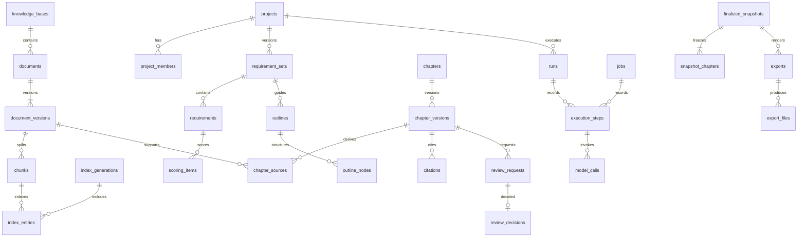

# 企业技术标写作 Harness Agent 数据库模型

版本：1.0.0；设计日期：2026-10-16。  
配套文档：[开发文档](./开发文档.md)、[API文档](./API文档.md)。  
本文件是待实施的模型与约束设计，含51张应用表；未运行迁移。框架检查点表单独管理。

## 1. 存储和通用字段

PostgreSQL app保存业务事实、正文、权限、版本与事件；harness保存图恢复状态；Milvus是可重建索引；SeaweedFS存不可变对象；Redis可重建且不承担唯一业务状态。

后续表标记字段包B或M，字段包也是每张表完整定义的一部分：

| 包 | 字段 | 类型 | 约束/默认 |
|---|---|---|---|
| B | id | uuid | PK DEFAULT gen_random_uuid() |
| B | org_id | uuid | NOT NULL FK organizations.id |
| B | created_at | timestamptz | NOT NULL DEFAULT now() |
| B | created_by | uuid | NULL FK users.id，系统可空 |
| M | B全部字段 | — | 继承 |
| M | updated_at | timestamptz | NOT NULL DEFAULT now()，每次修改更新 |
| M | lock_version | bigint | NOT NULL DEFAULT 1，CAS修改后+1 |
| none | 无公共字段 | — | organizations单独列出 |

所有org表加UNIQUE(org_id,id)，业务FK采用(org_id,foreign_id)复合引用。项目内引用再加(project_id,id)唯一/FK或明确事务校验。字段中“FK 表名”默认指该表id。除关联清理外ON DELETE RESTRICT。账号停用保留历史，不硬删被引用用户。

B表追加且不可变，M表也必须遵守版本内容不可改规则；允许变更的只是状态/指针或表说明中的字段。JSONB协议对象有schema_version，metadata及列表按固定用途校验。JSON数组默认[]，对象{}，SQL数组{}。日期UTC，费用numeric，hash为SHA-256小写十六进制。枚举用varchar+CHECK。删除使用显式deleted_at/revoked_at/status，不给所有表盲目加软删除。

## 2. 状态字典与关系

- **project_status**：draft / active / finalized / archived。
- **job_status**：queued / running / waiting_input / succeeded / failed / cancel_requested / cancelled。
- **run_status**：queued / running / waiting_review / waiting_input / succeeded / failed / cancel_requested / cancelled。
- **chapter_status**：empty / draft / in_review / approved / rejected / needs_review。
- **review_status**：pending / approved / rejected / stale。
- **document_status**：pending / processing / ready / needs_input / failed / deleted。
- **index_status**：building / ready / active / retired / failed。
- **export_status**：queued / running / ready / failed / revoked。



文档project/kb、步骤run/job是互斥关系，以CHECK约束实现。

## 3. 逐表字段字典

### 3.1 organizations — 企业实例

字段包：none。

| 字段 | PostgreSQL类型 | 必填/默认/引用 | 含义 |
|---|---|---|---|
| id | uuid | PK DEFAULT gen_random_uuid() | 企业ID |
| name | varchar(200) | NOT NULL | 名称 |
| acl_epoch | bigint | NOT NULL DEFAULT 1 | 全局权限版本 |
| created_at | timestamptz | NOT NULL DEFAULT now() | 创建时间 |

约束与索引：首期固定一企业，不提供租户切换API。

### 3.2 departments — 部门

字段包：M。

| 字段 | PostgreSQL类型 | 必填/默认/引用 | 含义 |
|---|---|---|---|
| name | varchar(100) | NOT NULL | 部门名 |
| parent_id | uuid | NULL FK departments | 上级 |
| status | varchar(16) | NOT NULL DEFAULT active | active/disabled |

约束与索引：UNIQUE NULLS NOT DISTINCT(org_id,parent_id,name)；父链不可成环。

### 3.3 users — 账号

字段包：M。

| 字段 | PostgreSQL类型 | 必填/默认/引用 | 含义 |
|---|---|---|---|
| username | varchar(100) | NOT NULL | 小写规范化登录名 |
| display_name | varchar(100) | NOT NULL | 姓名 |
| password_hash | text | NULL | Argon2id，外部身份可空 |
| department_id | uuid | NULL FK departments | 所属单部门 |
| status | varchar(16) | NOT NULL DEFAULT active | active/disabled |
| auth_version | bigint | NOT NULL DEFAULT 1 | 停用/改密递增 |
| external_identity | jsonb | NULL | issuer/subject预留 |

约束与索引：UNIQUE(org_id,username)；外部issuer/subject存在时唯一；用户停用同步增加acl_epoch。

### 3.4 roles — 组织角色

字段包：M。

| 字段 | PostgreSQL类型 | 必填/默认/引用 | 含义 |
|---|---|---|---|
| code | varchar(40) | NOT NULL | system_admin/knowledge_admin/user |
| name | varchar(100) | NOT NULL | 名称 |
| permissions | jsonb | NOT NULL DEFAULT [] | 固定权限码数组 |

约束与索引：UNIQUE(org_id,code)；只接受权限目录，无通配符。

### 3.5 user_roles — 角色分配

字段包：B。

| 字段 | PostgreSQL类型 | 必填/默认/引用 | 含义 |
|---|---|---|---|
| user_id | uuid | NOT NULL FK users | 账号 |
| role_id | uuid | NOT NULL FK roles | 角色 |

约束与索引：UNIQUE(org_id,user_id,role_id)；关联删除立即撤权。

### 3.6 auth_sessions — 刷新会话

字段包：M。

| 字段 | PostgreSQL类型 | 必填/默认/引用 | 含义 |
|---|---|---|---|
| user_id | uuid | NOT NULL FK users | 账号 |
| refresh_hash | char(64) | NOT NULL | 令牌SHA-256 |
| family_id | uuid | NOT NULL | 轮转族 |
| expires_at | timestamptz | NOT NULL | 绝对到期 |
| revoked_at | timestamptz | NULL | 撤销时间 |
| replaced_by | uuid | NULL FK auth_sessions | 新会话 |
| auth_version | bigint | NOT NULL | 签发版本 |

约束与索引：UNIQUE(refresh_hash)；INDEX(user_id,expires_at)；旧令牌重用撤销整族。

### 3.7 projects — 项目

字段包：M。

| 字段 | PostgreSQL类型 | 必填/默认/引用 | 含义 |
|---|---|---|---|
| name | varchar(200) | NOT NULL | 项目名 |
| industry | varchar(32) | NOT NULL | general/construction/it |
| status | varchar(20) | NOT NULL DEFAULT draft | project_status |
| owner_id | uuid | NOT NULL FK users | 负责人 |
| deadline | timestamptz | NULL | 截止时间 |
| active_requirement_set_id | uuid | NULL FK requirement_sets | 确认要求 |
| active_outline_id | uuid | NULL FK outlines | 确认大纲 |
| active_policy_id | uuid | NULL FK project_policies | 当前策略 |
| finalized_snapshot_id | uuid | NULL FK finalized_snapshots | 定稿 |

约束与索引：指针必须同项目；INDEX(org_id,status,created_at,id)；owner与成员关系同事务。

### 3.8 project_members — 项目成员

字段包：M。

| 字段 | PostgreSQL类型 | 必填/默认/引用 | 含义 |
|---|---|---|---|
| project_id | uuid | NOT NULL FK projects | 项目 |
| user_id | uuid | NOT NULL FK users | 用户 |
| role | varchar(20) | NOT NULL | owner/writer/reviewer/reader |
| status | varchar(16) | NOT NULL DEFAULT active | active/disabled |

约束与索引：UNIQUE(project_id,user_id)；一个active owner，与projects.owner_id一致。

### 3.9 model_profiles — 模型配置版本

字段包：M。

| 字段 | PostgreSQL类型 | 必填/默认/引用 | 含义 |
|---|---|---|---|
| logical_key | varchar(80) | NOT NULL | 配置系列 |
| version_no | integer | NOT NULL | 业务版本 |
| provider | varchar(80) | NOT NULL | 供应商 |
| model_name | varchar(200) | NOT NULL | 模型名 |
| revision | varchar(200) | NOT NULL | 权重/服务版本 |
| purpose | varchar(20) | NOT NULL | generation/embedding/rerank/ocr |
| is_cloud | boolean | NOT NULL DEFAULT false | 出网 |
| endpoint_ref | varchar(200) | NOT NULL | 受控地址引用 |
| secret_ref | varchar(200) | NULL | 秘密引用 |
| capabilities | jsonb | NOT NULL | 结构化输出/工具/context/dimension |
| price_snapshot | jsonb | NULL | 单价、币种与生效日 |
| enabled | boolean | NOT NULL DEFAULT true | 启用 |

约束与索引：UNIQUE(org_id,logical_key,version_no)；只允许原地启停，其余变化新增版本。

### 3.10 project_policies — 项目模型策略

字段包：B。

| 字段 | PostgreSQL类型 | 必填/默认/引用 | 含义 |
|---|---|---|---|
| project_id | uuid | NOT NULL FK projects | 项目 |
| version_no | integer | NOT NULL | 版本 |
| mode | varchar(24) | NOT NULL DEFAULT local_only | local_only/allowlisted_cloud |
| allowed_model_profile_ids | uuid[] | NOT NULL | 允许配置 |
| default_model_profile_id | uuid | NOT NULL FK model_profiles | 默认 |
| max_run_tokens | bigint | NOT NULL DEFAULT 300000 | 额度 |

约束与索引：UNIQUE(project_id,version_no)；default属于allowed，数组成员逐一校验外键/用途/启用状态。

### 3.11 knowledge_bases — 知识库

字段包：M。

| 字段 | PostgreSQL类型 | 必填/默认/引用 | 含义 |
|---|---|---|---|
| name | varchar(200) | NOT NULL | 名称 |
| description | text | NOT NULL DEFAULT '' | 描述 |
| active_generation_id | uuid | NULL FK index_generations | 活动索引代 |
| status | varchar(20) | NOT NULL DEFAULT active | active/archived |

约束与索引：UNIQUE(org_id,name)；active_generation属于本库。

### 3.12 project_knowledge_bases — 项目知识范围

字段包：B。

| 字段 | PostgreSQL类型 | 必填/默认/引用 | 含义 |
|---|---|---|---|
| project_id | uuid | NOT NULL FK projects | 项目 |
| kb_id | uuid | NOT NULL FK knowledge_bases | 知识库 |

约束与索引：UNIQUE(project_id,kb_id)；范围选择不产生授权。

### 3.13 resource_grants — 资料授权

字段包：B。

| 字段 | PostgreSQL类型 | 必填/默认/引用 | 含义 |
|---|---|---|---|
| kb_id | uuid | NULL FK knowledge_bases | 资源之一 |
| document_id | uuid | NULL FK documents | 资源之一 |
| principal_user_id | uuid | NULL FK users | 主体之一 |
| principal_department_id | uuid | NULL FK departments | 主体之一 |
| principal_project_id | uuid | NULL FK projects | 主体之一 |
| permission | varchar(16) | NOT NULL | read/manage |
| expires_at | timestamptz | NULL | 过期即撤销 |

约束与索引：资源二选一，主体三选一；UNIQUE NULLS NOT DISTINCT(org_id,所有资源/主体列,permission)；manage包含read。

### 3.14 files — 对象文件

字段包：M。

| 字段 | PostgreSQL类型 | 必填/默认/引用 | 含义 |
|---|---|---|---|
| project_id | uuid | NULL FK projects | 项目范围 |
| kb_id | uuid | NULL FK knowledge_bases | 知识范围 |
| purpose | varchar(20) | NOT NULL | source/template/export/derived_image |
| object_key | text | NOT NULL | 服务端不可变键 |
| original_name | varchar(255) | NOT NULL | 显示名 |
| media_type | varchar(120) | NOT NULL | 检测MIME |
| size_bytes | bigint | NOT NULL | 大小 |
| sha256 | char(64) | NOT NULL | 服务端hash |
| state | varchar(20) | NOT NULL | staged/ready/quarantined/deleted |
| deleted_at | timestamptz | NULL | 删除时间 |
| parent_file_id | uuid | NULL FK files | derived_image必填，指原件或模板；下载递归继承授权 |

约束与索引：UNIQUE(org_id,object_key)；source/export/derived_image恰一范围，template可组织级。derived_image只由解析/模板管线登记，继承来源授权。 parent_file_id同范围且无循环；derived_image不能脱离父文件授权。

### 3.15 upload_sessions — 上传会话

字段包：M。

| 字段 | PostgreSQL类型 | 必填/默认/引用 | 含义 |
|---|---|---|---|
| project_id | uuid | NULL FK projects | 项目 |
| kb_id | uuid | NULL FK knowledge_bases | 知识库 |
| purpose | varchar(20) | NOT NULL | source/template |
| filename | varchar(255) | NOT NULL | 文件名 |
| expected_size | bigint | NOT NULL | 1..200MiB |
| expected_sha256 | char(64) | NOT NULL | 声明hash |
| file_id | uuid | NULL FK files | 验证文件 |
| state | varchar(20) | NOT NULL DEFAULT initiated | initiated/uploaded/completed/expired/failed |
| expires_at | timestamptz | NOT NULL | 1小时到期 |

约束与索引：source恰一范围；创建者专用；完成操作只产生一个文档版本，临时对象24小时回收。

### 3.16 documents — 逻辑文档

字段包：M。

| 字段 | PostgreSQL类型 | 必填/默认/引用 | 含义 |
|---|---|---|---|
| project_id | uuid | NULL FK projects | 项目资料 |
| kb_id | uuid | NULL FK knowledge_bases | 企业资料 |
| title | varchar(300) | NOT NULL | 标题 |
| kind | varchar(30) | NOT NULL | tender/addendum/qualification/case/technical/reference |
| inherit_acl | boolean | NOT NULL DEFAULT true | 继承范围权限 |
| current_version_id | uuid | NULL FK document_versions | 当前版本 |
| classification | varchar(20) | NOT NULL DEFAULT confidential | internal/confidential/restricted |
| egress_policy | jsonb | NOT NULL | EgressPolicy |
| deleted_at | timestamptz | NULL | 即时停止服务 |

约束与索引：project/kb二选一；current_version属于本资料；INDEX(kb_id,deleted_at)。

### 3.17 document_versions — 不可变来源版本

字段包：M。

| 字段 | PostgreSQL类型 | 必填/默认/引用 | 含义 |
|---|---|---|---|
| document_id | uuid | NOT NULL FK documents | 逻辑文档 |
| file_id | uuid | NOT NULL FK files | 原件 |
| version_no | integer | NOT NULL | 递增版本 |
| status | varchar(20) | NOT NULL DEFAULT pending | document_status |
| parser_version | varchar(120) | NOT NULL | 解析器/配置 |
| content_hash | char(64) | NULL | 提取内容摘要 |
| page_count | integer | NULL | 页数 |
| valid_from | timestamptz | NULL | 生效 |
| valid_until | timestamptz | NULL | 失效 |
| extraction_report | jsonb | NOT NULL DEFAULT {} | 低置信度、修正映射、复核人及时间 |
| published_at | timestamptz | NULL | 发布时间 |

约束与索引：UNIQUE(document_id,version_no)；ready后内容/原件/解析器不可改，仅推进状态；纠正创建新版本。

### 3.18 chunks — 原文片段

字段包：B。

| 字段 | PostgreSQL类型 | 必填/默认/引用 | 含义 |
|---|---|---|---|
| document_version_id | uuid | NOT NULL FK document_versions | 版本 |
| ordinal | integer | NOT NULL | 顺序 |
| parent_chunk_id | uuid | NULL FK chunks | 同版本父块 |
| text | text | NOT NULL | ≤32768 UTF-8字节 |
| token_count | integer | NOT NULL | 向量模型计数 |
| content_hash | char(64) | NOT NULL | 摘要 |
| locator | jsonb | NOT NULL | Locator |
| heading_path | text[] | NOT NULL DEFAULT {} | 标题路径 |
| chunk_type | varchar(20) | NOT NULL | paragraph/table/fact |

约束与索引：UNIQUE(document_version_id,ordinal)；INDEX(document_version_id,content_hash)。

### 3.19 index_generations — 索引代

字段包：M。

| 字段 | PostgreSQL类型 | 必填/默认/引用 | 含义 |
|---|---|---|---|
| kb_id | uuid | NULL FK knowledge_bases | 知识范围 |
| project_id | uuid | NULL FK projects | 项目范围 |
| generation_no | integer | NOT NULL | 范围内版本 |
| collection_name | varchar(200) | NOT NULL | 物理集合名 |
| embedding_profile_id | uuid | NOT NULL FK model_profiles | 模型版本 |
| dimension | integer | NOT NULL DEFAULT 1024 | 维度 |
| analyzer_config | jsonb | NOT NULL | 中文分词配置 |
| index_config | jsonb | NOT NULL | 索引参数 |
| status | varchar(20) | NOT NULL DEFAULT building | index_status |
| manifest_hash | char(64) | NULL | 发布清单摘要 |

约束与索引：范围二选一，范围内generation_no唯一；UNIQUE(org_id,collection_name)，每范围至多一active。

### 3.20 index_entries — 索引登记

字段包：M。

| 字段 | PostgreSQL类型 | 必填/默认/引用 | 含义 |
|---|---|---|---|
| generation_id | uuid | NOT NULL FK index_generations | 索引代 |
| chunk_id | uuid | NOT NULL FK chunks | 片段 |
| vector_id | varchar(80) | NOT NULL | chunk UUID字符串 |
| status | varchar(20) | NOT NULL DEFAULT pending | pending/indexed/failed/deleted |
| indexed_hash | char(64) | NULL | 写入摘要 |
| last_error | jsonb | NULL | 错误 |

约束与索引：UNIQUE(generation_id,chunk_id)；INDEX(generation_id,status)；片段与索引范围匹配。

### 3.21 requirement_sets — 要求版本

字段包：M。

| 字段 | PostgreSQL类型 | 必填/默认/引用 | 含义 |
|---|---|---|---|
| project_id | uuid | NOT NULL FK projects | 项目 |
| version_no | integer | NOT NULL | 业务版本 |
| supersedes_id | uuid | NULL FK requirement_sets | 替代版本 |
| status | varchar(20) | NOT NULL DEFAULT draft | draft/analyzing/ready/confirmed/superseded/failed |
| content_hash | char(64) | NULL | 候选/确认摘要 |
| confirmed_by | uuid | NULL FK users | 确认人 |
| confirmed_at | timestamptz | NULL | 确认时间 |
| diff_summary | jsonb | NOT NULL DEFAULT {} | 补遗增删改与影响 |

约束与索引：UNIQUE(project_id,version_no)；至多一个confirmed；确认后条款不可改。

### 3.22 requirement_sources — 要求来源

字段包：B。

| 字段 | PostgreSQL类型 | 必填/默认/引用 | 含义 |
|---|---|---|---|
| requirement_set_id | uuid | NOT NULL FK requirement_sets | 要求集 |
| document_version_id | uuid | NOT NULL FK document_versions | 招标/补遗版本 |
| source_order | integer | NOT NULL | 顺序 |
| source_kind | varchar(20) | NOT NULL | base/addendum/clarification |

约束与索引：UNIQUE(requirement_set_id,document_version_id)；只引用同项目ready版本；文件顺序不自动决定冲突优先级。

### 3.23 requirements — 条款

字段包：M。

| 字段 | PostgreSQL类型 | 必填/默认/引用 | 含义 |
|---|---|---|---|
| requirement_set_id | uuid | NOT NULL FK requirement_sets | 要求集 |
| logical_key | uuid | NOT NULL | 跨版本对齐 |
| code | varchar(80) | NOT NULL | 编号 |
| text | text | NOT NULL | 原文/确认表述 |
| category | varchar(30) | NOT NULL | functional/technical/delivery/format/qualification/other |
| scope | varchar(20) | NOT NULL | technical/out_of_scope/needs_human |
| mandatory | boolean | NOT NULL DEFAULT false | 强制 |
| source_chunk_id | uuid | NOT NULL FK chunks | 出处 |
| locator | jsonb | NOT NULL | 精确定位 |
| clarification | text | NULL | 解释与歧义 |

约束与索引：UNIQUE(requirement_set_id,logical_key)、UNIQUE(requirement_set_id,code)；出处必须属于来源清单。

### 3.24 scoring_items — 评分项

字段包：M。

| 字段 | PostgreSQL类型 | 必填/默认/引用 | 含义 |
|---|---|---|---|
| requirement_set_id | uuid | NOT NULL FK requirement_sets | 要求版本 |
| requirement_id | uuid | NOT NULL FK requirements | 条款 |
| title | varchar(300) | NOT NULL | 名称 |
| max_score | numeric(10,2) | NULL | 未知为空 |
| criteria | jsonb | NOT NULL | 分档条件 |
| source_chunk_id | uuid | NOT NULL FK chunks | 出处 |

约束与索引：max_score非空时≥0；条款及出处属于本要求集。

### 3.25 templates — 模板系列

字段包：M。

| 字段 | PostgreSQL类型 | 必填/默认/引用 | 含义 |
|---|---|---|---|
| code | varchar(80) | NOT NULL | 系列码 |
| name | varchar(200) | NOT NULL | 名称 |
| industry | varchar(32) | NOT NULL | general/construction/it |
| active_version_id | uuid | NULL FK template_versions | 发布版本 |

约束与索引：UNIQUE(org_id,code)；仅管理员可发布验收通过版本。

### 3.26 template_versions — 模板版本

字段包：B。

| 字段 | PostgreSQL类型 | 必填/默认/引用 | 含义 |
|---|---|---|---|
| template_id | uuid | NOT NULL FK templates | 系列 |
| version_no | integer | NOT NULL | 业务版本 |
| file_id | uuid | NOT NULL FK files | 受控DOCX |
| manifest | jsonb | NOT NULL | TemplateManifest及校验报告摘要 |
| content_hash | char(64) | NOT NULL | 模板和manifest摘要 |

约束与索引：UNIQUE(template_id,version_no)；文件不可变，发布须有渲染验收。

### 3.27 outlines — 大纲版本

字段包：M。

| 字段 | PostgreSQL类型 | 必填/默认/引用 | 含义 |
|---|---|---|---|
| project_id | uuid | NOT NULL FK projects | 项目 |
| requirement_set_id | uuid | NOT NULL FK requirement_sets | 确认要求 |
| template_version_id | uuid | NOT NULL FK template_versions | 模板 |
| version_no | integer | NOT NULL | 业务版本 |
| status | varchar(20) | NOT NULL DEFAULT draft | draft/ready/confirmed/superseded |
| content_hash | char(64) | NULL | 摘要 |
| confirmed_by | uuid | NULL FK users | 确认人 |
| confirmed_at | timestamptz | NULL | 时间 |

约束与索引：UNIQUE(project_id,version_no)；确认基于当前要求，确认后节点不可改。

### 3.28 outline_nodes — 大纲节点

字段包：M。

| 字段 | PostgreSQL类型 | 必填/默认/引用 | 含义 |
|---|---|---|---|
| outline_id | uuid | NOT NULL FK outlines | 大纲 |
| parent_id | uuid | NULL FK outline_nodes | 同大纲父节点 |
| chapter_id | uuid | NULL FK chapters | 确认时稳定章节 |
| position | integer | NOT NULL | 同级顺序 |
| title | varchar(300) | NOT NULL | 标题 |
| target_words | integer | NOT NULL DEFAULT 3000 | 100..20000中文字符 |
| requirement_ids | uuid[] | NOT NULL DEFAULT {} | 要求关联 |
| instructions | text | NOT NULL DEFAULT '' | 目标 |

约束与索引：同父节点position唯一且无环；叶节点对应章节；同outline/chapter不重复；要求ID属于大纲要求集。

### 3.29 chapters — 章节工作区

字段包：M。

| 字段 | PostgreSQL类型 | 必填/默认/引用 | 含义 |
|---|---|---|---|
| project_id | uuid | NOT NULL FK projects | 项目 |
| logical_key | uuid | NOT NULL | 稳定标识 |
| title | varchar(300) | NOT NULL | 当前标题 |
| position | integer | NOT NULL | 展开顺序 |
| status | varchar(20) | NOT NULL DEFAULT empty | chapter_status |
| current_version_id | uuid | NULL FK chapter_versions | 当前正文 |
| is_active | boolean | NOT NULL DEFAULT true | 属于当前大纲 |

约束与索引：UNIQUE(project_id,logical_key)；active position项目内唯一；指针只指本章。

### 3.30 chapter_versions — 正文版本

字段包：B。

| 字段 | PostgreSQL类型 | 必填/默认/引用 | 含义 |
|---|---|---|---|
| chapter_id | uuid | NOT NULL FK chapters | 章节 |
| version_no | integer | NOT NULL | 业务版本 |
| requirement_set_id | uuid | NOT NULL FK requirement_sets | 要求快照 |
| outline_node_id | uuid | NOT NULL FK outline_nodes | 大纲快照 |
| parent_version_id | uuid | NULL FK chapter_versions | 历史修订链 |
| run_id | uuid | NULL FK runs | 生成来源 |
| author_kind | varchar(16) | NOT NULL | human/agent |
| submitted_by | uuid | NOT NULL FK users | 业务提交人 |
| content | jsonb | NOT NULL | ContentDocument |
| content_hash | char(64) | NOT NULL | 正文及来源摘要 |
| dependency_hash | char(64) | NOT NULL | 前置章及输入摘要 |
| classification | varchar(20) | NOT NULL | 最高来源密级 |

约束与索引：UNIQUE(chapter_id,version_no)；正文/引用/来源原子写入且不可变；parent仅表示历史关联，不必然当作模型输入。

### 3.31 chapter_sources — 完整来源谱系

字段包：B。

| 字段 | PostgreSQL类型 | 必填/默认/引用 | 含义 |
|---|---|---|---|
| chapter_version_id | uuid | NOT NULL FK chapter_versions | 正文 |
| document_version_id | uuid | NOT NULL FK document_versions | 实际输入来源 |
| usage | varchar(20) | NOT NULL | context/citation/upstream/requirement |

约束与索引：UNIQUE(chapter_version_id,document_version_id,usage)；包含上游摘要传递来源，不能靠删引用解除权限。

### 3.32 citations — 句段引用

字段包：B。

| 字段 | PostgreSQL类型 | 必填/默认/引用 | 含义 |
|---|---|---|---|
| chapter_version_id | uuid | NOT NULL FK chapter_versions | 正文 |
| chunk_id | uuid | NOT NULL FK chunks | 证据 |
| block_id | varchar(80) | NOT NULL | 正文块 |
| span_start | integer | NOT NULL DEFAULT 0 | Unicode码点起点 |
| span_end | integer | NOT NULL | 半开区间终点 |
| quote_text | text | NOT NULL | 原文摘录 |
| quote_hash | char(64) | NOT NULL | 摘录hash |
| usage_kind | varchar(20) | NOT NULL | fact/reference/requirement/proposal |
| verification | varchar(20) | NOT NULL | unverified/supported/unsupported |

约束与索引：span_end>start且不越界；来源在chapter_sources，摘录可在指定版本定位。

### 3.33 response_mappings — 逐条响应

字段包：M。

| 字段 | PostgreSQL类型 | 必填/默认/引用 | 含义 |
|---|---|---|---|
| requirement_id | uuid | NOT NULL FK requirements | 条款 |
| chapter_version_id | uuid | NULL FK chapter_versions | 正文 |
| status | varchar(20) | NOT NULL | covered/partial/missing/not_applicable |
| response_summary | text | NOT NULL DEFAULT '' | 响应说明 |
| citation_ids | uuid[] | NOT NULL DEFAULT {} | 证据 |
| reason | text | NULL | 缺失或不适用理由 |

约束与索引：UNIQUE NULLS NOT DISTINCT(requirement_id,chapter_version_id)；同项目/要求版本；missing可无章节；not_applicable须owner确认范围。

### 3.34 review_requests — 审核请求

字段包：M。

| 字段 | PostgreSQL类型 | 必填/默认/引用 | 含义 |
|---|---|---|---|
| project_id | uuid | NOT NULL FK projects | 项目 |
| run_id | uuid | NULL FK runs | 待恢复运行 |
| chapter_version_id | uuid | NOT NULL FK chapter_versions | 目标版本 |
| submitted_by | uuid | NOT NULL FK users | 提交人 |
| assigned_to | uuid | NULL FK users | 指定审核人 |
| requirement_set_id | uuid | NOT NULL FK requirement_sets | 要求快照 |
| outline_id | uuid | NOT NULL FK outlines | 大纲快照 |
| dependency_hash | char(64) | NOT NULL | 前置依赖 |
| status | varchar(16) | NOT NULL DEFAULT pending | review_status |

约束与索引：同chapter_version至多一pending；所有快照仍当前才可审批，禁止submitted_by自审。

### 3.35 review_decisions — 审核决定

字段包：B。

| 字段 | PostgreSQL类型 | 必填/默认/引用 | 含义 |
|---|---|---|---|
| review_id | uuid | NOT NULL FK review_requests | 审核 |
| reviewer_id | uuid | NOT NULL FK users | 审核人 |
| decision | varchar(16) | NOT NULL | approved/rejected |
| comment | text | NOT NULL | 意见 |
| version_hash | char(64) | NOT NULL | 所见正文摘要 |

约束与索引：UNIQUE(review_id)；不可改，审核失效仅标request=stale，不删除历史决定。

### 3.36 checks — 检查批次

字段包：M。

| 字段 | PostgreSQL类型 | 必填/默认/引用 | 含义 |
|---|---|---|---|
| project_id | uuid | NOT NULL FK projects | 项目 |
| chapter_version_id | uuid | NULL FK chapter_versions | 空为全文 |
| job_id | uuid | NOT NULL FK jobs | 执行任务 |
| snapshot_hash | char(64) | NOT NULL | 输入快照 |
| rules_version | varchar(80) | NOT NULL | 规则集 |
| status | varchar(20) | NOT NULL DEFAULT queued | queued/running/completed/failed/stale |
| summary | jsonb | NOT NULL DEFAULT {} | 计数和覆盖率 |

约束与索引：INDEX(project_id,created_at,id)；输入不再当前则stale。

### 3.37 check_findings — 检查问题

字段包：B。

| 字段 | PostgreSQL类型 | 必填/默认/引用 | 含义 |
|---|---|---|---|
| check_id | uuid | NOT NULL FK checks | 检查 |
| severity | varchar(16) | NOT NULL | blocker/warning/info |
| code | varchar(80) | NOT NULL | 稳定规则码 |
| message | text | NOT NULL | 说明 |
| requirement_id | uuid | NULL FK requirements | 条款 |
| chapter_version_id | uuid | NULL FK chapter_versions | 章节 |
| evidence | jsonb | NOT NULL DEFAULT {} | 定位及method=rule/model |

约束与索引：问题不可变；模型发现和确定性事实明确区分。

### 3.38 finding_resolutions — 问题处置

字段包：B。

| 字段 | PostgreSQL类型 | 必填/默认/引用 | 含义 |
|---|---|---|---|
| finding_id | uuid | NOT NULL FK check_findings | 问题 |
| action | varchar(24) | NOT NULL | accepted_warning/fixed |
| note | text | NOT NULL | 理由 |
| replacement_check_id | uuid | NULL FK checks | 修复后的新检查 |

约束与索引：UNIQUE(finding_id)；blocker只可fixed并指向已完成的新检查；warning仅reviewer可接受。

### 3.39 finalized_snapshots — 定稿快照

字段包：M。

| 字段 | PostgreSQL类型 | 必填/默认/引用 | 含义 |
|---|---|---|---|
| project_id | uuid | NOT NULL FK projects | 项目 |
| requirement_set_id | uuid | NOT NULL FK requirement_sets | 要求 |
| outline_id | uuid | NOT NULL FK outlines | 大纲 |
| check_id | uuid | NOT NULL FK checks | 有效全文检查 |
| template_version_id | uuid | NOT NULL FK template_versions | 模板 |
| snapshot_hash | char(64) | NOT NULL | 内容/来源/批准/模板摘要 |
| finalized_by | uuid | NOT NULL FK users | 负责人 |
| revoked_at | timestamptz | NULL | 撤销 |
| revoke_reason | text | NULL | 原因 |

约束与索引：INDEX(project_id,snapshot_hash)；同内容可形成新的定稿实例，旧撤销记录保留；重复请求由HTTP幂等及项目当前定稿检查去重。除撤销字段外不可变。

### 3.40 snapshot_chapters — 定稿章节

字段包：B。

| 字段 | PostgreSQL类型 | 必填/默认/引用 | 含义 |
|---|---|---|---|
| snapshot_id | uuid | NOT NULL FK finalized_snapshots | 快照 |
| chapter_version_id | uuid | NOT NULL FK chapter_versions | 正文 |
| review_decision_id | uuid | NOT NULL FK review_decisions | 批准决定 |
| position | integer | NOT NULL | 顺序 |

约束与索引：UNIQUE(snapshot_id,position)、UNIQUE(snapshot_id,chapter_version_id)；决定批准本版本。

### 3.41 runs — Agent运行

字段包：M。

| 字段 | PostgreSQL类型 | 必填/默认/引用 | 含义 |
|---|---|---|---|
| project_id | uuid | NOT NULL FK projects | 项目 |
| actor_user_id | uuid | NOT NULL FK users | 当前授权主体 |
| status | varchar(24) | NOT NULL DEFAULT queued | run_status |
| wait_reason | varchar(80) | NULL | revision_required/evidence_missing/input_changed/policy_changed/budget_exceeded |
| current_chapter_id | uuid | NULL FK chapters | 当前章 |
| workflow_version | varchar(80) | NOT NULL | 固定图版本 |
| thread_id | varchar(100) | NOT NULL | run UUID字符串 |
| input_snapshot | jsonb | NOT NULL | InputSnapshot |
| dispatch_no | integer | NOT NULL DEFAULT 1 | 调度号 |
| lease_owner | varchar(100) | NULL | Worker |
| lease_epoch | bigint | NOT NULL DEFAULT 0 | fencing序号 |
| lease_expires_at | timestamptz | NULL | 租约到期 |
| heartbeat_at | timestamptz | NULL | 心跳 |
| budget_tokens | bigint | NOT NULL DEFAULT 300000 | 额度 |
| spent_tokens | bigint | NOT NULL DEFAULT 0 | 已确认消耗 |
| reserved_tokens | bigint | NOT NULL DEFAULT 0 | 在途/未知预留 |
| active_ms | bigint | NOT NULL DEFAULT 0 | 活动耗时 |
| error | jsonb | NULL | ErrorDetail |
| last_event_seq | bigint | NOT NULL DEFAULT 0 | 持久事件高水位，清理事件不重置 |

约束与索引：UNIQUE(org_id,thread_id)；每project至多一非终态run；budget/spent/reserved非负；failed仅retryable且无新活动run才可重启。

### 3.42 jobs — 通用任务

字段包：M。

| 字段 | PostgreSQL类型 | 必填/默认/引用 | 含义 |
|---|---|---|---|
| project_id | uuid | NULL FK projects | 项目范围 |
| kb_id | uuid | NULL FK knowledge_bases | 知识范围 |
| actor_user_id | uuid | NOT NULL FK users | 授权主体 |
| kind | varchar(30) | NOT NULL | ingest/index_build/analyze/outline/check/export |
| status | varchar(24) | NOT NULL DEFAULT queued | job_status |
| target_id | uuid | NOT NULL | 多态目标 |
| input_snapshot | jsonb | NOT NULL | 固定输入 |
| progress | integer | NOT NULL DEFAULT 0 | 0..100 |
| attempt | integer | NOT NULL DEFAULT 0 | 最多5次 |
| lease_owner | varchar(100) | NULL | Worker |
| lease_epoch | bigint | NOT NULL DEFAULT 0 | 租约序号 |
| lease_expires_at | timestamptz | NULL | 到期 |
| budget_tokens | bigint | NOT NULL DEFAULT 100000 | 任务额度 |
| spent_tokens | bigint | NOT NULL DEFAULT 0 | 消耗 |
| reserved_tokens | bigint | NOT NULL DEFAULT 0 | 预留 |
| error | jsonb | NULL | ErrorDetail |

约束与索引：project/kb二选一；target映射ingest→document_versions/index_build→index_generations/analyze→requirement_sets/outline→outlines/check→checks/export→exports；逻辑外键由事务校验及巡检，不声称数据库自动保证。INDEX(status,lease_expires_at)。

### 3.43 execution_steps — 执行步骤账本

字段包：M。

| 字段 | PostgreSQL类型 | 必填/默认/引用 | 含义 |
|---|---|---|---|
| run_id | uuid | NULL FK runs | 运行 |
| job_id | uuid | NULL FK jobs | 任务 |
| step_key | varchar(300) | NOT NULL | 稳定业务键 |
| node_name | varchar(80) | NOT NULL | 阶段 |
| input_hash | char(64) | NOT NULL | 输入hash |
| iteration | integer | NOT NULL DEFAULT 0 | 持久化循环号 |
| state | varchar(20) | NOT NULL DEFAULT prepared | prepared/running/committed/failed |
| attempt | integer | NOT NULL DEFAULT 0 | 尝试数 |
| lease_epoch | bigint | NOT NULL | 执行租约 |
| result_ref | jsonb | NULL | 领域结果ID/hash |
| error | jsonb | NULL | 错误 |

约束与索引：run/job二选一；UNIQUE(org_id,step_key)；只复用committed结果。

### 3.44 tool_calls — 工具调用

字段包：M。

| 字段 | PostgreSQL类型 | 必填/默认/引用 | 含义 |
|---|---|---|---|
| step_id | uuid | NOT NULL FK execution_steps | 步骤 |
| call_index | integer | NOT NULL | 逻辑顺序 |
| attempt | integer | NOT NULL | 尝试 |
| name | varchar(80) | NOT NULL | 工具名 |
| tool_version | varchar(80) | NOT NULL | 版本 |
| input_hash | char(64) | NOT NULL | 摘要 |
| arguments | jsonb | NOT NULL | 业务参数，禁止凭证 |
| status | varchar(20) | NOT NULL | prepared/running/succeeded/failed |
| result_ref | jsonb | NULL | 结果/证据 |
| duration_ms | bigint | NULL | 耗时 |

约束与索引：UNIQUE(step_id,call_index,attempt)；完整参数为受限内容，公共审计不返回原文。

### 3.45 model_calls — 模型调用及费用

字段包：M。

| 字段 | PostgreSQL类型 | 必填/默认/引用 | 含义 |
|---|---|---|---|
| run_id | uuid | NULL FK runs | 运行 |
| job_id | uuid | NULL FK jobs | 任务 |
| step_id | uuid | NOT NULL FK execution_steps | 步骤 |
| profile_id | uuid | NOT NULL FK model_profiles | 模型版本 |
| call_key | varchar(300) | NOT NULL | 逻辑请求+尝试唯一键 |
| provider_request_id | varchar(200) | NULL | 外部请求ID |
| status | varchar(20) | NOT NULL | reserved/succeeded/failed/unknown |
| input_hash | char(64) | NOT NULL | 发送摘要 |
| authorized_acl_epoch | bigint | NOT NULL | 最后授权版本 |
| reserved_tokens | bigint | NOT NULL | 预留 |
| input_tokens | bigint | NULL | 实际输入 |
| output_tokens | bigint | NULL | 实际输出 |
| usage_extra | jsonb | NOT NULL DEFAULT {} | 缓存等用量 |
| cost_amount | numeric(18,6) | NULL | 未知不填0 |
| currency | varchar(8) | NULL | 币种 |
| price_snapshot | jsonb | NULL | 计价版本 |
| settled_at | timestamptz | NULL | 结算CAS字段 |

约束与索引：run/job二选一；UNIQUE(org_id,call_key)；结算只执行一次，unknown保留额度；不保存隐藏推理。

### 3.46 run_events — 可重放事件

字段包：B。

| 字段 | PostgreSQL类型 | 必填/默认/引用 | 含义 |
|---|---|---|---|
| run_id | uuid | NOT NULL FK runs | 运行 |
| seq | bigint | NOT NULL | run内单调序号 |
| event_type | varchar(80) | NOT NULL | 事件名 |
| data | jsonb | NOT NULL | 进度/资源ID/状态，不含正文 |

约束与索引：UNIQUE(run_id,seq)；持run锁分配序号，和业务同事务提交；保留30天。

### 3.47 outbox_events — 可靠投递

字段包：M。

| 字段 | PostgreSQL类型 | 必填/默认/引用 | 含义 |
|---|---|---|---|
| aggregate_type | varchar(40) | NOT NULL | 聚合类型 |
| aggregate_id | uuid | NOT NULL | 逻辑外键 |
| event_type | varchar(80) | NOT NULL | dispatch/resume/index_delete等 |
| dedupe_key | varchar(300) | NOT NULL | 业务唯一键 |
| payload | jsonb | NOT NULL | ID/版本/调度号 |
| available_at | timestamptz | NOT NULL DEFAULT now() | 最早投递 |
| claimed_until | timestamptz | NULL | 领取租约 |
| attempt | integer | NOT NULL DEFAULT 0 | 发布尝试 |
| published_at | timestamptz | NULL | 发布完成 |
| last_error | text | NULL | 脱敏错误 |

约束与索引：UNIQUE(org_id,dedupe_key)；部分INDEX(available_at) WHERE published_at IS NULL；发布不代表业务完成。

### 3.48 idempotency_keys — HTTP幂等

字段包：M。

| 字段 | PostgreSQL类型 | 必填/默认/引用 | 含义 |
|---|---|---|---|
| user_id | uuid | NOT NULL FK users | 调用者 |
| route_key | varchar(300) | NOT NULL | 方法+实际资源路径 |
| key | varchar(128) | NOT NULL | 幂等键 |
| request_hash | char(64) | NOT NULL | 规范请求hash |
| state | varchar(16) | NOT NULL | processing/completed |
| response_status | integer | NULL | 原状态 |
| response_body | jsonb | NULL | 原响应资源ID，不含文件正文 |
| expires_at | timestamptz | NOT NULL | 7天 |

约束与索引：UNIQUE(org_id,user_id,route_key,key)；业务和响应缓存同事务；重放前重新授权。

### 3.49 exports — 导出申请

字段包：M。

| 字段 | PostgreSQL类型 | 必填/默认/引用 | 含义 |
|---|---|---|---|
| project_id | uuid | NOT NULL FK projects | 项目 |
| snapshot_id | uuid | NULL FK finalized_snapshots | 正式定稿 |
| mode | varchar(16) | NOT NULL | draft/final |
| formats | text[] | NOT NULL | docx/pdf |
| input_manifest | jsonb | NOT NULL | 版本/来源/模板/字体/渲染器 |
| snapshot_hash | char(64) | NOT NULL | 输入hash |
| status | varchar(20) | NOT NULL DEFAULT queued | export_status |
| job_id | uuid | NOT NULL FK jobs | 任务 |
| revoked_at | timestamptz | NULL | 失效 |
| error | jsonb | NULL | 错误 |

约束与索引：final须有效snapshot，draft为空且带水印；全格式成功一起ready；源变更则revoked。

### 3.50 export_files — 导出文件

字段包：B。

| 字段 | PostgreSQL类型 | 必填/默认/引用 | 含义 |
|---|---|---|---|
| export_id | uuid | NOT NULL FK exports | 申请 |
| file_id | uuid | NOT NULL FK files | 对象 |
| format | varchar(20) | NOT NULL | docx/pdf/evidence_manifest |

约束与索引：UNIQUE(export_id,format)；下载重新校验所有来源。

### 3.51 audit_logs — 操作审计

字段包：B。

| 字段 | PostgreSQL类型 | 必填/默认/引用 | 含义 |
|---|---|---|---|
| actor_user_id | uuid | NULL FK users | 用户/系统 |
| action | varchar(100) | NOT NULL | 稳定动作 |
| resource_type | varchar(80) | NOT NULL | 对象类型 |
| resource_id | uuid | NULL | 对象ID |
| project_id | uuid | NULL FK projects | 范围 |
| request_id | varchar(100) | NULL | HTTP关联 |
| run_id | uuid | NULL FK runs | 运行 |
| result | varchar(20) | NOT NULL | allowed/denied/succeeded/failed |
| before_hash | char(64) | NULL | 变更前 |
| after_hash | char(64) | NULL | 变更后 |
| metadata | jsonb | NOT NULL DEFAULT {} | 脱敏理由和trace_id |

约束与索引：应用账号只INSERT/按范围SELECT；INDEX(project_id,created_at,id)、INDEX(actor_user_id,created_at)，保留365天。


## 4. 事务、访问和迁移

### 4.1 关键约束示例

```sql
CREATE UNIQUE INDEX uq_project_active_run ON app.runs(project_id)
WHERE status IN ('queued','running','waiting_review','waiting_input','cancel_requested');
CREATE UNIQUE INDEX uq_pending_review ON app.review_requests(chapter_version_id)
WHERE status='pending';
ALTER TABLE app.documents ADD CONSTRAINT ck_document_scope
CHECK (num_nonnulls(project_id,kb_id)=1);
ALTER TABLE app.execution_steps ADD CONSTRAINT ck_step_owner
CHECK (num_nonnulls(run_id,job_id)=1);
CREATE UNIQUE INDEX uq_step ON app.execution_steps(org_id,step_key);
CREATE UNIQUE INDEX uq_run_seq ON app.run_events(run_id,seq);
CREATE INDEX ix_outbox_ready ON app.outbox_events(available_at)
WHERE published_at IS NULL;
```

这些不是完整建库DDL；第3节所有约束均须迁移实现。循环引用（项目指针、章节版本、检查/导出与job）先建表再加FK，同事务使用DEFERRABLE INITIALLY DEFERRED；禁止永久关闭FK。生产大索引用并发创建，置于Alembic事务外块。

### 4.2 原子事务和锁顺序

| 用例 | 校验/锁 | 同一事务提交 |
|---|---|---|
| 创建run | 项目版本、权限、active run唯一 | run、幂等响应、Outbox、事件、审计 |
| 领取执行 | 组织配额锁、run/job锁、dispatch和lease | epoch+1、owner、租约；全局≤20 |
| 提交正文 | project→chapter→run；版本及epoch | 步骤committed、正文、来源、引用、响应映射、工作区指针、事件 |
| 审核 | project→chapter→run→review；非自审、快照当前 | 不可变决定、状态、resume Outbox和事件 |
| 编辑 | project→chapter；If-Match | 新版本、旧审核stale、后续章needs_review、run等待、定稿撤销 |
| 补遗确认 | 项目锁、要求版本CAS | 新active要求、差异影响、失效审核/定稿、暂停run |
| 撤权 | organization→资源 | grant变更、acl_epoch+1、清理Outbox、审计 |
| 模型预留 | run/job锁，spent+reserved≤budget | model_call和父额度 |
| 模型结算 | run/job→call；settled_at CAS | actual用量、费用、预留扣减，一次结算 |
| 定稿 | project→按顺序章节 | 重验批准/检查/证据，snapshot和章节清单 |
| 导出发布 | project→export；快照仍有效 | files、export_files、ready、job完成 |

要求/评分项或大纲节点的候选变动，须同事务重算父聚合content_hash并增加父lock_version；避免子项变化而确认仍使用旧摘要。响应矩阵改变同步使全文检查和项目内容快照失效。

全局锁顺序organization（仅配额/ACL时）→project→按ID排序chapter→run/job→其他资源。Saver只锁run，不再倒序锁project。死锁重试仅重做DB事务，不能顺带重放模型请求。对象写入、Milvus和网络请求在事务外，以预分配ID、不可变对象和账本补偿。

HTTP幂等的processing插入和业务完成在同一事务，失败整体回滚；唯一键并发等待1秒后返回IDEMPOTENCY_IN_PROGRESS，不制造独立悬挂状态。过7天记录可清理，但业务自然唯一约束长期存在。

业务结果先提交，checkpoint后保存；恢复根据step_key复用已提交结果。Saver写checkpoint前在同事务锁run并验证epoch，避免旧Worker污染。框架harness表由固定版本库的迁移维护，不手工仿造其内部schema。thread_id=run UUID；namespace包含输入快照hash及章节ID。公开API不接受checkpoint状态。

### 4.3 授权与失效

知识库读取要求用户/部门/当前项目的read或manage grant；项目上下文还须项目成员并选择该知识库。inherit_acl=false的文档还需document grant。项目资料默认继承项目成员，restricted资料需明确文档授权。project主体grant只对当前项目生效，不能让用户带到别的项目。

正文、摘要、检查和导出按chapter_sources传递闭包重验。系统管理员无默认内容读取权。撤权/删除事务通过最新ACL epoch和tombstone立即阻断；异步扫描标记依赖状态可稍后完成，但对外读取不能等扫描完成才限制。

PostgreSQL org RLS为额外防线，runtime无BYPASSRLS且非表owner；事务绑定SET LOCAL企业/用户上下文。部门/项目隔离由统一授权查询器实施，不能只靠单企业org RLS。[PostgreSQL行安全](https://www.postgresql.org/docs/17/ddl-rowsecurity.html)。

被定稿/审核引用的资料普通删除只tombstone，不级联删历史。资料过期仅允许授权审计读取，不能继续作为当前事实。恢复备份后应用最新删除/撤权清单。

### 4.4 查询、迁移与保留

列表索引(org_id,project_id,created_at,id)，文档版本(document_id,version_no DESC)，审核(project_id,status,created_at)，恢复(status,lease_expires_at)，索引补偿(generation_id,status)。分页用游标，不用大offset。JSONB只给真实查询建立表达式索引，不全量GIN。

首期不强制分区；事件/审计/用量达1000万行后单独设计按月迁移，处理全局唯一约束限制，不能声称普通分区主键天然全局唯一。迁移expand→双读兼容→分批回填→校验→约束→切写→旧run退出后contract。app/harness迁移版本分别记录，启动时不由多副本并发迁移。

保留SSE30天、结束run checkpoint90天、审核/审计至少365天、项目资料归档后365天再申请清理。被活动任务引用的数据延长保留；法律保留标记优先。checkpoint清理后返回CHECKPOINT_EXPIRED，不假称能原点恢复。

## 5. Milvus物理模型

### 5.1 集合与字段

每知识库或项目资料范围一个活动Collection，命名kb_<uuid>_g<n>或project_<uuid>_g<n>，并监控集合加载成本。每代固定模型revision/dimension/chunker/analyzer/index配置，变化建新代。PG存活动指针，检索使用明确物理集合名，不依赖跨库原子alias切换。

| 字段 | Milvus类型 | 约束/用途 |
|---|---|---|
| vector_id | VARCHAR(80) | PK，auto_id=false，chunk UUID字符串 |
| org_id/scope_id | VARCHAR(36) | 企业和当前范围 |
| document_id/document_version_id/chunk_id | VARCHAR(36) | 精确来源 |
| generation_id | VARCHAR(36) | 索引代 |
| classification | VARCHAR(20) | 辅助密级，PG为准 |
| valid_until_epoch | INT64 | 无到期为0 |
| content_hash | VARCHAR(64) | 对账 |
| text | VARCHAR(32768) | UTF-8字节限制，启用analyzer |
| dense_vector | FLOAT_VECTOR dim=1024 | 归一化BGE-M3 |
| sparse_vector | SPARSE_FLOAT_VECTOR | BM25函数生成 |

禁用dynamic_field。text analyzer_params={"type":"chinese"}，用中文标准编号、专有名词及中英混排回归。[中文分析器](https://milvus.io/docs/chinese-analyzer.md)。BM25从text生成sparse_vector，不能把BGE-M3的另一种sparse输出写入同字段。[全文检索](https://milvus.io/docs/full-text-search.md)。

| 索引 | 参数 |
|---|---|
| dense | HNSW，COSINE，M=16，efConstruction=200；查询ef=128、Top50 |
| sparse | SPARSE_INVERTED_INDEX，BM25；Top50，固定版本默认检索算法 |
| document_version_id/org_id/scope_id | INVERTED标量索引 |

查询两路完全相同的授权版本白名单，每批500ID，最多4批并发；RRF k=60合并后重排40、上下文12。索引发布与首期查询使用Strong consistency；这只保证Milvus内部可见性，不代表跨存储事务。[Milvus一致性](https://milvus.io/docs/consistency.md)。

### 5.2 发布和重建

PG写processing+chunks+pending entries→256条批量upsert→Strong核对ID/hash→PG切ready/current。失败版本不开放，旧版继续服务；取消解析标failed并记录CANCELLED_BY_USER，旧当前版不受影响。向量主键幂等，重试不新增重复片段。

删除先PG阻断再异步清向量。每小时对账missing/stale/orphan。新generation先冻结输入清单和水位，构建期间增量通过Outbox补齐，切换时短暂锁范围发布并追平，再验证质量和权限。旧代留7天；活动run引用时延长，检索仍重查当前来源状态。

Milvus丢失可由PG文本/模型重建；S3原件、filer元数据及PG必须一起备份，不能只备向量。100万片段需测量TOAST/索引/两代空间，不按原始dense大小直接定容量。

## 6. JSONB协议与内容模型

| 协议 | 固定字段 |
|---|---|
| InputSnapshot v1 | schema_version、requirement_set_id、outline_id、template_version_id、policy_id、generation_ids、profile_ids、approved_chapters、acl_epoch、content_snapshot_hash |
| ContentDocument v1 | schema_version、blocks；每块唯一block_id，paragraph/heading/list/table/image_ref |
| Locator v1 | schema_version、format及PDF页码/bbox，DOCX段落/表格，XLSX sheet/cell_range |
| EgressPolicy v1 | schema_version、mode=local_only/cloud_allowlist、provider_ids |
| Capabilities v1 | schema_version、structured_output、tool_call、context_window；embedding加dimension |
| TemplateManifest v1 | schema_version、slots、styles、numbering、page_setup、citation_appendix、font_bundle_hash、validation |
| ErrorDetail v1 | schema_version、code、message、retryable、stage |
| ExportManifest v1 | schema_version、chapter_version_ids、source_version_ids、template_version_id、font_bundle_hash、render_engine_version、mode |

这些schema用同一Pydantic定义校验；不兼容改动升级schema_version。其他metadata按表契约验证，不允许任意大对象。canonical JSON采用排序键、UTF-8、固定数字/空白规则，hash排除时间/request_id，包含全部语义来源及审核依赖。

所有数组引用和多态target在服务事务中校验并定期巡检，不能因为使用JSON就省略关系完整性。章节谱系与正文同事务保存，验证API每个ID在本模型有对应主键。

